# 배구 전력 분석 플랫폼 설계서 (초안)

| 항목 | 내용 |
|---|---|
| 문서 버전 | v0.1 (초안) |
| 작성일 | 2026-11-02 |
| 기준 문서 | 요구사항 명세서 v0.6 ([requirements.md](requirements.md)) |
| 구성 | 1. 아키텍처 설계 / 2. ERD / 3. DFD / 4. UML / 5. 요구사항 반영 필요 사항 |

다이어그램은 Mermaid로 작성했다. GitHub·GitLab에서는 그림으로 보이고, VS Code에서는 "Markdown Preview Mermaid Support" 확장을 설치하면 미리보기에서 볼 수 있다.

---

## 1. 아키텍처 설계

### 1.1 설계 원칙

| 원칙 | 내용 | 관련 요구사항 |
|---|---|---|
| 람다 아키텍처 | 배치(Spark)와 실시간(Flink)을 분리하고, 서빙 계층(PostgreSQL)에서 합친다 | 2.4절 |
| 원천 우선 저장(ELT) | 수집한 데이터는 가공 전에 HDFS에 그대로 남긴다. 가공 로직이 바뀌면 원천부터 다시 처리한다 | PIPE-03, PIPE-08, NFR-22 |
| 수집과 처리의 분리 | 수집기는 Kafka에 발행만 하고, 처리는 Flink·Spark가 맡는다. 한쪽 장애가 다른 쪽을 멈추지 않는다 | PIPE-02 |
| 서비스는 조회만 | Django는 서빙 DB와 Elasticsearch를 조회만 한다. 무거운 계산은 모두 파이프라인에서 미리 끝낸다 | NFR-11, NFR-21 |
| 외부 비공개 | 사용자에게는 Nginx(웹·API)만 공개하고, 데이터 플랫폼 관리 화면은 내부망에서만 접근한다 | NFR-34 |

### 1.2 시스템 컨텍스트

시스템과 외부 행위자(사람, 외부 시스템)의 관계다.

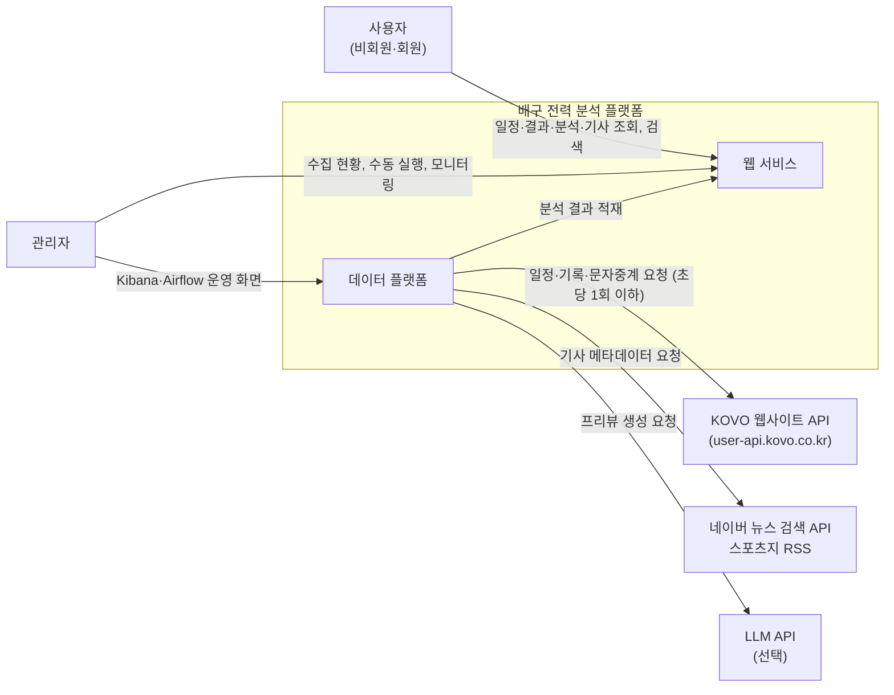

### 1.3 컨테이너 구성

실행 단위(컨테이너)와 통신 방향이다. 굵은 흐름은 데이터 흐름, 점선은 제어(스케줄링·조회) 흐름이다.

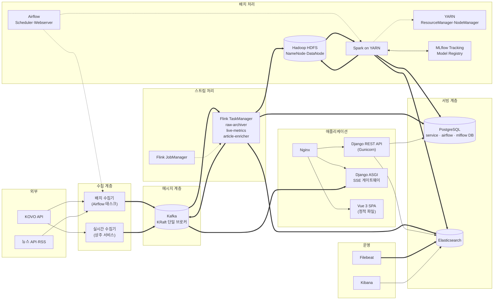

### 1.4 구성 요소별 책임

| 구성 요소 | 책임 | 입력 | 출력 |
|---|---|---|---|
| 배치 수집기 | 일정·결과·순위, 경기 상세 기록, 종료 경기 문자중계, 선수 정보, 기사 수집. 요청 속도 제한(초당 1회), 수집 이력 기록 | KOVO API, 뉴스 API·RSS | Kafka `kovo.*`, `news.article` |
| 실시간 수집기 | 오늘 경기 일정을 읽어 경기 시작 10분 전부터 종료까지 15~30초 주기로 문자중계 조회. 새 이벤트만 발행 | KOVO `/stat/real-time`, PostgreSQL(오늘 일정) | Kafka `kovo.live` |
| 경기 재생기 | 종료 경기의 랠리 이벤트를 원래 간격(또는 배속)으로 다시 발행 | HDFS 원천(`kovo.rally`) | Kafka `kovo.live` |
| Flink `raw-archiver` | 모든 토픽을 날짜별 JSON 파일로 HDFS에 보관 | Kafka 전체 토픽 | HDFS `/raw/` |
| Flink `live-metrics` | 진행 경기 상태(점수, 서브권, 연속 득점), 세트별 지표 계산 | `kovo.live` | PostgreSQL `live_*`, Kafka `live.metrics` |
| Flink `article-enricher` | 기사 중복 제거(URL·제목 유사도), 팀·선수 태깅 | `news.article`, 팀·선수 사전 | Elasticsearch `articles`, PostgreSQL `article*` |
| Spark 작업 | 원천 정제, 피처 집계, 데이터 마트 생성, 전력 지수, 모델 학습·예측 | HDFS `/raw/` | HDFS `/curated/`·`/features/`, PostgreSQL, Elasticsearch `entities` |
| Airflow | 배치 수집·Spark·학습·예측 일정 관리, 재시도·알림 | DAG 정의 | 작업 실행 |
| MLflow | 실험·모델 버전 관리, `champion`·`candidate` 별칭 | Spark·scikit-learn 학습 결과 | 모델 레지스트리 |
| Django REST API | 조회 API, 회원·관심 팀, 관리자 기능 | PostgreSQL, Elasticsearch | JSON 응답 |
| SSE 게이트웨이 | 진행 경기 지표를 브라우저에 실시간 전달 | Kafka `live.metrics` | Server-Sent Events |
| Filebeat·Kibana | 전 컨테이너 로그 수집과 운영 대시보드 | 컨테이너 로그, Kafka·Airflow 지표 | Elasticsearch `logs-*`, 대시보드 |

### 1.5 배포 구성 (Docker Compose, 단일 서버 32GB 기준)

| 서비스 | 이미지(예시) | 내부 포트 | 메모리 상한 | 외부 공개 |
|---|---|---|---|---|
| nginx | nginx | 80, 443 | 256MB | 공개 |
| django-api | 자체 이미지(Python 3.12, Gunicorn) | 8000 | 1GB | Nginx 경유 |
| django-sse | 자체 이미지(Uvicorn) | 8001 | 512MB | Nginx 경유 |
| postgres | postgres:16 | 5432 | 2GB | 비공개 |
| kafka | apache/kafka (KRaft) | 9092 | 2GB | 비공개 |
| hadoop-namenode / datanode | apache/hadoop | 9870, 9864 | 각 1GB | 비공개 |
| yarn-resourcemanager / nodemanager | apache/hadoop | 8088, 8042 | 1GB / 6GB | 비공개 |
| flink-jobmanager / taskmanager | flink (PyFlink 포함 자체 이미지) | 8081 | 1GB / 3GB | 비공개 |
| airflow (scheduler, webserver, LocalExecutor) | apache/airflow | 8080 | 3GB | 비공개 |
| mlflow | 자체 이미지 | 5000 | 512MB | 비공개 |
| elasticsearch | elasticsearch (nori 플러그인 포함) | 9200 | 4GB | 비공개 |
| kibana | kibana | 5601 | 1GB | 비공개 |
| filebeat | filebeat | - | 256MB | 비공개 |
| live-collector | 자체 이미지 | - | 256MB | 비공개 |

- 합계 약 26GB로, 32GB 서버에서 운영체제 여유분을 남긴다.
- 네트워크는 `public`(nginx, django)과 `data`(나머지)로 나누고, nginx만 호스트 포트를 연다. 관리 화면(Airflow 8080, Kibana 5601, Flink 8081, YARN 8088, MLflow 5000)은 SSH 터널로 접속한다 (NFR-34).
- 데이터 볼륨: `pg-data`, `kafka-data`, `hdfs-nn`, `hdfs-dn`, `es-data`, `mlflow-artifacts`.
- 비밀 값(DB 비밀번호, API 키)은 `.env`로 주입하고 저장소에는 `.env.example`만 둔다 (NFR-33).

### 1.6 저장소별 데이터 배치

| 저장소 | 데이터 | 보관 |
|---|---|---|
| Kafka | 토픽 7개 (1.7절) | 7일 |
| HDFS `/raw/topic={topic}/dt={yyyy-mm-dd}/` | 수집 원본 JSON (메시지 1건 = 1줄, `dt`는 수집일) | 영구 |
| HDFS `/curated/{table}/season={code}/` | 정제 테이블(Parquet): match, set_score, team_match_stat, player_match_stat, rally_event | 영구 |
| HDFS `/features/{name}/` | 모델 학습용 피처(Parquet): match_features, player_features | 영구 |
| PostgreSQL `service` | 서빙 테이블과 데이터 마트 (2장 ERD) | 현재 + 과거 시즌 |
| PostgreSQL `airflow`, `mlflow` | 각 도구의 메타데이터 | 영구 |
| Elasticsearch | `articles`, `entities`(선수·팀 자동완성), `logs-*` | 기사 2년, 로그 30일 |
| MLflow 아티팩트 볼륨 | 모델 파일, 평가 그래프 | 영구 |

### 1.7 Kafka 토픽 (요구사항 2.5절 + 설계 추가)

| 토픽 | 키 | 파티션 | 생산자 | 소비자 |
|---|---|---|---|---|
| `kovo.schedule` | 시즌 코드 | 1 | 배치 수집기 | raw-archiver |
| `kovo.match` | 시즌-경기 번호 (예: `022-3`) | 3 | 배치 수집기 | raw-archiver |
| `kovo.rally` | 시즌-경기 번호 | 3 | 배치 수집기 | raw-archiver |
| `kovo.live` | 시즌-경기 번호 | 3 | 실시간 수집기, 경기 재생기 | live-metrics, raw-archiver |
| `kovo.player` (추가, 2026-11-11) | 선수 코드 | 1 | 배치 수집기(수상·주요 기록) | raw-archiver |
| `news.article` | 기사 URL | 1 | 배치 수집기 | article-enricher, raw-archiver |
| `live.metrics` (추가) | 시즌-경기 번호 | 3 | Flink live-metrics | SSE 게이트웨이 |
| `ops.collection-log` (추가) | 작업 이름 | 1 | 모든 수집기 | raw-archiver(→ Kibana는 로그로 확인) |

### 1.8 Airflow DAG 설계

| DAG | 실행 주기 | 주요 태스크 | 관련 요구사항 |
|---|---|---|---|
| `kovo_daily` | 매일 06:00 | 시즌 목록 → 현재 시즌 일정·결과 → 최근 7일 중 확정 안 된 종료 경기의 상세·문자중계(누락 보충) → HDFS 적재 확인 → Spark 정제 → 데이터 마트 → `entities` 색인, 선수 유형(`player_types.py`) → 포지션별 능력치(`player_ratings.py`) | COL-01, 02, 05, PIPE-04, 05 |
| `kovo_postgame` | 매일 14:00~23:40, 20분마다 (주말 경기는 14·16시 시작) | DB에서 어제 이후 시작했는데 확정 안 된 경기 확인(없으면 KOVO 요청 없이 종료) → 그 시즌 일정 갱신 → 끝난 경기의 상세·문자중계 → HDFS 적재 확인 → Spark 정제 → `CONFIRMED`. 문자중계가 아직 없으면 `FINISHED`로 남고 다음 실행이 다시 수집 | COL-03, 10, ANL-01, NFR-13 |
| `kovo_backfill` | 수동 실행 (`seasons` 예: `001-021`, `limit`, `skip_confirmed`) | 시즌 목록 → 시즌별(차례로) 일정 → 확정 안 된 종료 경기의 상세·문자중계(`020` 이전은 문자중계 없음) → HDFS 적재 확인 → Spark 정제 | COL-04, PIPE-08 |
| `news_collect` | 매시 5분 | 뉴스 검색 API·RSS 수집 → `news.article` 발행 → Flink가 모두 저장했는지 확인(같은 제목으로 합쳐진 기사는 먼저 저장된 기사로 셈) | COL-07 |
| `ml_weekly_retrain` | 매주 월 04:00 | 피처 생성 → 후보 모델 학습(Hyperopt) → MLflow `candidate` 등록 → 최근 경기 성능 비교 → 더 좋으면 `champion` 교체 | ANL-03, 09, 10 |
| `ml_daily_predict` | 매일 07:00 | `kovo_daily`·`kovo_reprocess`가 정제 중이면 끝날 때까지 대기(최대 3시간, 넘으면 알림 후 그대로 진행) → 피처 생성 → `champion` 모델로 7일 내 예정 경기 예측 → `match_prediction` 저장(7일 밖 예정 경기의 예측은 지움) | ANL-03, WEB-08 |
| `live_replay` | 수동 실행 (`match`, `speed`) | 경기 재생기 실행 → Flink가 끝까지 따라갔는지 확인 | PIPE-11 |
| `kovo_honors` (2026-11-11) | 매주 월 05:00 (`scope`: `current` 최근 400일 안에 뛴 선수 / `all` 모든 선수, 처음 한 번) | 대상 선수(PostgreSQL) → 선수마다 `/players/{코드}/honor` 수집(`kovo.player`) → HDFS 적재 확인 → Spark `curate_honors.py` → `player_honor` 전체 교체 | COL-04 |
| `kovo_reprocess` | 수동 실행 (`games` 예: `023-9, 023-10`, `dates` 예: `2026-11-01~2026-11-05`, `seasons`, `recollect`) | 날짜 → 경기 번호(PostgreSQL) → (`recollect`면) 그 시즌 일정 + 경기 상세·문자중계 다시 수집(확정된 경기 포함, 50경기까지) → HDFS 적재 확인 → 관련 시즌 전체 Spark 정제(원천부터) → 데이터 마트 | PIPE-08, ADM-02 |

공통 설정: 재시도 3회(5분 간격, ML·기사는 2회), 실패 시 관리자 알림(메신저 웹훅 + Django 관리 화면), 동시 실행 1개 (PIPE-09).

구현 메모 (2026-11-03, `airflow/dags/kovo_*.py`, 공통 단계는 `airflow/dags/kovo_tasks/pipeline.py`):
- **HDFS 적재 확인**: 수집 실행마다 `run_id`, 토픽, 건수를 넘기고, 센서가 WebHDFS로 확정된 파일(숨김 파일 제외)에서 그 `run_id`가 붙은 줄을 센다. 모두 보이면 통과한다(1분 간격, reschedule 모드).
- **KOVO 요청 제한 공유**: 태스크는 각자 다른 프로세스라, 컨테이너의 잠금 파일(`KOVO_RATE_LOCK_FILE`)로 모든 수집 태스크가 초당 1회를 함께 지킨다.
- **정제 동시 실행**: Spark 실행마다 전용 staging 스키마를 쓰고 끝나면 지운다. 서빙 테이블 반영은 PostgreSQL advisory lock으로 한 번에 하나만 한다. YARN 자원이 모자라면 두 번째 작업은 YARN 대기열에서 기다린다.
- **실패 알림 (PIPE-09, 2026-11-06, `kovo_tasks/alerts.py`)**: 모든 DAG의 `default_args`에 작업 실패 콜백, DAG에 실행 실패 콜백을 단다.
  - 작업이 재시도를 모두 쓰고 실패하면 서비스 DB `job_alert`에 한 줄(DAG·단계·실행·시도·오류 첫 2000자·Airflow 로그 링크)을 남긴다. `ALERT_WEBHOOK_URL`(Mattermost·Slack은 `{"text"}`, Discord는 `{"content"}`)이 있으면 메신저로도 보낸다. 전송 결과는 `delivery`에 `SENT`·`NO_WEBHOOK`·`FAILED`로 남는다.
  - 같은 단계의 미확인 알림이 6시간 안에 있으면 기록만 하고 다시 보내지 않는다(`REPEAT`). 20분마다 도는 `kovo_postgame`이 계속 실패해도 채널이 넘치지 않게 하기 위해서다.
  - 실행 실패 콜백(DAG 처리기에서 돈다)은 그 실행에 작업 알림이 없을 때만 알린다. 메모리 부족 등으로 작업 프로세스가 강제 종료되면 작업 콜백이 돌지 못하기 때문이다.
  - 서비스 DB가 꺼져 있으면 기록 없이 메신저로만 보낸다. 콜백은 예외를 내지 않는다(원래 실패 로그를 가리지 않게).
  - Django 관리 첫 화면에 "확인하지 않은 작업 실패 N건"이 뜨고, 수집 현황에서 '확인함'으로 표시한다.

### 1.9 Flink 작업 설계

| 작업 | 입력 | 처리 | 출력 | 상태(State) |
|---|---|---|---|---|
| `raw-archiver` | `kovo.*`, `news.*`, `ops.*` 토픽 (`live.metrics`는 파생 데이터라 제외) | 토픽·수집일별로 묶어 메시지 1건을 1줄로 기록. 파일은 128MB 또는 연 지 5분이 되면 확정되고(실측 약 6분 이내), 다음 체크포인트에 보인다 | HDFS `/raw/topic={토픽}/dt={수집일}/` | Kafka offset (체크포인트, 소비자 그룹 `raw-archiver`에도 커밋) |
| `live-metrics` | `kovo.live` | 경기 번호별 keyBy → 이벤트 순서대로 점수·세트·서브권·연속 득점 갱신, 세트별 공격 성공률·서브 득점·블로킹·범실 집계 | PostgreSQL `live_match_state`·`live_set_metric`(upsert), Kafka `live.metrics` | 경기별 상태 (경기 종료 이벤트 수신 시 정리) |
| `article-enricher` | `news.article` | URL 기준 중복 제거(7일 상태 유지), 제목 정규화 후 팀·선수 사전과 매칭해 태그 부여 | Elasticsearch `articles`, PostgreSQL `article`·`article_team`·`article_player` | 최근 7일 URL 집합 |

- 언어는 팀 주 언어에 맞춰 PyFlink(Table API·DataStream API)를 쓴다. Kafka·JDBC·Elasticsearch 커넥터 JAR을 이미지에 포함한다.
- 체크포인트 30초, 저장 위치는 HDFS `/flink/checkpoints`. 장애 시 마지막 체크포인트부터 재개한다.
- `raw-archiver`는 `flink-job-keeper` 서비스가 1분마다 확인해 없으면 다시 제출한다(PC·Docker 재시작 대비). 다시 제출할 때는 가장 최근의 완료된 체크포인트(또는 세이브포인트)에서 복원한다(`flink_jobs/latest_checkpoint.py`). 체크포인트에는 Kafka 위치와 쓰다 만 파일의 상태가 함께 있어서 재시작해도 메시지가 빠지지 않는다. 커밋된 Kafka 위치부터 새로 시작하면 쓰다 만 파일의 내용이 버려져 최대 몇 분치가 빠진다(2026-11-03 실제 발생, HDFS 적재 확인 센서가 검출). 체크포인트 간격·보관 위치(`/flink/checkpoints/raw-archiver`, 작업이 멈춰도 보관)는 제출하는 쪽 설정을 따르므로 작업 코드에 직접 둔다. 일부러 멈출 때는 `flink cancel`이 아니라 세이브포인트와 함께 `flink stop`을 쓴다.

### 1.10 백엔드·프론트엔드 모듈 구조

| Django 앱 | 담당 | 주요 모델 |
|---|---|---|
| `accounts` | 회원가입·로그인(토큰 인증), 관심 팀·선수 | User, FavoriteTeam, FavoritePlayer |
| `league` | 시즌·대회·팀·선수 | Season, Competition, Team, Player, PlayerTeamHistory |
| `matches` | 경기·세트·기록·랠리 | Match, SetScore, TeamMatchStat, PlayerMatchStat, PlayerAttackStat, RallyEvent |
| `analytics` | 전력 지수, 예측, 데이터 마트 조회 | TeamRating, MatchPrediction, ModelVersion, TeamSeasonSummary, PlayerSeasonSummary |
| `live` | 실시간 상태 조회, SSE 엔드포인트 | LiveMatchState, LiveSetMetric |
| `articles` | 기사 목록, 통합 검색(Elasticsearch) | Article, ArticleTeam, ArticlePlayer |
| `ops` | 데이터 품질 검사 결과, 관리자 데이터 보정, 수집 현황·작업 실패 알림, 수동 실행 (모두 Django 관리 화면) | QualityIssue, Correction, JobAlert, ManualRun |

| Vue 영역 | 구성 |
|---|---|
| `views/` | Home, Schedule, MatchDetail, MatchLive, Standings, TeamDetail, PlayerDetail, Preview, Articles, Search, Login, Admin |
| `stores/` (Pinia) | `auth`(토큰·사용자·관심 팀과 선수), `filters`(남녀부·시즌 선택). 실시간 상태는 화면 안에서 SSE로 받는다 |
| `api/` | axios 인스턴스와 도메인별 API 함수 |
| `components/charts/` | 전력 지수 추이, 레이더 차트, 승리 확률 그래프 |

저장소 구조(모노레포 권장):

| 폴더 | 내용 |
|---|---|
| `backend/` | Django 프로젝트 |
| `frontend/` | Vue 프로젝트 |
| `collectors/` | 배치·실시간 수집기, 경기 재생기 (Python 패키지) |
| `airflow/dags/` | DAG 정의 |
| `spark_jobs/` | PySpark 작업 |
| `flink_jobs/` | PyFlink 작업 |
| `ml/` | 피처 정의, 학습·평가 코드, MLflow 연동 |
| `infra/` | 서비스별 Dockerfile과 설정 (Hadoop, Airflow, MLflow, Flink, Elasticsearch, Filebeat, PostgreSQL, Kafka) |
| `compose.yaml` (루트) | 개발 환경 Docker Compose. 묶음(프로필)별 실행: 기본(PostgreSQL·Kafka), `app`, `batch`, `stream`, `search` |
| `docs/` | 요구사항·설계 문서 |

### 1.11 주요 REST API

| 메서드·경로 | 설명 | 관련 요구사항 |
|---|---|---|
| `GET /api/seasons` | 시즌·대회 목록 | WEB-02 |
| `GET /api/matches?season=&gender=&team=&month=` | 경기 일정·결과 | WEB-02 |
| `GET /api/matches/{id}` | 경기 상세(세트 점수, 팀·선수 기록, 예측 대비 결과) | WEB-03 |
| `GET /api/matches/{id}/rallies?set=` | 랠리 기록 | WEB-03 |
| `GET /api/matches/{id}/preview` | 경기 프리뷰(승리 확률, 상대 전적, 지표 비교) | WEB-08 |
| `GET /api/live` | 진행 중 경기 목록과 현재 상태 | WEB-04 |
| `GET /api/live/{id}/stream` | 실시간 지표 SSE 스트림 | WEB-04 |
| `GET /api/standings?season=&gender=` | 팀 순위, 부문별 선수 순위 | WEB-05 |
| `GET /api/teams/{id}` | 팀 상세(선수단, 전력 지수 추이, 강약점). 이 시즌 경기가 10경기 미만이면 `rating.previous`에 지난 시즌 마지막 10경기의 Elo를 함께 준다(차트에 흐리게 이어 그림) | WEB-06 |
| `GET /api/players/{id}` | 선수 상세(시즌·경기 기록, 효율 지표, 백분위, 능력치 카드 `ratings`: `seasons` = 시즌마다 능력치·종합·포지션 내 순위·이전 시즌 대비, `careers` = 포지션별 통산 카드·역대 순위·최고 시즌, `honors` = 수상·트리플크라운·기록 달성(각각 최근 것부터, 없으면 null)) | WEB-07, COL-04 |
| `GET /api/ratings?season=&gender=&position=&all=&scope=` | 포지션별 능력치 순위(순위 자격 선수, `all=1`이면 잠정 선수도). `scope=career`면 역대 통산 순위(시즌 무시, 순위 자격 시즌 3번 이상, 기간·최고 시즌·마지막 팀) | WEB-07, ANL-05 |
| `GET /api/articles?team=&player=&page=` | 기사 목록 | WEB-09 |
| `GET /api/search?q=` / `GET /api/search/suggest?q=` | 통합 검색 / 자동완성 | WEB-10 |
| `POST /api/auth/signup`, `POST /api/auth/login`, `POST /api/auth/logout` | 회원가입·로그인·로그아웃 (토큰 발급·삭제) | WEB-11 |
| `GET·DELETE /api/me` | 내 정보, 회원 탈퇴(비밀번호 확인) | WEB-11, NFR-03 |
| `GET·POST /api/me/favorites`, `DELETE /api/me/favorites/{team\|player}/{코드}` | 관심 팀·선수 | WEB-12 |
| `GET /api/me/feed` | 홈 화면의 관심 팀(순위·다음 경기·지난 경기)·관심 선수(최근 경기·시즌 기록·폼) | WEB-12 |
| `/admin/ops/jobalert/` (Django 관리 "수집 현황") | Airflow 작업별 최근 실행·7일 실패 수, 수집기 실행 결과(ES `ops-collection-*`), 작업 실패 내역 | ADM-01, PIPE-09 |
| `/admin/ops/manualrun/` (Django 관리 "수동 실행") | 예약 작업 지금 실행, 경기·날짜·시즌 재처리, 과거 시즌 수집, 경기 재생 (Airflow REST API 호출), 실행 기록 | ADM-02 |

구현 메모 — 회원 기능 (2026-11-05, `backend/accounts`, Vue `AuthView`·`AccountView`·`FavoriteButton`·`FavoriteFeed`):
- 이메일·닉네임·비밀번호로 가입한다. `username`에는 소문자로 바꾼 이메일을 넣고, 로그인은 이메일로 찾는다(관리자 계정은 `username`이 달라도 된다). 비밀번호는 Django 기본 해시와 검증기(8자 이상, 흔한·숫자만·이메일과 비슷한 비밀번호 거절)를 쓴다(NFR-31).
- 인증은 DRF 토큰. Vue가 `localStorage`에 두고 `Authorization: Token ...`으로 보낸다. 로그아웃은 토큰을 지운다(모든 기기에서 로그아웃). 서버가 모르는 토큰이면 공개 API도 401이 되므로, axios가 토큰을 버리고 그 요청을 토큰 없이 한 번 다시 보낸다.
- 가입·로그인은 IP마다 1분에 10번(`AUTH_THROTTLE_RATE`). 로그인 실패 문구는 이메일이 있는지 알 수 없게 하나로 쓴다. 로그인 뒤 돌아갈 주소(`?next=`)는 같은 사이트 경로만 따른다.
- 저장하는 개인정보는 이메일·닉네임뿐이고, 메일은 보내지 않는다. 탈퇴하면 계정·관심 목록·토큰을 바로 지운다(NFR-03).
- 관심 팀·선수는 각 10개까지. 홈 맨 위 "내 관심"에 팀은 순위·최근 5경기·다음 경기(예측 확률 포함)·지난 경기, 선수는 최근 경기와 시즌 기록·폼(ANL-08)을 보여준다. 비율은 시도가 적으면(경기 5회, 시즌 15회 미만) 숨긴다. 오늘·다음 경기와 최근 결과에서는 관심 팀 경기를 앞에 두고 별로 표시하며, 순위표에서도 관심 팀 줄을 강조한다.

목록 API는 페이지네이션(기본 20건)을 적용하고, 조회 결과는 갱신 주기에 맞춰 캐시한다(일정·순위 5분, 경기 상세는 확정 후 1일).

구현 메모 (2026-11-03): 경기 경로는 `/api/matches/{시즌-경기번호}`(예: `022-3`)로 했다. 내부 id는 DB를 다시 만들면 바뀌기 때문이다. 팀·선수는 KOVO 코드로 찾는다. 순위와 선수 순위는 데이터 마트(`team_season_summary` 등)가 생기기 전까지 API가 경기 기록에서 바로 계산한다(`backend/league/standings.py`). 캐시는 아직 적용하지 않았다. 구현한 화면은 홈, 일정·결과, 경기 상세(프리뷰 포함), 순위, 팀, 선수, 기사(`/news`), 검색(`/search`, 머리글 자동완성), 실시간 경기(`/matches/{키}/live`, 홈의 "진행 중 경기")이다. 실시간 API는 `GET /api/live`, `GET /api/live/{키}`(현재 상태와 지금까지의 모든 득점), `GET /api/live/{키}/stream`(SSE)이다.

응답 시간 측정 (2026-11-11, `python scripts/measure_latency.py`, 화면이 부르는 API 19개 × 30번, Django 개발 서버):
일반 API 510건 p95 **121ms**(기준 500ms, NFR-11 통과), 검색 60건 p95 **32ms**(기준 1초, NFR-12 통과).
처음 잴 때는 `/api/teams`가 p95 381ms로 가장 느렸다(홈·원정 경기에 동시에 JOIN해 행이 불어남). 하위 쿼리로 바꿔 약 25ms가 됐고, 결과는 모든 시즌·성별에서 같다.
캐시 없이 통과했으므로 캐시는 아직 두지 않는다.
Windows에서 `localhost`로 재면 IPv6 연결 실패를 기다리는 시간(요청마다 약 2초)이 더해지므로 `127.0.0.1`로 잰다.

---

## 2. ERD

서빙 DB(PostgreSQL `service`) 기준이다. 모든 테이블은 대리 키 `id`(bigint)를 쓰고, KOVO 원본 코드는 고유 제약으로 둔다. 시각 컬럼은 `timestamptz`, 저장 시각은 `created_at`·`updated_at`을 공통으로 둔다(그림에서는 생략).

### 2.1 경기·기록 도메인

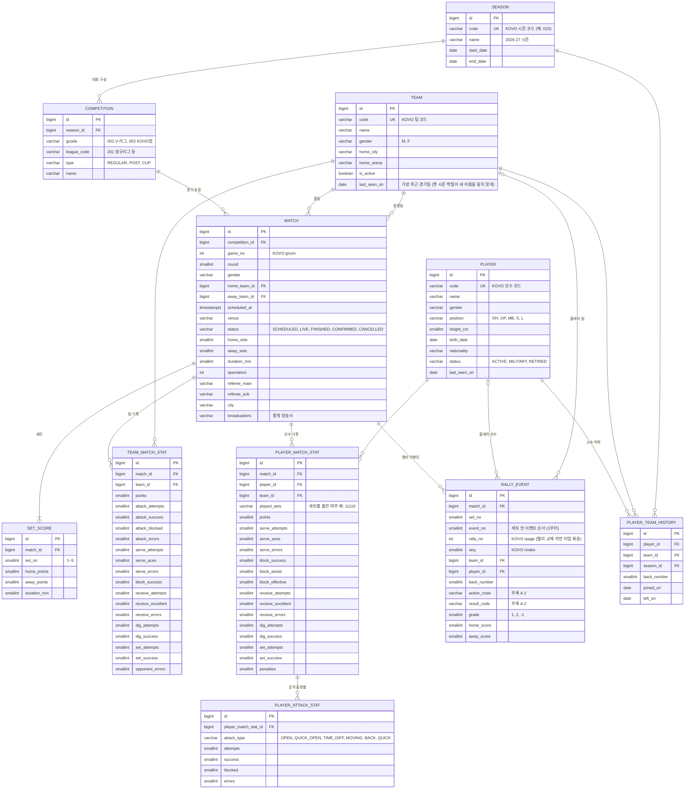

구현 메모 (2026-11-03, `backend/league/models.py`, `backend/matches/models.py`):
- `team_match_stat`과 `player_match_stat`은 같은 기록 컬럼 20개를 공유한다. 공격(시도·성공·피차단·범실), 서브(시도·에이스·범실), 블로킹(시도·성공·유효·어시스트), 리시브(시도·정확·실패), 디그(시도·성공), 세트(시도·성공), 범실 합계, 경고다. KOVO 필드와의 대응은 모델 주석에 있다.
- `team_match_stat.points`는 상대 범실 득점을 포함한 팀 총득점이고, `opponent_errors` = 총득점 − 공격 성공 − 블로킹 − 서브 에이스로 계산한다. `player_match_stat`에는 등번호, 포지션, 주장 여부, 세트별 출전(`11100`)을 더 둔다.
- 테이블 구조는 Django 마이그레이션이 만들고, 데이터는 Spark가 넣는다. 그래서 저장 시각 컬럼은 DB 기본값(`now()`)을 쓴다. Django의 `on_delete=CASCADE`는 DB 규칙이 아니므로, 병합 SQL은 자식 행부터 지운다.

### 2.2 분석·예측·실시간 도메인

```mermaid
erDiagram
  TEAM ||--o{ TEAM_RATING : "전력 지수 이력"
  SEASON ||--o{ TEAM_RATING : ""
  MATCH |o--o{ TEAM_RATING : "갱신 원인 경기"
  MATCH ||--o{ MATCH_PREDICTION : "예측"
  MODEL_VERSION ||--o{ MATCH_PREDICTION : "예측 모델"
  MATCH ||--o| LIVE_MATCH_STATE : "실시간 상태"
  MATCH ||--o{ LIVE_SET_METRIC : "세트별 실시간 지표"
  TEAM ||--o{ LIVE_SET_METRIC : ""
  TEAM ||--o{ TEAM_SEASON_SUMMARY : "팀 시즌 마트"
  COMPETITION ||--o{ TEAM_SEASON_SUMMARY : ""
  PLAYER ||--o{ PLAYER_SEASON_SUMMARY : "선수 시즌 마트"
  COMPETITION ||--o{ PLAYER_SEASON_SUMMARY : ""
  MATCH |o--o| AI_PREVIEW : "AI 프리뷰 (선택)"

  TEAM_RATING {
    bigint id PK
    bigint team_id FK
    bigint season_id FK
    bigint match_id FK
    date rated_on
    numeric rating "Elo"
    numeric rating_change
  }
  MODEL_VERSION {
    bigint id PK
    varchar name "match-winner"
    int version "MLflow 모델 버전"
    varchar mlflow_run_id
    varchar alias "champion, candidate, none"
    jsonb metrics "accuracy, log_loss, brier"
    varchar train_seasons "예: 015-022"
    timestamptz registered_at
  }
  MATCH_PREDICTION {
    bigint id PK
    bigint match_id FK
    bigint model_version_id FK
    numeric home_win_prob
    smallint pred_home_sets
    smallint pred_away_sets
    timestamptz predicted_at
    boolean is_correct "경기 종료 후 채움"
  }
  LIVE_MATCH_STATE {
    bigint match_id PK
    smallint current_set
    smallint home_points
    smallint away_points
    smallint home_sets
    smallint away_sets
    bigint serving_team_id
    smallint home_run "연속 득점"
    smallint away_run
    numeric home_win_prob "선택 ANL-07"
    int last_event_seq
    timestamptz updated_at
  }
  LIVE_SET_METRIC {
    bigint id PK
    bigint match_id FK
    smallint set_no
    bigint team_id FK
    numeric attack_success_rate
    smallint serve_aces
    smallint block_points
    smallint errors
    timestamptz updated_at
  }
  TEAM_SEASON_SUMMARY {
    bigint id PK
    bigint team_id FK
    bigint competition_id FK
    smallint rank
    smallint matches
    smallint wins
    smallint losses
    smallint win_points "승점"
    numeric set_ratio
    numeric point_ratio
    numeric attack_success_rate
    numeric receive_efficiency
    numeric block_per_set
    numeric serve_per_set
    numeric sideout_rate "ANL-11"
    numeric break_rate "ANL-11"
  }
  PLAYER_SEASON_SUMMARY {
    bigint id PK
    bigint player_id FK
    bigint competition_id FK
    bigint team_id FK
    smallint matches
    smallint sets
    smallint points
    numeric attack_success_rate
    numeric attack_efficiency
    numeric receive_efficiency
    numeric dig_per_set
    numeric block_per_set
    numeric serve_per_set
    numeric percentile_json "포지션 내 백분위"
    varchar cluster_label "ANL-06"
  }
  AI_PREVIEW {
    bigint id PK
    bigint match_id FK
    text content
    varchar llm_model
    timestamptz created_at
  }
```

구현 메모 (2026-11-03, `backend/analytics/models.py`, `spark_jobs/build_marts.py`): `team_rating`, `team_season_summary`, `player_season_summary`를 먼저 만들었다(예측 관련 테이블은 예측 모델과 함께).
- Elo: 시작 1500, K = 24 × (세트 차 1·2·3 → 1, 1.25, 1.5), 홈 이점은 전체 경기의 홈 승률에서 계산(2025-26 기준 57% → 약 49점), 새 시즌 첫 경기 전에 1500 쪽으로 1/3 되돌림. 경기 전 Elo 확률의 적중률(약 62%)이 예측 모델의 기준선이다.
- 사이드아웃율 = 상대 서브 랠리 중 득점 비율, 브레이크율 = 자기 서브 랠리 중 득점 비율. 문자중계가 있는 2023-24 시즌부터 계산된다.
- 선수 백분위는 같은 시즌·대회·성별·포지션의 순위 자격 선수(팀 세트의 1/3 이상 출전) 안에서 계산하고 `percentiles`(JSON)에 둔다.
- 마트는 매 실행마다 전체 시즌으로 다시 계산해 한 트랜잭션으로 교체한다(Elo가 전체 이력에 의존). `kovo_daily`·`kovo_postgame`·`kovo_backfill`의 정제 다음 단계로 실행된다.

구현 메모 — 경기 결과 예측 (2026-11-04, `spark_jobs/build_features.py`, `train_model.py`, `predict_matches.py`, DAG `ml_weekly_retrain`·`ml_daily_predict`):
- 피처는 경기마다 **그 경기 시작 전 정보만** 쓴다(팀별 기록에서 시작 시각 이전의 마지막 상태를 붙이는 as-of 조인). 경기 전 Elo 차이·Elo 확률, 최근 5경기 승률·세트 득실, 시즌 누적 공격 성공률·리시브 효율·세트당 블로킹·서브·범실, 휴식일, 최근 2년 상대 전적(평활), 포스트시즌·성별.
- 목표는 홈팀 기준 세트 스코어 6가지(3:0~0:3). 승리 확률 = P(3:0)+P(3:1)+P(3:2). Spark MLlib 다항 로지스틱 회귀·랜덤 포레스트 중 Hyperopt가 고른다(시도마다 MLflow 하위 Run).
- 시간순 분할: 시험 = 최근 완결 시즌, 검증 = 그 앞 두 시즌, 학습 = 나머지. 첫 모델(v1): 2025-26 시험 시즌 적중률 64.3%, Log Loss 0.653 (Elo만 쓸 때 62.4%, 0.668).
- 등록: MLflow `match-winner`. 현재 champion의 설정(모델 종류·하이퍼파라미터)과 새로 찾은 설정을 **같은 학습 데이터로 학습해 같은 시험 시즌으로 채점**하고, 더 좋은 쪽(같으면 새 설정)으로 전체 시즌을 학습해 새 `champion`으로 등록한다. 그래서 서비스 모델은 늘 최신 데이터로 학습되고, 설정은 실제로 더 나을 때만 바뀐다. 이전 실행이 기록한 수치는 피처·시즌이 바뀌면 비교할 수 없어서 쓰지 않는다(2026-11-04 변경).
- 예측은 시작 전 경기에만 저장하고, 끝나면 `is_correct`를 채운다. 화면의 적중률은 실제 경기 전 예측만 센다.

### 2.3 기사·회원·운영 도메인

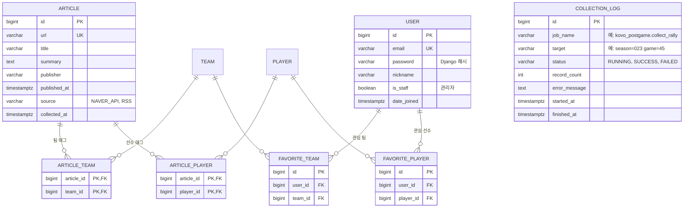

### 2.4 제약조건과 인덱스

| 테이블 | 고유 제약 | 인덱스 | 비고 |
|---|---|---|---|
| `season` | `code` | - | |
| `competition` | (`season_id`, `gcode`, `league_code`) | - | |
| `match` | (`competition_id`, `game_no`) | (`scheduled_at`), (`home_team_id`, `scheduled_at`), (`away_team_id`, `scheduled_at`), (`status`) | 일정 조회, 팀별 최근 N경기 |
| `set_score` | (`match_id`, `set_no`) | - | |
| `team_match_stat` | (`match_id`, `team_id`) | (`team_id`) | |
| `player_match_stat` | (`match_id`, `player_id`) | (`player_id`, `match_id`) | 선수별 경기 기록 |
| `player_attack_stat` | (`player_match_stat_id`, `attack_type`) | - | |
| `rally_event` | (`match_id`, `set_no`, `event_no`) | (`match_id`, `set_no`), (`player_id`) | 시즌당 30만~40만 행. 시즌 코드 기준 파티셔닝 검토 |
| `player_team_history` | (`player_id`, `team_id`, `season_id`) | - | |
| `team_rating` | (`team_id`, `rated_on`) | - | |
| `match_prediction` | (`match_id`, `model_version_id`) | - | |
| `live_set_metric` | (`match_id`, `set_no`, `team_id`) | - | Flink upsert 대상 |
| `team_season_summary` | (`team_id`, `competition_id`) | (`competition_id`, `rank`) | |
| `player_season_summary` | (`player_id`, `competition_id`) | (`competition_id`) | |
| `article` | `url` | (`published_at`) | |
| `favorite_team`·`favorite_player` | (`user_id`, 대상 id) | - | |
| `collection_log` | - | (`job_name`, `started_at`) | |

### 2.5 Elasticsearch 인덱스

| 인덱스 | 주요 필드 | 분석기 | 용도 |
|---|---|---|---|
| `articles` | `title`(text), `summary`(text), `publisher`(keyword), `published_at`(date), `team_codes`(keyword[]), `player_codes`(keyword[]), `url`(keyword) | nori(한글 형태소), 제목은 edge n-gram 보조 필드 | 기사 검색, 팀·선수 필터 |
| `entities` | `type`(team/player), `name`(text + `search_as_you_type`), `code`(keyword), `team_name`, `position`, `status` | nori + 초성 검색용 보조 필드(선택) | 통합 검색 자동완성 |
| `logs-*` | Filebeat 기본 필드, `service`, `level`, `message` | 기본 | 운영 로그 (Kibana) |

구현 메모 — 기사·검색·운영 대시보드 (2026-11-04):
- **수집** (`collectors/collectors/news.py`, DAG `news_collect` 매시 5분): 연합뉴스·뉴시스·동아일보·한국경제·한겨레 스포츠 RSS(robots.txt 허용 경로) + 네이버 뉴스 검색 API(키가 있을 때). 배구 낱말(배구, V리그, 팀 별칭 등; "지배구조" 같은 "배구조"는 제외)이 제목·요약에 있는 기사만, 제목·요약 160자·언론사·링크·발행 시각만 `news.article`에 보낸다. 일부 RSS는 본문 전체를 주므로 발행 전에 자른다(NFR-02, NFR-06). 한 피드가 실패해도 나머지는 계속하고, 모두 실패할 때만 실패.
- **article-enricher** (`flink_jobs/article_enricher.py`, PyFlink DataStream): URL로, 다음에 정규화한 제목(앞의 [말머리]와 (종합) 등 제거, 10자 미만은 제외)으로 키를 나눠 7일 TTL 상태로 첫 건만 통과시킨다. 태그는 `article_tags.py`: 팀은 현재 이름+별칭, 선수는 최근 두 시즌 출전 선수(마지막 경기의 팀). 두 글자 이름은 그 선수의 팀이 함께 나올 때만, 동명이인은 팀으로 가려지지 않으면 태그하지 않는다. PostgreSQL `article`·`article_team`·`article_player`와 Elasticsearch `articles`(별칭 → `articles-v2`, 문서 id = sha1(url))에 upsert하므로 재처리해도 결과가 같다. 체크포인트는 `/flink/checkpoints/article-enricher`, `flink-job-keeper`가 지킨다.
- **분석기**: `ko` = nori(혼합 분해) + 품사 필터 + 읽기 변환, `bigram` = 2글자 n-gram. "IBK기업은행"처럼 영문·한글이 붙은 낱말은 표준 토크나이저의 CJK bigram이 만들어지지 않아 n-gram 토크나이저를 쓴다(그래서 "기업은행"으로도 찾는다).
- **entities** (`spark_jobs/index_entities.py`, `kovo_daily`의 마트 다음): HDFS `/curated/kovo`에서 팀·선수의 최신 이름·팀·포지션과 최근 1년·통산 경기 수를 계산해 elasticsearch-hadoop으로 `entities-<시각>`에 쓰고, 건수를 확인한 뒤 별칭 `entities`를 옮기고 이전 색인을 지운다. 자동완성 순서는 `weight`(현재 팀 > 최근 1년 출전 많은 선수 > 통산).
- **API**: `GET /api/articles`(PostgreSQL), `GET /api/search`, `GET /api/search/suggest`(Elasticsearch, 장애 시 503). 강조 표시는 `encoder: html`로 본문을 이스케이프한 뒤 `<mark>`만 넣는다.
- **Kibana** (`infra/kibana/build_dashboard.py` → `dashboard.ndjson`, `kibana-setup`이 import): 수집 성공률·실패·건수(`ops.collection-log`를 Filebeat Kafka 입력으로 `ops-collection-*`), Kafka 컨슈머 랙, Airflow DAG 소요·시작 지연·태스크 대기(Metricbeat sql 모듈 → `metrics-volley`), 서비스별 오류 로그(`logs-volley-*`, 줄 내용으로 `log.level` 판정), 언론사별 기사 저장. 컨슈머 랙은 `kafka-lag` 서비스가 쓴다: Flink KafkaSource는 그룹 멤버로 참여하지 않고 위치만 커밋해서 Metricbeat kafka 모듈에 `raw-archiver`·`article-enricher`가 나오지 않기 때문이다.

### 2.6 전력 분석 확장 (2026-11-05 구현)

| 테이블 | 고유 제약 | 작성 | 내용 |
|---|---|---|---|
| `player_type` | (`gender`, `cluster_no`) | Spark `player_types.py` (매번 전체 교체) | 선수 유형: 이름, 주 포지션, 특징(`traits`), 중심(`centroid`, z), 크기, k, 실루엣, MLflow run |
| `player_style` | (`player_id`, `season_id`) | 〃 | 선수 시즌의 유형, 13개 특징값과 z, 같은 시즌·역대 유사 선수 5명(JSON) |
| `player_rating` | (`player_id`, `season_id`) | Spark `player_ratings.py` (매번 전체 교체, `kovo_daily`에서 선수 유형 다음) | 포지션별 선수 능력치 카드: 능력치별 1~99점(근거 수치·가중치·z 포함 JSON)과 종합 점수, 순위 자격·잠정 여부 |
| `player_rating_career` | (`player_id`, `position`) | Spark `player_ratings.py` (`player_rating`과 같은 트랜잭션) | 포지션별 통산 능력치 카드: 시즌 점수의 출전 세트 가중 평균, 통산 합계로 낸 근거 기록, 첫·마지막·최고 시즌, 역대 순위 자격(순위 자격 시즌 3번 이상) |
| `player_honor` (2026-11-11) | (`player_id`, `kind`, `seq`) | Spark `curate_honors.py` (매번 전체 교체, DAG `kovo_honors`) | 선수의 수상·주요 기록 한 줄: 종류(`AWARD` 수상, `TRIPLE_CROWN`, `RECORD` 기준 기록 달성), KOVO 목록 순서, 시즌(`2025-2026`), 시즌을 뗀 제목, KOVO 원문 |
| `prediction_backtest` | (`match_id`, `model_version_id`) | Spark `train_model.py` | 모델 버전별 walk-forward 예측(그 시즌 이전만 학습)과 같은 경기의 Elo 확률, 실제 결과 |
| `team_season_summary` 추가 열 | - | Spark `build_marts.py` | `attack_after_good_receive`·`attack_after_poor_receive`(리시브 직후 첫 공격 성공률), `clutch_rallies`·`clutch_win_rate`(20:20 이후 랠리) |

구현 메모:
- **포지션별 능력치 (ANL-05 확장, 2026-11-09)**: `player_ratings.py`. 같은 성별·포지션에서 그 시즌과 앞 두 시즌의 순위 자격 선수를 기준 집단으로, 수치마다 시도 수만큼 기준 평균 쪽으로 당긴 값(축소 추정)의 z를 구하고, 능력치 = 그 z의 평균을 다시 표준화, 점수 = 60 + 12z(1~99). 능력치 구성과 근거(팀을 옮긴 선수의 시즌 간 일치도, 팀 승률과의 관계)는 파일 머리말에 있다. 서브는 2023-24부터 문자중계 '서브 압박'(에이스 또는 상대 리시브가 '정확'이 아님), 세터 토스는 2023-24부터 '같은 공격수가 다른 세터의 공을 받았을 때 대비 득점률', 그 전 시즌은 경기 기록 대체값(세터는 세트 성공률, 참고용 표시). KOVO '세트 성공'은 토스 뒤 공격이 득점한 횟수(문자중계 '정확' 토스와 504경기 중 502경기 일치)라 공격수 영향이 크다. 가중치는 팀 선수들의 종합 점수와 팀 승률의 상관(234 팀-시즌)으로 조정했다(0.713 → 0.738, 앞뒤 두 기간 모두 개선). 종합 = 카드에 보이는 능력치 점수의 가중 평균(사용자 결정, 평균 60·표준편차 약 8, 80 이상은 1% 미만). 통산 카드(같은 날 추가): 능력치마다 시즌 점수를 출전 세트 수로 가중 평균(시즌 점수가 이미 그 시기 선수들과 비교한 값이라 시대가 달라도 같은 눈금), 근거 기록은 시즌 합계로 다시 계산하고 문자중계 수치처럼 일부 시즌에만 있는 값은 기간을 붙인다. 종합은 시즌 카드와 같은 가중 평균. 역대 순위는 순위 자격 시즌이 3번 이상인 같은 성별·포지션 선수끼리(포지션 평균 59~60). 등급 이름(정상급 등)은 쓰지 않는다(사용자 결정). 팀 동료 보정(2026-11-12): 팀을 옮긴 선수의 다음 시즌 점수가 크게 흔들리는 능력치를 찾아(리베로 리시브 0.61 → 0.17, OH 공격 효율 0.51 → 0.14, OH 득점력 0.85 → 0.52 등) "내 값 ± λ × (같은 팀 동료 값 - 리그 값)"을 시험했다. OH 득점력(동료가 많이 득점한 만큼 더함, λ 1.0)과 OH 리시브(동료가 잘 받은 만큼 절반을 뺌, λ 0.5)만 좋아져 적용했다(이적 선수 상관 0.52 → 0.60, 0.44 → 0.51, 팀 승률 상관 0.739 → 0.742). 리베로 리시브·OH 공격 효율은 같은 보정으로 오히려 나빠져 넣지 않았다. 카드의 근거 기록은 보정 전 실제 값을 보여 준다. 득점력 정의 변경, 기준 집단 30세트, 축소 무게 증가는 시험했지만 효과가 없었다(`player_ratings.py` 머리말). 화면: 선수 화면 맨 위 '능력치 카드'(`PlayerRatingCard`: 위쪽 띠에 통산과 시즌별 종합을 작은 막대로 늘어놓아 고르면 그 카드로 바뀜(탭, 화살표 키), 종합 게이지·포지션 내 순위, 능력치별 불릿 막대와 평균 60 표시·근거 기록·이전 시즌 대비, 통산은 역대 순위·최고 시즌 버튼), '포지션별 능력치' `/ratings`(시즌별 / 역대 통산 전환(`?scope=career`), 상위 3명 카드에 가장 높은 능력치, 능력치별 정렬 표, 시즌 초반이면 지난 시즌 안내; 역대 표의 선수 링크는 `?card=career`로 선수 화면의 통산 카드를 연다).
- **팀 강약점 (ANL-02, WEB-06)**: 팀 화면 레이더. 8개 지표(공격 성공률, 리시브 효율, 블로킹, 서브 에이스, 디그, 범실, 사이드아웃, 브레이크)마다 리그 팀 중 순위를 0~100점(1위 100, 꼴찌 0, 범실은 적을수록 높음)으로 바꿔 그린다. 50 점선이 리그 중간. 같은 내용을 강점·약점 문장과 리그 평균 비교표로도 보여준다.
- **선수 유형 (ANL-06, WEB-07)**: `player_types.py`가 정규리그 선수 시즌(팀 세트의 1/3 이상, 10세트 이상)마다 13개 특징을 만든다. 세트당 득점·공격 시도·오픈(퀵오픈 포함)·속공·후위 공격·서브 에이스·블로킹·리시브·디그·세트·범실, 그리고 공격 성공률·리시브 효율(시도가 적으면 리그 평균 쪽으로 당기는 축소 추정: 평균 시도 20개를 더한 것처럼 계산). 성별마다 표준화 후 Spark MLlib K-means를 k=4~9로 돌리고, 실루엣이 최고값의 90% 이상인 가장 큰 k를 고른다(모든 k를 MLflow `player-types`에 기록). 30세트 이상 선수로만 학습하고 나머지는 배정만 한다(`provisional`). 유형 이름은 주 포지션 + 같은 포지션의 다른 유형과 다른 점(그 포지션 최다 득점이면 "주포형", 아무것도 두드러지지 않으면 "보조형"·"균형형"). 유사 선수는 표준화된 특징의 거리로 같은 시즌·역대 각 5명이고, 유사도는 같은 성별 모든 선수 쌍 중 그보다 먼 쌍의 비율(0~100)이다. 2021–22 시즌(018)까지의 포지션 코드(L 레프트, C 센터, R 라이트, Li 리베로)는 정제 단계(`curate_kovo.py`)에서 현재 코드(OH, MB, OP, L, S)로 바꾼다. 그 뒤 단계에서 다시 바꾸지 않는다(2026-11-09까지 선수 유형 작업이 'L'을 한 번 더 바꿔 2005~2019 리베로가 아웃사이드 히터로 묶였다).
- **선수 폼 (ANL-08)**: `backend/analytics/form.py`. 최근 5경기와 그 전 경기(3경기 이상)를 세트당 득점·공격 성공률·리시브 효율로 비교한다. 차이를 표준오차로 나눈 값이 1.64 이상이고 차이가 충분히 클 때(세트당 0.5점, 5%p)만 상승·하락이라 한다. 선수 화면 "최근 폼", 팀 화면 "선수 폼 변화".
- **예측 검증 (ANL-10)**: `train_model.py`가 등록 후 고른 설정으로 최근 4시즌을 walk-forward로 예측해 `prediction_backtest`와 MLflow(`backtest_{시즌}_*`)에 남긴다. `/api/predictions`·화면 `/predictions`는 시즌별 적중률·Log Loss(모델 vs Elo), 확신도 구간별 예측 확률 대 실제 적중률, 이번 시즌 실제 예측 결과를 보여준다.
- **모델 피처 추가 (ANL-03)**: 최근 5경기·시즌 누적 세트당 점수 차(`form_pointdiff`, `pointdiff`). 기존 규칙대로 챔피언 설정과 같은 데이터에서 비교해 나은 쪽이 새 챔피언이 된다.
- **선수 능력치 피처 (ANL-03, 2026-11-10)**: `squad`(이번 시즌 그 경기 전까지 팀에서 뛴 선수들의 직전 2시즌 내 최신 종합 점수를 이번 시즌 출전 세트로 가중 평균, 홈-원정)와 `squad_known`(그런 카드가 있는 선수의 세트 비율: 새 외국인·신인은 없음). 그 시즌 카드는 쓰지 않아 결과 누출이 없다(`player_ratings.py`가 `/marts/kovo/player_rating`에 Parquet도 쓴다). 챔피언 v7 설정으로 016~022 일곱 시즌 walk-forward 비교: log loss 0.6301 → 0.6277(경기별 차이 -0.0024, 표준오차 0.0008), 일곱 시즌 모두 개선, 정확도 64.3% → 64.4%. 시즌 첫 경기는 값이 없다(0 = 차이 없음).
- **선수 Elo 피처 (ANL-03, 2026-11-12, `build_marts.py` `player_elo`)**: 선수마다 Elo 점수를 두고, 경기 전 팀 전력 = 예상 출전 명단(앞선 경기들의 세트 출전 비율을 지수 이동 평균, 최근 경기 비중 0.7, 이번 경기 출전은 쓰지 않음) 점수의 가중 평균. 경기 뒤 뛴 선수마다 팀 Elo와 같은 변화량(K 36, 세트 차 보정) × 자기 출전 세트 비율만큼 움직인다. 이적하면 점수가 선수를 따라간다. 새 시즌에는 앞 두 시즌 중 최신 능력치 카드 쪽으로 절반 되돌린다(카드 60 = 1500, 1점 = 12 Elo; 카드가 없으면 1500). 설정은 2011-12~2018-19로 고르고 2019-20~2025-26 7시즌(1,726경기)으로 시험: 경기 전 확률 log loss 팀 Elo 0.6414 → 선수 Elo 0.6297(7시즌 모두, 경기당 -0.0091, 표준오차 0.0023). 포지션별 신인 출발 보정·팀 Elo 섞기는 효과 없음. `match_elo` 마트에 `home_pelo`·`away_pelo`·`pelo_home_win_prob`로 함께 저장하고 피처 `pelo_diff`·`pelo_prob`가 된다. 챔피언 v8 설정으로 같은 7시즌 walk-forward: 팀 Elo 피처 0.6277 → 둘 다 0.6259 → 선수 Elo만 0.6251(7시즌 모두, z 3.7), 정확도 64.4% → 65.1%. 그래서 모델 입력(`train_model.py` FEATURE_COLS)은 `elo_*` 대신 `pelo_*`를 쓴다. 화면의 팀 전력 지수와 예측 검증의 Elo 비교 기준은 팀 Elo 그대로다.
- **상황별 효율 (ANL-11)**: 리시브 정확(`RR exc`) 후 첫 공격 성공률과 그 외 리시브 후 성공률, 양 팀 20점(5세트 10점) 이상에서 시작한 랠리 승률. 팀 화면 리그 평균 비교표에 함께 나온다.

---

## 3. DFD (데이터 흐름도)

표기: 사각형은 외부 개체, 원은 처리(프로세스), 원통은 데이터 저장소다. 저장소 번호는 D1 Kafka, D2 HDFS, D3 PostgreSQL, D4 Elasticsearch, D5 MLflow 레지스트리다.

### 3.1 레벨 0 (컨텍스트)

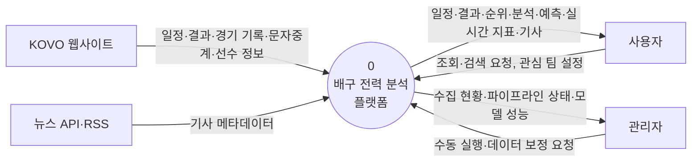

### 3.2 레벨 1

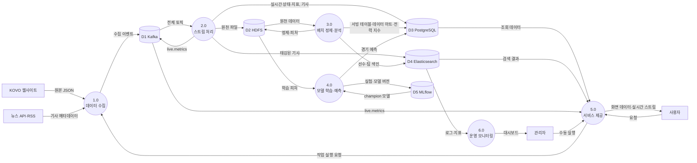

| 처리 | 설명 | 구현 |
|---|---|---|
| 1.0 데이터 수집 | KOVO·뉴스 데이터를 요청 속도 제한 안에서 수집해 Kafka에 발행 | 배치 수집기(Airflow), 실시간 수집기, 경기 재생기 |
| 2.0 스트림 처리 | 원천 보관, 실시간 지표 계산, 기사 정제·태깅 | Flink 3개 작업 |
| 3.0 배치 정제·분석 | 원천 → 정제 → 데이터 마트, 전력 지수, 사이드아웃 분석 | Spark on YARN (Airflow 실행) |
| 4.0 모델 학습·예측 | 피처로 학습, MLflow 등록, champion 모델로 예측 | Spark·scikit-learn·MLflow (Airflow 실행) |
| 5.0 서비스 제공 | 조회·검색·실시간 스트림 API, 관리자 기능 | Django, SSE 게이트웨이, Vue |
| 6.0 운영 모니터링 | 로그·지표 수집과 대시보드 | Filebeat, Kibana |

### 3.3 레벨 2: 2.0 스트림 처리 (실시간 경기)

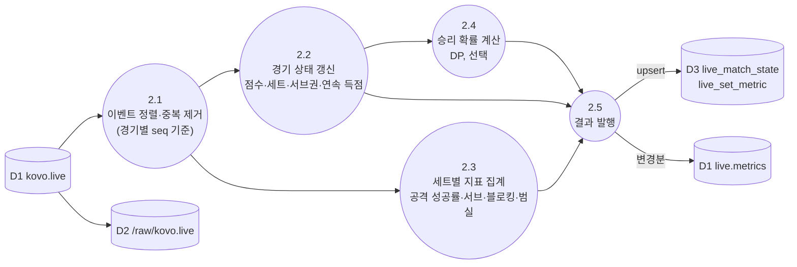

### 3.4 레벨 2: 3.0 배치 정제·분석

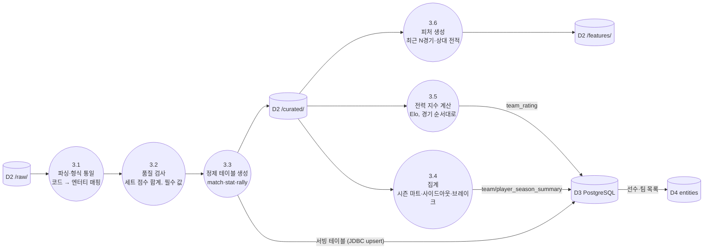

구현 (`spark_jobs/curate_kovo.py`, `spark_jobs/sql/merge_kovo.sql`):

| 단계 | 내용 |
|---|---|
| 3.1 파싱 | 원본 JSON을 필요한 필드만 명시한 스키마로 읽는다. 같은 항목을 다시 수집한 경우 가장 최근 것만 쓴다(일정·경기 상세는 `시즌-경기번호`, 문자중계는 세트별 가장 최근 수집 실행). 경기·세트 점수는 일정, 선수·팀 기록은 경기 상세, 랠리는 문자중계에서 가져온다 |
| 3.2 보정·품질 검사 | 먼저 관리자 보정(ADM-03, `data_correction`)을 적용하고 검사한다(PIPE-10). **오류**(경기가 `CONFIRMED`가 되지 않고 `FINISHED`로 남음): `SET_COUNT_MISMATCH`(세트 스코어와 세트별 점수 불일치), `INVALID_SET_SCORE`(세트 점수가 25점·5세트 15점, 2점 차 규칙에 맞지 않음), `MISSING_BOX_SCORE`, `MISSING_RALLY`, `RALLY_SCORE_MISMATCH`(랠리로 센 점수 ≠ 공식 점수), `STAT_RANGE`(성공·범실이 시도보다 많음), `MISSING_VALUE`(팀 코드·경기 날짜·선수 코드 누락). **경고**: `BOX_SCORE_MISMATCH`(팀 합계 ≠ 선수 합), `POINTS_MISMATCH`(팀 득점 ≠ 세트 점수 합), `PLAYER_POINTS_MISMATCH`(선수 득점 ≠ 공격+블로킹+서브, 2008-09 시즌부터. 그 전 시즌은 KOVO 득점 정의가 달라 행의 1/3이 어긋난다), `PLAYER_NAME_MISSING`(문자중계에만 나온 선수). 결과는 `staging.quality_issue` → `quality_issue`(아래 구현 메모) |
| 3.3 정제 테이블 | HDFS `/curated/kovo/{테이블}/season_code=…/`(Parquet, 처리한 시즌만 교체) → PostgreSQL `staging` 스키마(JDBC) → 병합 SQL 한 트랜잭션으로 서빙 테이블에 upsert. 다시 실행해도 결과와 id가 같다 |

랠리 승자는 `rgrade = +1` 이벤트의 팀이다(요구사항 부록 A). 이 규칙으로 계산한 진행 점수가 2025-26 시즌 모든 세트의 공식 점수와 일치했다. 2025-26 + 2026-27 시즌 처리 시간은 약 2분 20초다(YARN 실행기 1개).

구현 메모 — 데이터 품질·보정 (2026-11-05, PIPE-10·ADM-03, `backend/ops`):
- `quality_issue`: 검사 하나가 한 행(시즌·경기·세트·검사·대상 코드). 정제 실행마다 그 시즌에서 찾은 문제를 upsert하고, 더는 나오지 않는 문제는 `RESOLVED`로 바꾼다. 관리자가 `ACKNOWLEDGED`(확인함: KOVO 원천에도 없음 등)로 표시하면 다음 실행에서도 유지된다. Django 관리 화면 "품질 검사 결과"에서 상태·메모를 바꾸고, 고칠 수 있는 문제는 보정 화면으로 바로 간다.
- `data_correction`: 선수(이름·포지션·키 등)·팀(이름·홈 경기장)·경기(세트 스코어·관중·심판 등)·세트 점수·선수/팀 경기 기록의 한 항목을 근거와 함께 고친다. 저장하면 서빙 테이블에 바로 반영되고(원래 값은 `source_value`에 남음, 끄면 되돌림), Spark 정제가 매번 같은 보정을 적용하므로 재수집해도 유지되고 마트(Elo·시즌 기록)에도 들어간다. 경기 단위 보정이 바뀐 시즌은 다음 날 `kovo_daily`가 다시 정제한다. 보정은 지우지 않고 끈다(이력 유지).
- `kovo_daily`의 `quality_gate`: 최근 7일 경기에 미해결 오류가 있거나, 정규리그 경기가 시작 6시간 뒤에도 결과가 없으면 실패한다(재시도 없음). 경고와 확인함은 실패시키지 않는다.
- 경기 상세 API의 `data_notes`: 그 경기의 미해결·확인함 오류(예: "3·4세트 문자중계 없음")와 보정한 항목 수. 화면은 점수판 아래에 짧게 안내한다.
- Kibana "배구 파이프라인 운영"에 검사별 미해결 건수와 미해결 오류 수 패널(Metricbeat sql 모듈이 서빙 DB를 5분마다 조회).

---

## 4. UML

### 4.1 유스케이스 다이어그램

### 4.2 시퀀스 다이어그램: 경기 종료 후 기록 반영 (NFR-13: 1시간 이내)

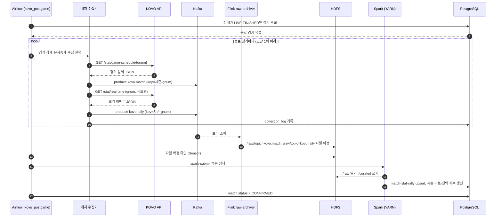

### 4.3 시퀀스 다이어그램: 실시간 경기 (NFR-14: 30초 이내)

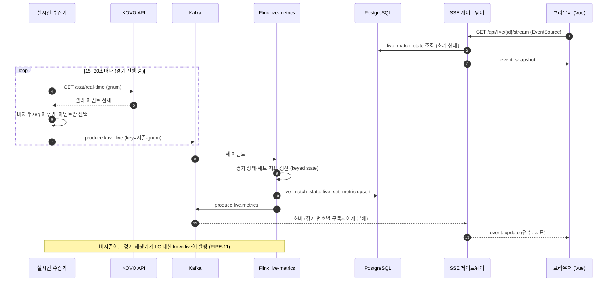

구현 메모 — 실시간 경기 (2026-11-04):
- **실시간 수집기** (`collectors/collectors/live.py`, compose `live-collector`, `stream` 프로필): 1분마다 DB에서 10분 안에 시작하거나 진행 중인 경기(`SCHEDULED`·`LIVE`, 시작 4시간 이내)를 읽고, 15초마다 경기별로 현재 세트의 `/stat/real-time`을 요청한다. 세트 피드에서 아직 보내지 않은 위치부터의 이벤트만 `kovo.live`에 보낸다(`payload = {match, set, start, events, mode: LIVE, session: live}`). 세트 피드에 `ET`가 있으면 다음 세트로, 한 팀이 3세트를 이기면 끝낸다. Kafka가 받았다고 확인한 뒤에만 위치를 넘기므로 실패하면 같은 이벤트를 다시 보낸다. 재시작하면 `live_match_state.last_event_seq`와 `set_scores`에서 이어 간다. KOVO 요청 간격은 Airflow와 같은 잠금 파일(`kovo-rate` 볼륨)을 써서 합쳐서 초당 1회 이하다(NFR-01).
- **경기 재생기** (`collectors/collectors/replay.py`, DAG `live_replay`): 원천 HDFS 파일에서 경기 한 건을 찾으려면 모든 수집일 파일을 읽어야 해서, Spark가 원천에서 만든 `rally_event`를 읽어 KOVO 피드 모양으로 되돌린다. 랠리 하나를 메시지 하나로 보내고, 간격은 세트 소요 시간(`set_score.duration_min`)을 랠리 수로 나눈 값 ÷ 배속이다. `mode: REPLAY`와 새 `session`을 붙인다.
- **이벤트 순번**: `seq = 세트 × 10000 + 세트 피드 안의 위치`. KOVO는 세트 피드 뒤에 이어 붙이기만 하므로 같은 이벤트는 같은 순번이 되고, Flink는 마지막 순번 이하를 버린다.
- **live-metrics** (`flink_jobs/live_metrics.py` + 계산 `live_state.py`): 경기별 keyed state(JSON, TTL 12시간 — 경기 끝에 바로 지우지 않는 것은 늦게 도착한 중복 메시지가 상태를 처음부터 다시 만들지 않게 하기 위해서다). 득점은 `rgrade = +1` 이벤트의 팀, 서브권은 직전 득점 팀, 세트 지표는 공격(`A*` 시도·`suc` 성공), 서브(`VV`·`VS`의 `suc` 에이스·`er*` 범실), 블로킹(`BB suc`), 범실(`er*` 결과)이다. 지난 경기를 재생해 경기 박스스코어와 공격 시도·성공, 서브 에이스·범실, 블로킹, 범실이 모두 같음을 확인했다. 다른 `session`이 오면 그 경기를 처음부터 다시 계산하고 그 경기의 실시간 행을 지운다. 출력은 PostgreSQL upsert(`live_match_state`, `live_set_metric`, 그리고 점수 추이용 **`live_rally`**(득점 1건 = 1행, 2.2절에 없던 테이블로 추가))와 Kafka `live.metrics`(키 = 경기). DataStream의 Kafka 싱크는 키를 따로 지정할 수 없어 Flink SQL Kafka 커넥터(`key.fields`)로 쓴다. 실제 경기(`mode = LIVE`)만 `match.status`를 `LIVE`·`FINISHED`로 바꾸고, 배치 병합(`merge_kovo.sql`)은 일정에 결과가 아직 없을 때 이를 `SCHEDULED`로 되돌리지 않는다.
- **실시간 승리 확률 (ANL-07)**: 서브하는 쪽별 랠리 승리 확률을 두 팀의 이번 시즌 사이드아웃·브레이크 비율로 정하고(이번 시즌 경기 수가 적으면 지난 시즌 값과 경기 수 5개 기준으로 섞는다), 동적 계획법으로 세트(25점·5세트 15점, 2점 차, 듀스는 닫힌 식)와 경기(3세트 선승) 승리 확률을 구한다. 세트 사이에는 서브권을 모르므로 양쪽 평균을 쓴다.
- **SSE 게이트웨이** (`backend/live/hub.py`, `views.py`, compose `django-sse`: Uvicorn): 프로세스마다 Kafka 컨슈머 하나가 `live.metrics`의 모든 파티션을 끝에서부터 읽어 경기별로 열린 스트림에 나눠 준다(소비자 그룹 오프셋을 쓰지 않는다. 접속하면 DB에서 현재 상태를 먼저 보내기 때문에 지난 메시지가 필요 없다). 스트림은 구독을 먼저 걸고 `snapshot`을 보낸 뒤 `update`를 이어 보내며, 15초마다 `: ping`을 보낸다. 느린 브라우저는 오래된 업데이트를 버린다(업데이트마다 전체 상태가 들어 있다). 개발 서버에서는 Vite가 `/api/live/{키}/stream`만 `django-sse`로 넘긴다.
- **지연(NFR-14)**: 재생으로 잰 수집 시각 → DB 저장은 평균 약 3초(120배속에서도 최대 4.5초), SSE 전달은 그 직후다.

### 4.4 시퀀스 다이어그램: 주간 재학습과 모델 교체

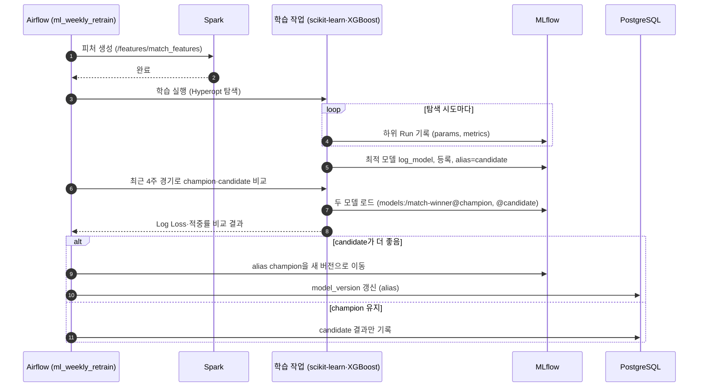

### 4.5 상태 다이어그램: 경기 상태

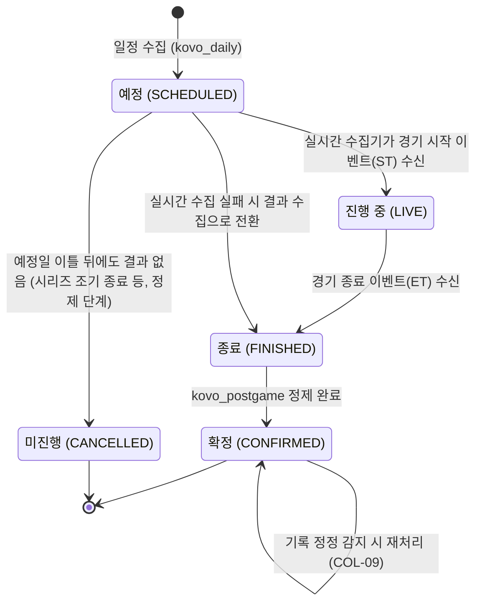

품질 검사(문자중계 누락, 세트 점수 불일치, 선수 기록 없음)를 통과하지 못한 경기는 결과가 있어도 `FINISHED`에 머문다. 원천에 기록이 없는 경우는 `collectors/README.md`의 "알려진 원천 누락"에 둔다.

### 4.6 상태 다이어그램: 모델 버전 별칭

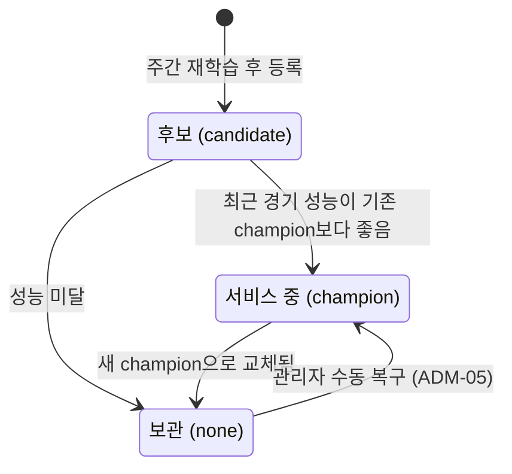

구현 메모 — 수집 현황·수동 실행 (2026-11-06, ADM-01·02, `ops/jobs.py`, `ops/admin.py`, `ops/forms.py`): 별도 REST API 대신 Django 관리 화면 두 개로 만들었다(관리자 권한 계정만, 이 PC에서만 열림, NFR-32·34). "수집 현황"은 Airflow REST API(`/api/v2/dags`, `/dags/{id}/dagRuns`)로 작업별 최근 12회 실행과 7일 실패 수를, Elasticsearch `ops-collection-*`(수집기가 Kafka `ops.collection-log`에 남긴 시작·결과)로 수집기별 성공·실패·끝나지 않은 실행을 보여주고, 그 아래에 `job_alert`(PIPE-09) 목록을 둔다. "수동 실행"은 종류별 양식이 입력을 먼저 검사하고(경기 번호·날짜 범위·시즌 형식, 재생할 경기가 끝났는지) Airflow `POST /dags/{id}/dagRuns`로 설정과 함께 실행한 뒤 `manual_run`에 남긴다. 일시 중지된 DAG는 실행이 대기열에만 쌓이므로 거절한다. Airflow·Elasticsearch가 꺼져 있으면 그 부분만 오류를 표시한다.

구현 메모 — 모델 관리 (2026-11-05, ADM-05): Django 관리 "모델 관리"(`analytics/admin.py`, `analytics/registry.py`)가 MLflow REST API로 `match-winner`의 등록 버전을 읽어 버전별 학습·시험 시즌, 시험 정확도·로그 손실(같은 경기의 Elo 기준선과 함께), 실전 적중(경기 전 예측만, `match_prediction`)을 보여준다. 최고 관리자가 버전과 사유를 골라 `champion` 별칭을 옮기면 `model_change`에 누가·언제·왜를 남기고, Airflow REST API로 `ml_daily_predict`를 바로 실행해 다가오는 경기 예측을 새 모델로 다시 만든다. MLflow·Airflow가 꺼져 있으면(batch 프로필) 화면에 그렇게 표시한다. 주간 재학습은 그때의 `champion`과 새 설정을 같은 데이터로 비교하므로, 수동으로 고른 버전도 같은 규칙으로 평가된다.

### 4.7 클래스 다이어그램: 수집기 모듈

설계 포인트:
- 모든 KOVO 요청은 `KovoClient` 하나를 거치고, `RateLimiter`가 초당 1회 이하를 보장한다 (NFR-01).
- 수집기는 Kafka 발행까지만 책임진다. 저장·가공은 Flink·Spark가 맡는다.
- `LiveCollector`는 경기별 마지막 이벤트 순번(`last_seq_by_match`)을 기억해 새 이벤트만 발행한다. 재시작 시에는 `live_match_state.last_event_seq`에서 복구한다.

---

## 5. 요구사항 반영 필요 사항

설계 중 요구사항 명세서(v0.6)에 없던 결정을 추가했다. 아래 항목은 **요구사항 명세서 v0.7에 반영 완료**했다.

| 항목 | 설계 결정 | 반영 위치 |
|---|---|---|
| Kafka 토픽 추가 | `live.metrics`(Flink → SSE 게이트웨이), `ops.collection-log`(수집 이력) | 요구사항 2.5절 |
| Flink 역할 추가 | `raw-archiver`가 Kafka → HDFS 원천 적재를 담당 (PIPE-03 구현 주체) | 요구사항 2.8절, PIPE-03 |
| 실시간 전달 방식 | SSE 게이트웨이(Django ASGI)가 Kafka `live.metrics`를 구독해 브라우저로 전달 | 요구사항 9장 6번(SSE 확정) |
| Airflow 실행기 | LocalExecutor 사용 (Celery·Redis 미사용으로 자원 절약) | 요구사항 2.2절 |
| 데이터 마트 테이블 | `team_season_summary`, `player_season_summary` 추가 | 요구사항 6.1절 |
| 경기 상태 확정 단계 | `CONFIRMED` 상태 추가 (정제 완료 기준) | 요구사항 6.1절 Match |
| 메모리 계획 | 서비스별 메모리 상한 합계 약 26GB | 요구사항 7장 |
