# 배구 전력 분석 플랫폼 설계서 (초안)

| 항목 | 내용 |
|---|---|
| 문서 버전 | v0.1 (초안) |
| 작성일 | 2026-11-02 |
| 기준 문서 | 요구사항 명세서 v0.6 ([requirements.md](requirements.md)) |
| 구성 | 1. 아키텍처 설계 / 2. ERD / 3. DFD / 4. UML / 5. 요구사항 반영 필요 사항 |

다이어그램은 Mermaid로 작성했다. GitHub·GitLab에서는 그림으로 보이고, VS Code에서는 "Markdown Preview Mermaid Support" 확장을 설치하면 미리보기에서 볼 수 있다.

---

## 1. 아키텍처 설계

### 1.1 설계 원칙

| 원칙 | 내용 | 관련 요구사항 |
|---|---|---|
| 람다 아키텍처 | 배치(Spark)와 실시간(Flink)을 분리하고, 서빙 계층(PostgreSQL)에서 합친다 | 2.4절 |
| 원천 우선 저장(ELT) | 수집한 데이터는 가공 전에 HDFS에 그대로 남긴다. 가공 로직이 바뀌면 원천부터 다시 처리한다 | PIPE-03, PIPE-08, NFR-22 |
| 수집과 처리의 분리 | 수집기는 Kafka에 발행만 하고, 처리는 Flink·Spark가 맡는다. 한쪽 장애가 다른 쪽을 멈추지 않는다 | PIPE-02 |
| 서비스는 조회만 | Django는 서빙 DB와 Elasticsearch를 조회만 한다. 무거운 계산은 모두 파이프라인에서 미리 끝낸다 | NFR-11, NFR-21 |
| 외부 비공개 | 사용자에게는 Nginx(웹·API)만 공개하고, 데이터 플랫폼 관리 화면은 내부망에서만 접근한다 | NFR-34 |

### 1.2 시스템 컨텍스트

시스템과 외부 행위자(사람, 외부 시스템)의 관계다.

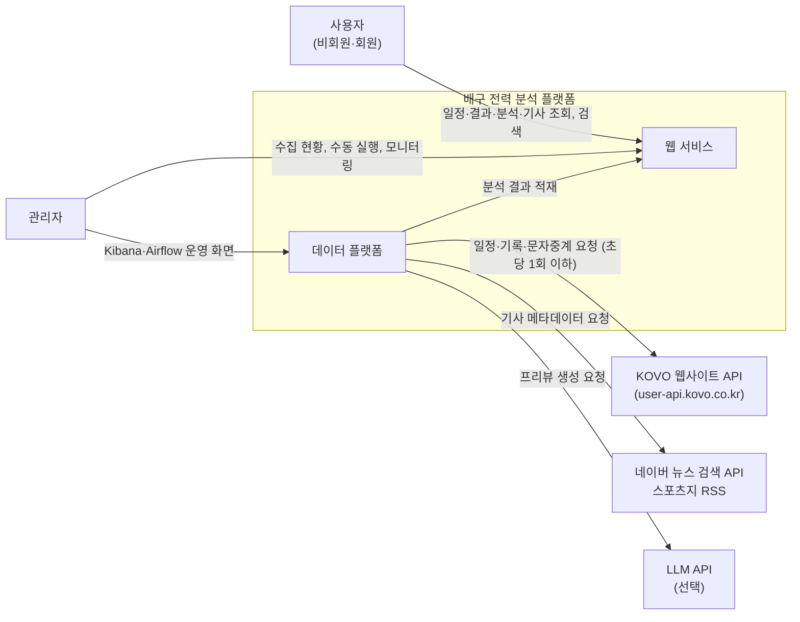

### 1.3 컨테이너 구성

실행 단위(컨테이너)와 통신 방향이다. 굵은 흐름은 데이터 흐름, 점선은 제어(스케줄링·조회) 흐름이다.

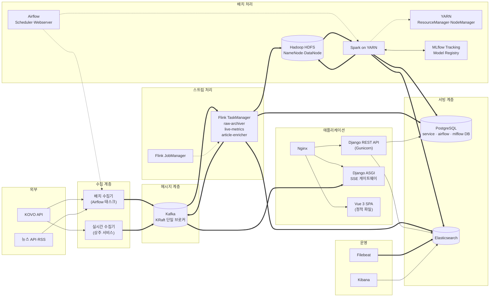

### 1.4 구성 요소별 책임

| 구성 요소 | 책임 | 입력 | 출력 |
|---|---|---|---|
| 배치 수집기 | 일정·결과·순위, 경기 상세 기록, 종료 경기 문자중계, 선수 정보, 기사 수집. 요청 속도 제한(초당 1회), 수집 이력 기록 | KOVO API, 뉴스 API·RSS | Kafka `kovo.*`, `news.article` |
| 실시간 수집기 | 오늘 경기 일정을 읽어 경기 시작 10분 전부터 종료까지 15~30초 주기로 문자중계 조회. 새 이벤트만 발행 | KOVO `/stat/real-time`, PostgreSQL(오늘 일정) | Kafka `kovo.live` |
| 경기 재생기 | 종료 경기의 랠리 이벤트를 원래 간격(또는 배속)으로 다시 발행 | HDFS 원천(`kovo.rally`) | Kafka `kovo.live` |
| Flink `raw-archiver` | 모든 토픽을 날짜별 JSON 파일로 HDFS에 보관 | Kafka 전체 토픽 | HDFS `/raw/` |
| Flink `live-metrics` | 진행 경기 상태(점수, 서브권, 연속 득점), 세트별 지표 계산 | `kovo.live` | PostgreSQL `live_*`, Kafka `live.metrics` |
| Flink `article-enricher` | 기사 중복 제거(URL·제목 유사도), 팀·선수 태깅 | `news.article`, 팀·선수 사전 | Elasticsearch `articles`, PostgreSQL `article*` |
| Spark 작업 | 원천 정제, 피처 집계, 데이터 마트 생성, 전력 지수, 모델 학습·예측 | HDFS `/raw/` | HDFS `/curated/`·`/features/`, PostgreSQL, Elasticsearch `entities` |
| Airflow | 배치 수집·Spark·학습·예측 일정 관리, 재시도·알림 | DAG 정의 | 작업 실행 |
| MLflow | 실험·모델 버전 관리, `champion`·`candidate` 별칭 | Spark·scikit-learn 학습 결과 | 모델 레지스트리 |
| Django REST API | 조회 API, 회원·관심 팀, 관리자 기능 | PostgreSQL, Elasticsearch | JSON 응답 |
| SSE 게이트웨이 | 진행 경기 지표를 브라우저에 실시간 전달 | Kafka `live.metrics` | Server-Sent Events |
| Filebeat·Kibana | 전 컨테이너 로그 수집과 운영 대시보드 | 컨테이너 로그, Kafka·Airflow 지표 | Elasticsearch `logs-*`, 대시보드 |

### 1.5 배포 구성 (Docker Compose, 단일 서버 32GB 기준)

| 서비스 | 이미지(예시) | 내부 포트 | 메모리 상한 | 외부 공개 |
|---|---|---|---|---|
| nginx | nginx | 80, 443 | 256MB | 공개 |
| django-api | 자체 이미지(Python 3.12, Gunicorn) | 8000 | 1GB | Nginx 경유 |
| django-sse | 자체 이미지(Uvicorn) | 8001 | 512MB | Nginx 경유 |
| postgres | postgres:16 | 5432 | 2GB | 비공개 |
| kafka | apache/kafka (KRaft) | 9092 | 2GB | 비공개 |
| hadoop-namenode / datanode | apache/hadoop | 9870, 9864 | 각 1GB | 비공개 |
| yarn-resourcemanager / nodemanager | apache/hadoop | 8088, 8042 | 1GB / 6GB | 비공개 |
| flink-jobmanager / taskmanager | flink (PyFlink 포함 자체 이미지) | 8081 | 1GB / 3GB | 비공개 |
| airflow (scheduler, webserver, LocalExecutor) | apache/airflow | 8080 | 3GB | 비공개 |
| mlflow | 자체 이미지 | 5000 | 512MB | 비공개 |
| elasticsearch | elasticsearch (nori 플러그인 포함) | 9200 | 4GB | 비공개 |
| kibana | kibana | 5601 | 1GB | 비공개 |
| filebeat | filebeat | - | 256MB | 비공개 |
| live-collector | 자체 이미지 | - | 256MB | 비공개 |

- 합계 약 26GB로, 32GB 서버에서 운영체제 여유분을 남긴다.
- 네트워크는 `public`(nginx, django)과 `data`(나머지)로 나누고, nginx만 호스트 포트를 연다. 관리 화면(Airflow 8080, Kibana 5601, Flink 8081, YARN 8088, MLflow 5000)은 SSH 터널로 접속한다 (NFR-34).
- 데이터 볼륨: `pg-data`, `kafka-data`, `hdfs-nn`, `hdfs-dn`, `es-data`, `mlflow-artifacts`.
- 비밀 값(DB 비밀번호, API 키)은 `.env`로 주입하고 저장소에는 `.env.example`만 둔다 (NFR-33).

### 1.6 저장소별 데이터 배치

| 저장소 | 데이터 | 보관 |
|---|---|---|
| Kafka | 토픽 7개 (1.7절) | 7일 |
| HDFS `/raw/topic={topic}/dt={yyyy-mm-dd}/` | 수집 원본 JSON (메시지 1건 = 1줄, `dt`는 수집일) | 영구 |
| HDFS `/curated/{table}/season={code}/` | 정제 테이블(Parquet): match, set_score, team_match_stat, player_match_stat, rally_event | 영구 |
| HDFS `/features/{name}/` | 모델 학습용 피처(Parquet): match_features, player_features | 영구 |
| PostgreSQL `service` | 서빙 테이블과 데이터 마트 (2장 ERD) | 현재 + 과거 시즌 |
| PostgreSQL `airflow`, `mlflow` | 각 도구의 메타데이터 | 영구 |
| Elasticsearch | `articles`, `entities`(선수·팀 자동완성), `logs-*` | 기사 2년, 로그 30일 |
| MLflow 아티팩트 볼륨 | 모델 파일, 평가 그래프 | 영구 |

### 1.7 Kafka 토픽 (요구사항 2.5절 + 설계 추가)

| 토픽 | 키 | 파티션 | 생산자 | 소비자 |
|---|---|---|---|---|
| `kovo.schedule` | 시즌 코드 | 1 | 배치 수집기 | raw-archiver |
| `kovo.match` | 시즌-경기 번호 (예: `022-3`) | 3 | 배치 수집기 | raw-archiver |
| `kovo.rally` | 시즌-경기 번호 | 3 | 배치 수집기 | raw-archiver |
| `kovo.live` | 시즌-경기 번호 | 3 | 실시간 수집기, 경기 재생기 | live-metrics, raw-archiver |
| `news.article` | 기사 URL | 1 | 배치 수집기 | article-enricher, raw-archiver |
| `live.metrics` (추가) | 시즌-경기 번호 | 3 | Flink live-metrics | SSE 게이트웨이 |
| `ops.collection-log` (추가) | 작업 이름 | 1 | 모든 수집기 | raw-archiver(→ Kibana는 로그로 확인) |

### 1.8 Airflow DAG 설계

| DAG | 실행 주기 | 주요 태스크 | 관련 요구사항 |
|---|---|---|---|
| `kovo_daily` | 매일 06:00 | 시즌 목록 → 현재 시즌 일정·결과 → 최근 7일 중 확정 안 된 종료 경기의 상세·문자중계(누락 보충) → HDFS 적재 확인 → Spark 정제. (구현 예정: 순위·선수 정보 수집, 데이터 마트, `entities` 색인) | COL-01, 02, 05, PIPE-04, 05 |
| `kovo_postgame` | 매일 14:00~23:40, 20분마다 (주말 경기는 14·16시 시작) | DB에서 어제 이후 시작했는데 확정 안 된 경기 확인(없으면 KOVO 요청 없이 종료) → 그 시즌 일정 갱신 → 끝난 경기의 상세·문자중계 → HDFS 적재 확인 → Spark 정제 → `CONFIRMED`. 문자중계가 아직 없으면 `FINISHED`로 남고 다음 실행이 다시 수집 | COL-03, 10, ANL-01, NFR-13 |
| `kovo_backfill` | 수동 실행 (`seasons` 예: `001-021`, `limit`, `skip_confirmed`) | 시즌 목록 → 시즌별(차례로) 일정 → 확정 안 된 종료 경기의 상세·문자중계(`020` 이전은 문자중계 없음) → HDFS 적재 확인 → Spark 정제 | COL-04, PIPE-08 |
| `news_collect` | 매시 정각 | 뉴스 검색 API·RSS 수집 → `news.article` 발행 | COL-07 |
| `ml_weekly_retrain` | 매주 월 04:00 | 피처 생성 → 후보 모델 학습(Hyperopt) → MLflow `candidate` 등록 → 최근 경기 성능 비교 → 더 좋으면 `champion` 교체 | ANL-03, 09, 10 |
| `ml_daily_predict` | 매일 07:00 | `champion` 모델로 7일 내 예정 경기 예측 → `match_prediction` 저장 | ANL-03, WEB-08 |
| `replay_match` | 수동 실행 (경기 번호, 배속 입력) | 경기 재생기 실행 | PIPE-11 |
| `reprocess` | 수동 실행 (날짜·시즌 입력) | 원천부터 정제·마트 재생성 | PIPE-08, ADM-02 |

공통 설정: 재시도 3회(5분 간격), 실패 시 관리자 알림(이메일 또는 메신저 웹훅), 동시 실행 1개 (PIPE-09).

구현 메모 (2026-11-03, `airflow/dags/kovo_*.py`, 공통 단계는 `airflow/dags/kovo_tasks/pipeline.py`):
- **HDFS 적재 확인**: 수집 실행마다 `run_id`, 토픽, 건수를 넘기고, 센서가 WebHDFS로 확정된 파일(숨김 파일 제외)에서 그 `run_id`가 붙은 줄을 센다. 모두 보이면 통과한다(1분 간격, reschedule 모드).
- **KOVO 요청 제한 공유**: 태스크는 각자 다른 프로세스라, 컨테이너의 잠금 파일(`KOVO_RATE_LOCK_FILE`)로 모든 수집 태스크가 초당 1회를 함께 지킨다.
- **정제 동시 실행**: Spark 실행마다 전용 staging 스키마를 쓰고 끝나면 지운다. 서빙 테이블 반영은 PostgreSQL advisory lock으로 한 번에 하나만 한다. YARN 자원이 모자라면 두 번째 작업은 YARN 대기열에서 기다린다.
- 실패 알림은 아직 없다(Airflow UI에서 확인).

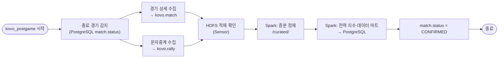

### 1.9 Flink 작업 설계

| 작업 | 입력 | 처리 | 출력 | 상태(State) |
|---|---|---|---|---|
| `raw-archiver` | `kovo.*`, `news.*`, `ops.*` 토픽 (`live.metrics`는 파생 데이터라 제외) | 토픽·수집일별로 묶어 메시지 1건을 1줄로 기록. 파일은 128MB 또는 연 지 5분이 되면 확정되고(실측 약 6분 이내), 다음 체크포인트에 보인다 | HDFS `/raw/topic={토픽}/dt={수집일}/` | Kafka offset (체크포인트, 소비자 그룹 `raw-archiver`에도 커밋) |
| `live-metrics` | `kovo.live` | 경기 번호별 keyBy → 이벤트 순서대로 점수·세트·서브권·연속 득점 갱신, 세트별 공격 성공률·서브 득점·블로킹·범실 집계 | PostgreSQL `live_match_state`·`live_set_metric`(upsert), Kafka `live.metrics` | 경기별 상태 (경기 종료 이벤트 수신 시 정리) |
| `article-enricher` | `news.article` | URL 기준 중복 제거(7일 상태 유지), 제목 정규화 후 팀·선수 사전과 매칭해 태그 부여 | Elasticsearch `articles`, PostgreSQL `article`·`article_team`·`article_player` | 최근 7일 URL 집합 |

- 언어는 팀 주 언어에 맞춰 PyFlink(Table API·DataStream API)를 쓴다. Kafka·JDBC·Elasticsearch 커넥터 JAR을 이미지에 포함한다.
- 체크포인트 30초, 저장 위치는 HDFS `/flink/checkpoints`. 장애 시 마지막 체크포인트부터 재개한다.
- `raw-archiver`는 `flink-job-keeper` 서비스가 1분마다 확인해 없으면 다시 제출한다(PC·Docker 재시작 대비). 다시 제출된 작업은 소비자 그룹에 커밋된 Kafka 위치부터 읽는다. 체크포인트 간격은 제출하는 쪽 설정을 따르므로 작업 코드에 직접 둔다.

### 1.10 백엔드·프론트엔드 모듈 구조

| Django 앱 | 담당 | 주요 모델 |
|---|---|---|
| `accounts` | 회원가입·로그인(토큰 인증), 관심 팀·선수 | User, FavoriteTeam, FavoritePlayer |
| `league` | 시즌·대회·팀·선수 | Season, Competition, Team, Player, PlayerTeamHistory |
| `matches` | 경기·세트·기록·랠리 | Match, SetScore, TeamMatchStat, PlayerMatchStat, PlayerAttackStat, RallyEvent |
| `analytics` | 전력 지수, 예측, 데이터 마트 조회 | TeamRating, MatchPrediction, ModelVersion, TeamSeasonSummary, PlayerSeasonSummary |
| `live` | 실시간 상태 조회, SSE 엔드포인트 | LiveMatchState, LiveSetMetric |
| `articles` | 기사 목록, 통합 검색(Elasticsearch) | Article, ArticleTeam, ArticlePlayer |
| `ops` | 수집 이력, 수동 실행(Airflow REST API 호출) | CollectionLog |

| Vue 영역 | 구성 |
|---|---|
| `views/` | Home, Schedule, MatchDetail, MatchLive, Standings, TeamDetail, PlayerDetail, Preview, Articles, Search, Login, Admin |
| `stores/` (Pinia) | `auth`(토큰·사용자), `favorites`(관심 팀), `live`(SSE 연결·실시간 상태), `filters`(남녀부·시즌 선택) |
| `api/` | axios 인스턴스와 도메인별 API 함수 |
| `components/charts/` | 전력 지수 추이, 레이더 차트, 승리 확률 그래프 |

저장소 구조(모노레포 권장):

| 폴더 | 내용 |
|---|---|
| `backend/` | Django 프로젝트 |
| `frontend/` | Vue 프로젝트 |
| `collectors/` | 배치·실시간 수집기, 경기 재생기 (Python 패키지) |
| `airflow/dags/` | DAG 정의 |
| `spark_jobs/` | PySpark 작업 |
| `flink_jobs/` | PyFlink 작업 |
| `ml/` | 피처 정의, 학습·평가 코드, MLflow 연동 |
| `infra/` | 서비스별 Dockerfile과 설정 (Hadoop, Airflow, MLflow, Flink, Elasticsearch, Filebeat, PostgreSQL, Kafka) |
| `compose.yaml` (루트) | 개발 환경 Docker Compose. 묶음(프로필)별 실행: 기본(PostgreSQL·Kafka), `app`, `batch`, `stream`, `search` |
| `docs/` | 요구사항·설계 문서 |

### 1.11 주요 REST API

| 메서드·경로 | 설명 | 관련 요구사항 |
|---|---|---|
| `GET /api/seasons` | 시즌·대회 목록 | WEB-02 |
| `GET /api/matches?season=&gender=&team=&month=` | 경기 일정·결과 | WEB-02 |
| `GET /api/matches/{id}` | 경기 상세(세트 점수, 팀·선수 기록, 예측 대비 결과) | WEB-03 |
| `GET /api/matches/{id}/rallies?set=` | 랠리 기록 | WEB-03 |
| `GET /api/matches/{id}/preview` | 경기 프리뷰(승리 확률, 상대 전적, 지표 비교) | WEB-08 |
| `GET /api/live` | 진행 중 경기 목록과 현재 상태 | WEB-04 |
| `GET /api/live/{id}/stream` | 실시간 지표 SSE 스트림 | WEB-04 |
| `GET /api/standings?season=&gender=` | 팀 순위, 부문별 선수 순위 | WEB-05 |
| `GET /api/teams/{id}` | 팀 상세(선수단, 전력 지수 추이, 강약점) | WEB-06 |
| `GET /api/players/{id}` | 선수 상세(시즌·경기 기록, 효율 지표, 백분위) | WEB-07 |
| `GET /api/articles?team=&player=&page=` | 기사 목록 | WEB-09 |
| `GET /api/search?q=` / `GET /api/search/suggest?q=` | 통합 검색 / 자동완성 | WEB-10 |
| `POST /api/auth/signup`, `POST /api/auth/login` | 회원가입·로그인 | WEB-11 |
| `GET·POST·DELETE /api/me/favorites` | 관심 팀·선수 | WEB-12 |
| `GET /api/admin/collection-logs` | 수집 이력 | ADM-01 |
| `POST /api/admin/jobs/{dag}/run` | 수집·재처리 수동 실행 (Airflow REST API 호출) | ADM-02 |

목록 API는 페이지네이션(기본 20건)을 적용하고, 조회 결과는 갱신 주기에 맞춰 캐시한다(일정·순위 5분, 경기 상세는 확정 후 1일).

구현 메모 (2026-11-03): 경기 경로는 `/api/matches/{시즌-경기번호}`(예: `022-3`)로 했다. 내부 id는 DB를 다시 만들면 바뀌기 때문이다. 팀·선수는 KOVO 코드로 찾는다. 순위와 선수 순위는 데이터 마트(`team_season_summary` 등)가 생기기 전까지 API가 경기 기록에서 바로 계산한다(`backend/league/standings.py`). 캐시는 아직 적용하지 않았다. 구현한 화면은 홈, 일정·결과, 경기 상세, 순위, 팀, 선수다. 프리뷰·실시간·기사·검색은 해당 데이터가 준비된 뒤 만든다.

---

## 2. ERD

서빙 DB(PostgreSQL `service`) 기준이다. 모든 테이블은 대리 키 `id`(bigint)를 쓰고, KOVO 원본 코드는 고유 제약으로 둔다. 시각 컬럼은 `timestamptz`, 저장 시각은 `created_at`·`updated_at`을 공통으로 둔다(그림에서는 생략).

### 2.1 경기·기록 도메인

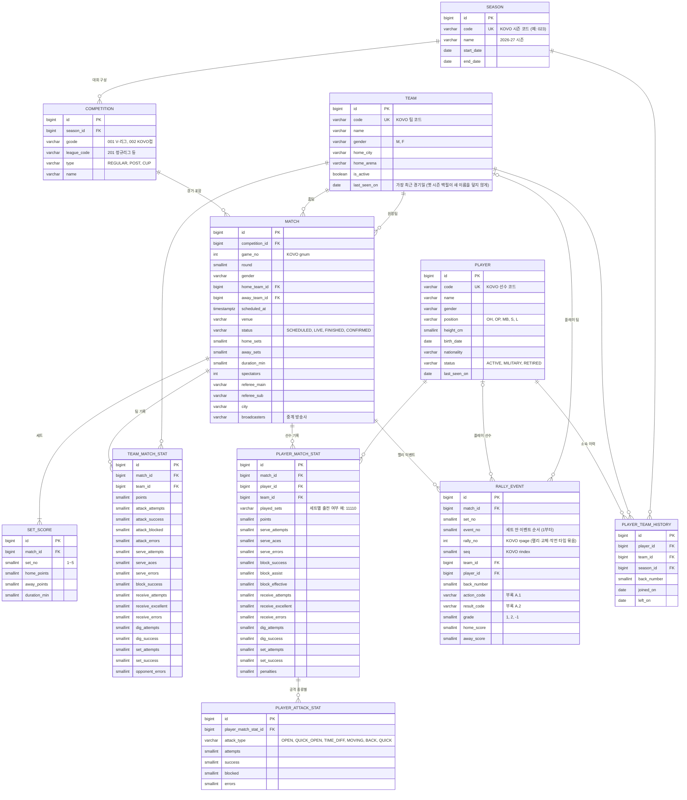

구현 메모 (2026-11-03, `backend/league/models.py`, `backend/matches/models.py`):
- `team_match_stat`과 `player_match_stat`은 같은 기록 컬럼 20개를 공유한다. 공격(시도·성공·피차단·범실), 서브(시도·에이스·범실), 블로킹(시도·성공·유효·어시스트), 리시브(시도·정확·실패), 디그(시도·성공), 세트(시도·성공), 범실 합계, 경고다. KOVO 필드와의 대응은 모델 주석에 있다.
- `team_match_stat.points`는 상대 범실 득점을 포함한 팀 총득점이고, `opponent_errors` = 총득점 − 공격 성공 − 블로킹 − 서브 에이스로 계산한다. `player_match_stat`에는 등번호, 포지션, 주장 여부, 세트별 출전(`11100`)을 더 둔다.
- 테이블 구조는 Django 마이그레이션이 만들고, 데이터는 Spark가 넣는다. 그래서 저장 시각 컬럼은 DB 기본값(`now()`)을 쓴다. Django의 `on_delete=CASCADE`는 DB 규칙이 아니므로, 병합 SQL은 자식 행부터 지운다.

### 2.2 분석·예측·실시간 도메인

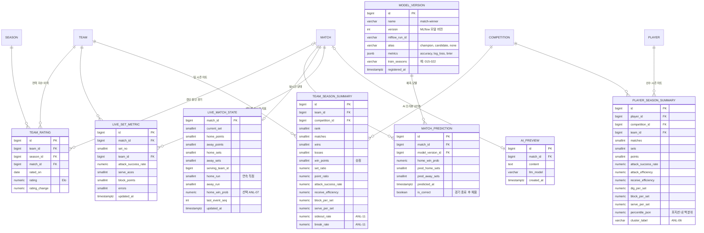

구현 메모 (2026-11-03, `backend/analytics/models.py`, `spark_jobs/build_marts.py`): `team_rating`, `team_season_summary`, `player_season_summary`를 먼저 만들었다(예측 관련 테이블은 예측 모델과 함께).
- Elo: 시작 1500, K = 24 × (세트 차 1·2·3 → 1, 1.25, 1.5), 홈 이점은 전체 경기의 홈 승률에서 계산(2025-26 기준 57% → 약 49점), 새 시즌 첫 경기 전에 1500 쪽으로 1/3 되돌림. 경기 전 Elo 확률의 적중률(약 62%)이 예측 모델의 기준선이다.
- 사이드아웃율 = 상대 서브 랠리 중 득점 비율, 브레이크율 = 자기 서브 랠리 중 득점 비율. 문자중계가 있는 2023-24 시즌부터 계산된다.
- 선수 백분위는 같은 시즌·대회·성별·포지션의 순위 자격 선수(팀 세트의 1/3 이상 출전) 안에서 계산하고 `percentiles`(JSON)에 둔다.
- 마트는 매 실행마다 전체 시즌으로 다시 계산해 한 트랜잭션으로 교체한다(Elo가 전체 이력에 의존). `kovo_daily`·`kovo_postgame`·`kovo_backfill`의 정제 다음 단계로 실행된다.

### 2.3 기사·회원·운영 도메인

### 2.4 제약조건과 인덱스

| 테이블 | 고유 제약 | 인덱스 | 비고 |
|---|---|---|---|
| `season` | `code` | - | |
| `competition` | (`season_id`, `gcode`, `league_code`) | - | |
| `match` | (`competition_id`, `game_no`) | (`scheduled_at`), (`home_team_id`, `scheduled_at`), (`away_team_id`, `scheduled_at`), (`status`) | 일정 조회, 팀별 최근 N경기 |
| `set_score` | (`match_id`, `set_no`) | - | |
| `team_match_stat` | (`match_id`, `team_id`) | (`team_id`) | |
| `player_match_stat` | (`match_id`, `player_id`) | (`player_id`, `match_id`) | 선수별 경기 기록 |
| `player_attack_stat` | (`player_match_stat_id`, `attack_type`) | - | |
| `rally_event` | (`match_id`, `set_no`, `event_no`) | (`match_id`, `set_no`), (`player_id`) | 시즌당 30만~40만 행. 시즌 코드 기준 파티셔닝 검토 |
| `player_team_history` | (`player_id`, `team_id`, `season_id`) | - | |
| `team_rating` | (`team_id`, `rated_on`) | - | |
| `match_prediction` | (`match_id`, `model_version_id`) | - | |
| `live_set_metric` | (`match_id`, `set_no`, `team_id`) | - | Flink upsert 대상 |
| `team_season_summary` | (`team_id`, `competition_id`) | (`competition_id`, `rank`) | |
| `player_season_summary` | (`player_id`, `competition_id`) | (`competition_id`) | |
| `article` | `url` | (`published_at`) | |
| `favorite_team`·`favorite_player` | (`user_id`, 대상 id) | - | |
| `collection_log` | - | (`job_name`, `started_at`) | |

### 2.5 Elasticsearch 인덱스

| 인덱스 | 주요 필드 | 분석기 | 용도 |
|---|---|---|---|
| `articles` | `title`(text), `summary`(text), `publisher`(keyword), `published_at`(date), `team_codes`(keyword[]), `player_codes`(keyword[]), `url`(keyword) | nori(한글 형태소), 제목은 edge n-gram 보조 필드 | 기사 검색, 팀·선수 필터 |
| `entities` | `type`(team/player), `name`(text + `search_as_you_type`), `code`(keyword), `team_name`, `position`, `status` | nori + 초성 검색용 보조 필드(선택) | 통합 검색 자동완성 |
| `logs-*` | Filebeat 기본 필드, `service`, `level`, `message` | 기본 | 운영 로그 (Kibana) |

---

## 3. DFD (데이터 흐름도)

표기: 사각형은 외부 개체, 원은 처리(프로세스), 원통은 데이터 저장소다. 저장소 번호는 D1 Kafka, D2 HDFS, D3 PostgreSQL, D4 Elasticsearch, D5 MLflow 레지스트리다.

### 3.1 레벨 0 (컨텍스트)

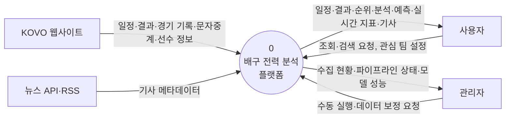

### 3.2 레벨 1

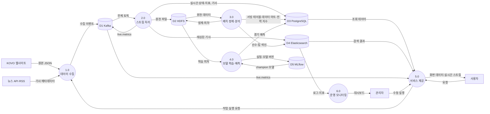

| 처리 | 설명 | 구현 |
|---|---|---|
| 1.0 데이터 수집 | KOVO·뉴스 데이터를 요청 속도 제한 안에서 수집해 Kafka에 발행 | 배치 수집기(Airflow), 실시간 수집기, 경기 재생기 |
| 2.0 스트림 처리 | 원천 보관, 실시간 지표 계산, 기사 정제·태깅 | Flink 3개 작업 |
| 3.0 배치 정제·분석 | 원천 → 정제 → 데이터 마트, 전력 지수, 사이드아웃 분석 | Spark on YARN (Airflow 실행) |
| 4.0 모델 학습·예측 | 피처로 학습, MLflow 등록, champion 모델로 예측 | Spark·scikit-learn·MLflow (Airflow 실행) |
| 5.0 서비스 제공 | 조회·검색·실시간 스트림 API, 관리자 기능 | Django, SSE 게이트웨이, Vue |
| 6.0 운영 모니터링 | 로그·지표 수집과 대시보드 | Filebeat, Kibana |

### 3.3 레벨 2: 2.0 스트림 처리 (실시간 경기)

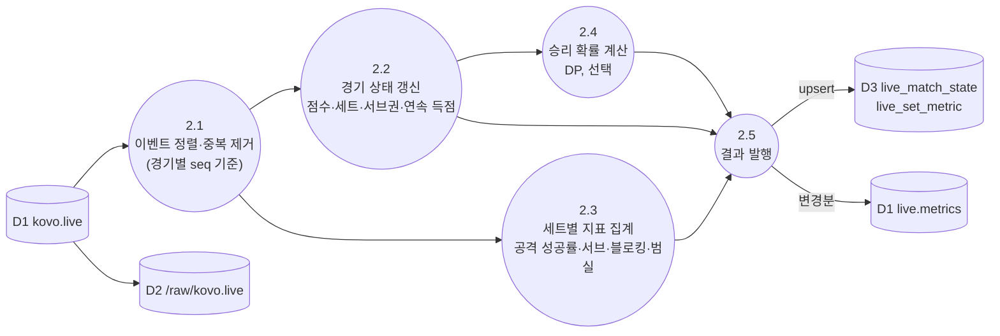

### 3.4 레벨 2: 3.0 배치 정제·분석

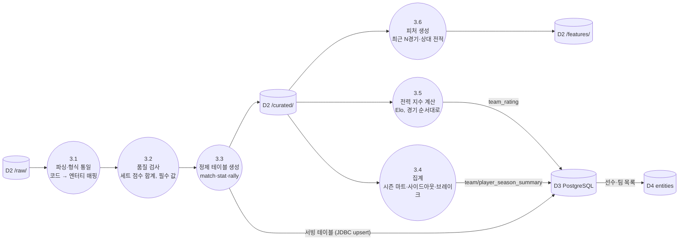

구현 (`spark_jobs/curate_kovo.py`, `spark_jobs/sql/merge_kovo.sql`):

| 단계 | 내용 |
|---|---|
| 3.1 파싱 | 원본 JSON을 필요한 필드만 명시한 스키마로 읽는다. 같은 항목을 다시 수집한 경우 가장 최근 것만 쓴다(일정·경기 상세는 `시즌-경기번호`, 문자중계는 세트별 가장 최근 수집 실행). 경기·세트 점수는 일정, 선수·팀 기록은 경기 상세, 랠리는 문자중계에서 가져온다 |
| 3.2 품질 검사 | `SET_COUNT_MISMATCH`(세트 스코어와 세트별 점수 불일치), `MISSING_BOX_SCORE`, `MISSING_RALLY`, `RALLY_SCORE_MISMATCH`(랠리로 센 점수 ≠ 공식 점수), `BOX_SCORE_MISMATCH`(팀 합계 ≠ 선수 합). 앞의 네 가지가 있으면 경기는 `CONFIRMED`가 되지 않고 `FINISHED`로 남는다 |
| 3.3 정제 테이블 | HDFS `/curated/kovo/{테이블}/season_code=…/`(Parquet, 처리한 시즌만 교체) → PostgreSQL `staging` 스키마(JDBC) → 병합 SQL 한 트랜잭션으로 서빙 테이블에 upsert. 다시 실행해도 결과와 id가 같다 |

랠리 승자는 `rgrade = +1` 이벤트의 팀이다(요구사항 부록 A). 이 규칙으로 계산한 진행 점수가 2025-26 시즌 모든 세트의 공식 점수와 일치했다. 2025-26 + 2026-27 시즌 처리 시간은 약 2분 20초다(YARN 실행기 1개).

---

## 4. UML

### 4.1 유스케이스 다이어그램

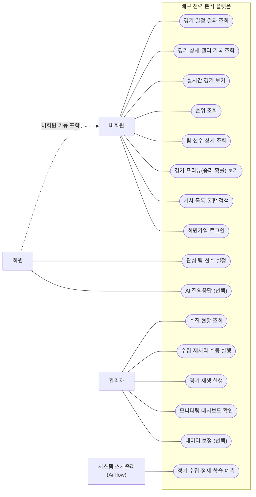

### 4.2 시퀀스 다이어그램: 경기 종료 후 기록 반영 (NFR-13: 1시간 이내)

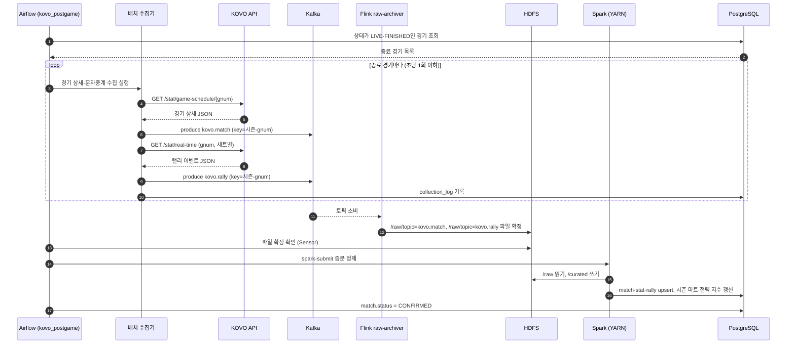

### 4.3 시퀀스 다이어그램: 실시간 경기 (NFR-14: 30초 이내)

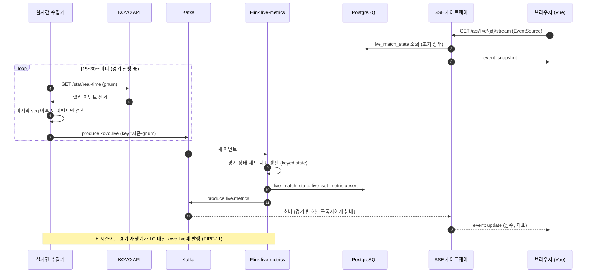

### 4.4 시퀀스 다이어그램: 주간 재학습과 모델 교체

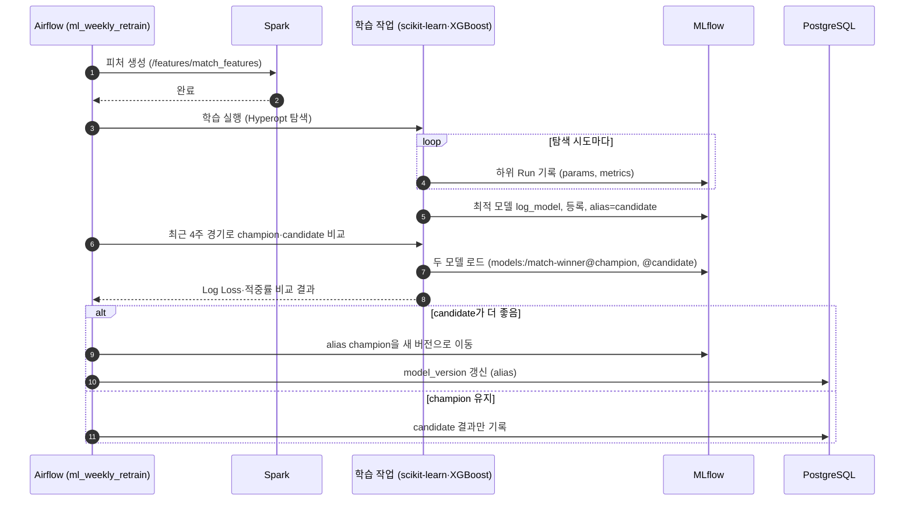

### 4.5 상태 다이어그램: 경기 상태

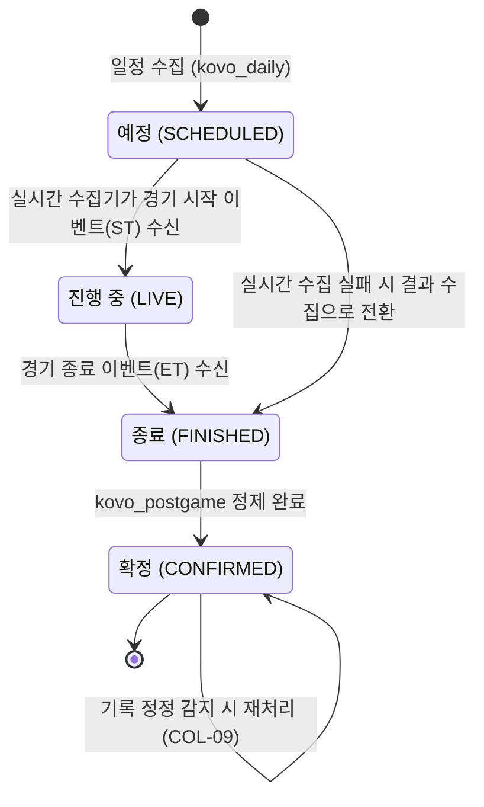

### 4.6 상태 다이어그램: 모델 버전 별칭

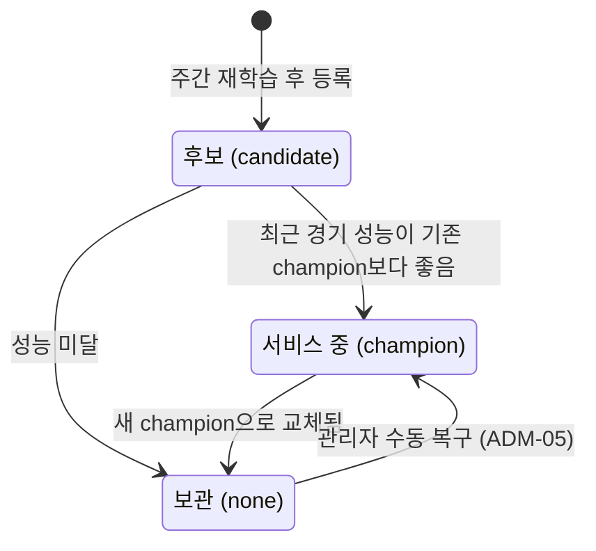

### 4.7 클래스 다이어그램: 수집기 모듈

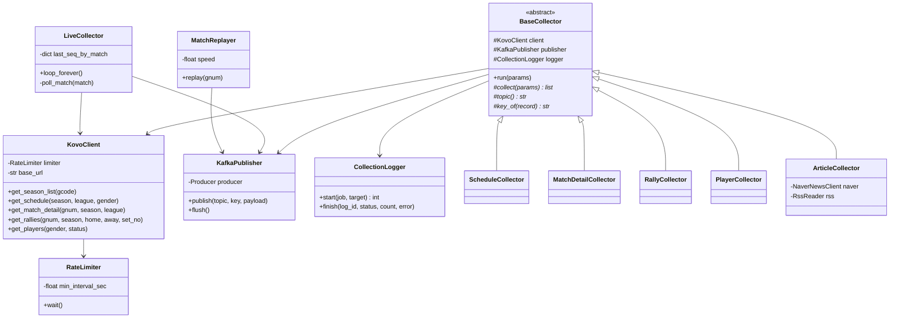

설계 포인트:
- 모든 KOVO 요청은 `KovoClient` 하나를 거치고, `RateLimiter`가 초당 1회 이하를 보장한다 (NFR-01).
- 수집기는 Kafka 발행까지만 책임진다. 저장·가공은 Flink·Spark가 맡는다.
- `LiveCollector`는 경기별 마지막 이벤트 순번(`last_seq_by_match`)을 기억해 새 이벤트만 발행한다. 재시작 시에는 `live_match_state.last_event_seq`에서 복구한다.

---

## 5. 요구사항 반영 필요 사항

설계 중 요구사항 명세서(v0.6)에 없던 결정을 추가했다. 아래 항목은 **요구사항 명세서 v0.7에 반영 완료**했다.

| 항목 | 설계 결정 | 반영 위치 |
|---|---|---|
| Kafka 토픽 추가 | `live.metrics`(Flink → SSE 게이트웨이), `ops.collection-log`(수집 이력) | 요구사항 2.5절 |
| Flink 역할 추가 | `raw-archiver`가 Kafka → HDFS 원천 적재를 담당 (PIPE-03 구현 주체) | 요구사항 2.8절, PIPE-03 |
| 실시간 전달 방식 | SSE 게이트웨이(Django ASGI)가 Kafka `live.metrics`를 구독해 브라우저로 전달 | 요구사항 9장 6번(SSE 확정) |
| Airflow 실행기 | LocalExecutor 사용 (Celery·Redis 미사용으로 자원 절약) | 요구사항 2.2절 |
| 데이터 마트 테이블 | `team_season_summary`, `player_season_summary` 추가 | 요구사항 6.1절 |
| 경기 상태 확정 단계 | `CONFIRMED` 상태 추가 (정제 완료 기준) | 요구사항 6.1절 Match |
| 메모리 계획 | 서비스별 메모리 상한 합계 약 26GB | 요구사항 7장 |
