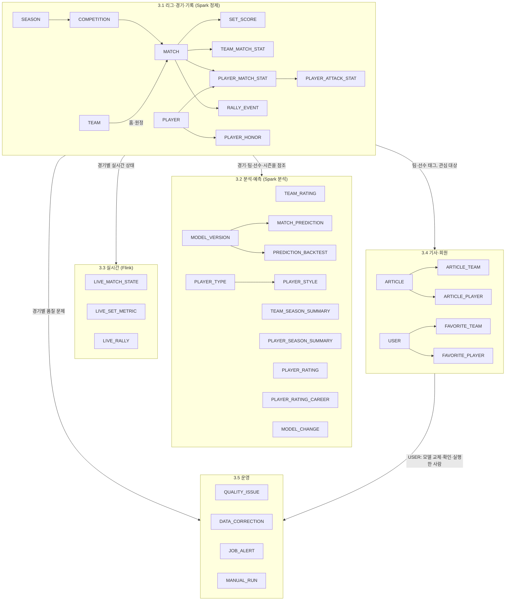
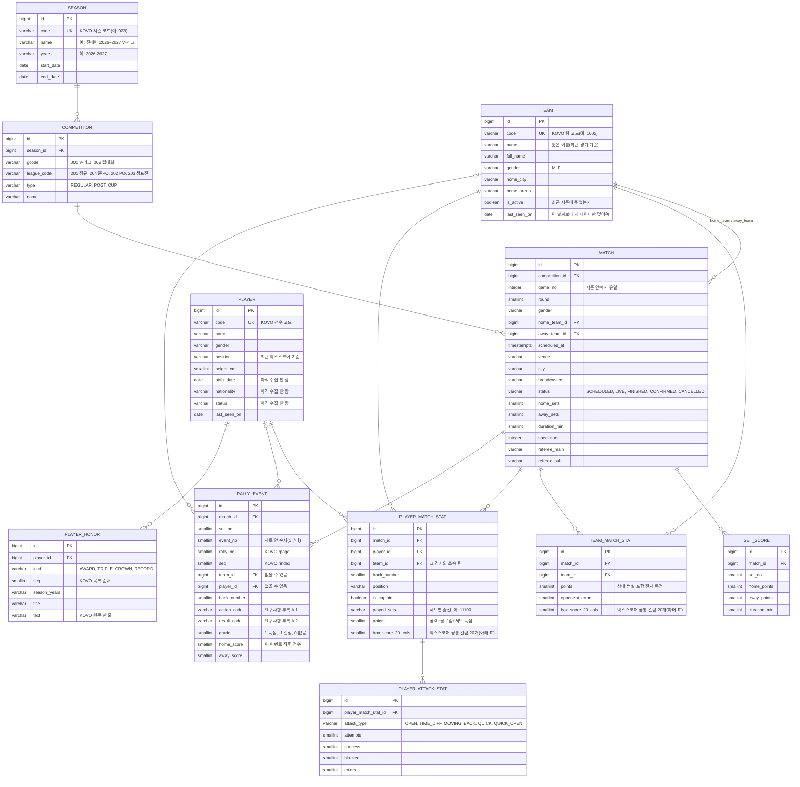
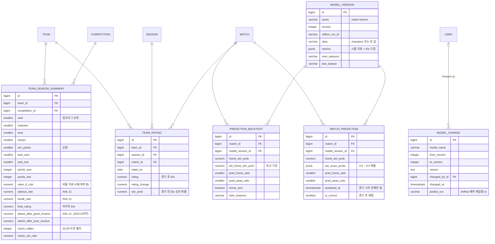
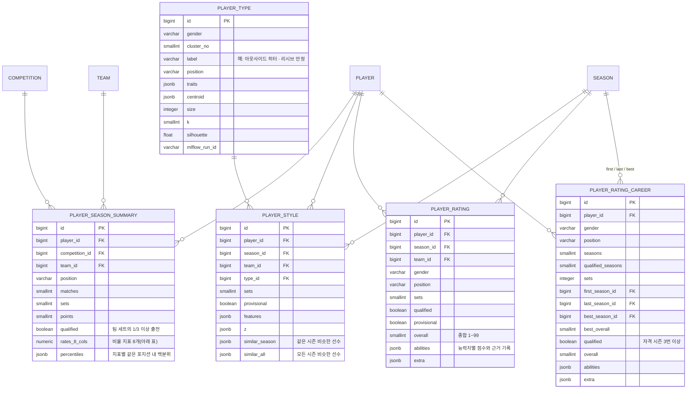
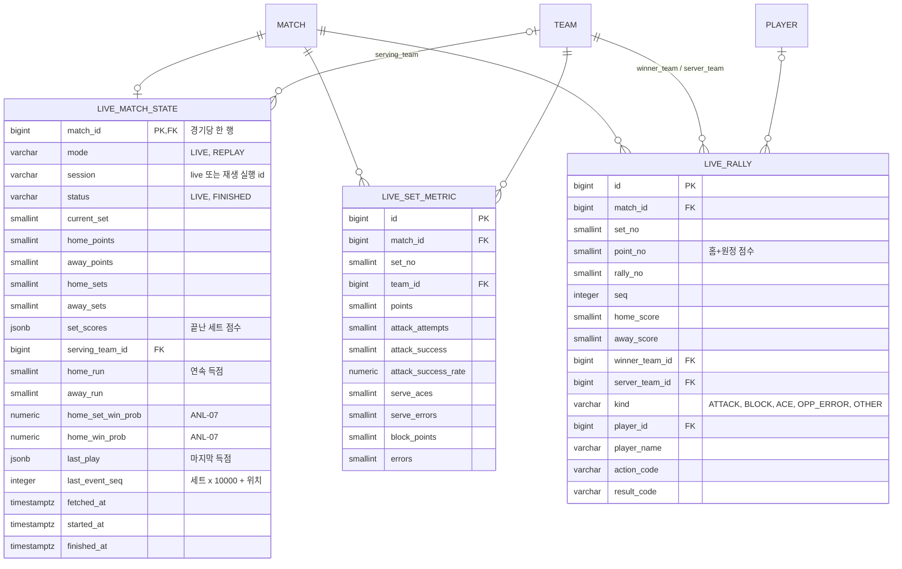
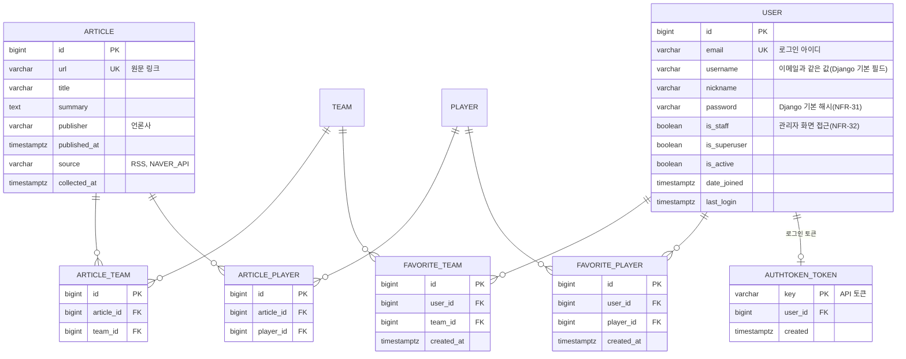
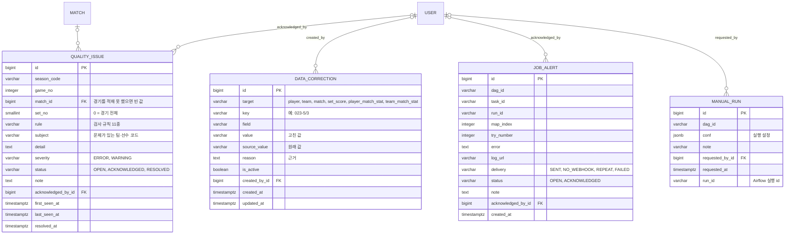

# ERD (현재 구현 기준)

- 작성일: 2026-11-16 / 기준: 실제 코드 `backend/*/models.py`(Django 마이그레이션이 관리하는 스키마)
- 대상: 서비스 DB(PostgreSQL `service`)의 테이블 35개(리그·경기·기록 11, 분석·예측 11, 실시간 3, 기사·회원 6, 운영 4) + 로그인 토큰 테이블. Django 자체 테이블(`django_*`, `auth_*` 권한 그룹)은 뺐다. 4장에 PostgreSQL 밖의 저장소(HDFS, Elasticsearch, MLflow)를 따로 적었다.
- [설계서 2장](design.md#2-erd)의 ERD는 2026-11-02 초안이다. 무엇이 바뀌었는지는 5장에 정리했다.
- 관련 문서: [요구사항 명세서](requirements.md), [설계서](design.md), [화면 설계서](screen-spec.md). 제출용 Word: `배구_전력분석_ERD_v1.0.docx`
- 다이어그램 원본은 Markdown 문서(`docs/erd.md`)의 Mermaid 코드다. 인쇄·Word용 그림 파일은 [images/diagrams/](images/diagrams/)(`erd-*.png`, 2배 해상도)

## 목차

1. [공통 규칙](#1-공통-규칙)
2. [전체 관계도](#2-전체-관계도)
3. [도메인별 ERD와 테이블 정의](#3-도메인별-erd와-테이블-정의)
   - 3.1 [리그·경기·기록](#31-리그경기기록)
   - 3.2 [분석·예측](#32-분석예측)
   - 3.3 [실시간](#33-실시간)
   - 3.4 [기사·회원](#34-기사회원)
   - 3.5 [운영](#35-운영)
4. [PostgreSQL 밖의 저장소](#4-postgresql-밖의-저장소)
5. [초안(설계서 2장) 대비 바뀐 점](#5-초안설계서-2장-대비-바뀐-점)

---

## 1. 공통 규칙

| 항목 | 규칙 |
|---|---|
| 기본 키 | 모든 테이블이 `id bigint`(자동 증가). 예외: `live_match_state`는 `match_id`가 기본 키(경기당 한 행) |
| 자연 키 | 시즌·팀·선수는 KOVO 코드(`code`)가 유일 키. 경기는 (대회, 경기 번호)로 유일하고, 화면·API에서는 `시즌 코드-경기 번호`(예: `023-22`)로 부른다. DB를 다시 만들어도 바뀌지 않는 값으로 찾기 위해서다 |
| 공통 컬럼 | 파이프라인이 쓰는 테이블(`PipelineModel`을 상속한 테이블, 아래 표에서 ●)은 `created_at`, `updated_at`(timestamptz, DB 기본값 `now()`)을 가진다. 병합 SQL이 upsert할 때마다 `updated_at`을 바꾼다 |
| 쓰는 쪽 | 대부분의 테이블은 Django가 아니라 **Spark·Flink가 SQL로 직접 쓴다**. 웹 앱(Django)은 읽기만 한다. 웹 앱이 쓰는 테이블은 회원·관심·운영 테이블뿐이다 |
| 스키마 관리 | 테이블 구조는 Django 마이그레이션 하나로만 관리한다. Spark는 같은 구조의 임시 스키마(`staging_*`)에 적재한 뒤 잠금(advisory lock)을 걸고 병합한다 |
| 삭제 규칙 | 경기·시즌을 지우면 딸린 기록이 함께 지워진다(CASCADE). 팀·선수는 기록이 남아 있으면 지울 수 없다(PROTECT). 회원이 탈퇴하면 관심 목록은 지워지고, 운영 기록의 "처리한 사람"은 비운다(SET_NULL) |
| 코드 값 | 성별 `M` 남자부 / `F` 여자부. 포지션 `OH` 아웃사이드 히터, `OP` 아포짓, `MB` 미들 블로커, `S` 세터, `L` 리베로 |

자료형 표기: `varchar(n)` 글자, `smallint`·`integer` 정수(대부분 0 이상만 허용), `numeric(p,s)` 소수, `jsonb` JSON, `timestamptz` 날짜·시각, `date` 날짜, `boolean` 참·거짓.

## 2. 전체 관계도

도메인(묶음)과 테이블 사이의 큰 관계만 그렸다. 화살표는 "부모 → 자식"(1 대 다)이다. 컬럼과 정확한 관계 기호는 3장의 도메인별 그림에 있다.

| 도메인 | 테이블 | 쓰는 쪽 |
|---|---|---|
| 리그·경기·기록 | season, competition, team, player, player_honor, match, set_score, team_match_stat, player_match_stat, player_attack_stat, rally_event | Spark `curate_kovo.py`, `curate_honors.py` |
| 분석·예측 | team_rating, team_season_summary, player_season_summary, model_version, match_prediction, prediction_backtest, player_type, player_style, player_rating, player_rating_career | Spark `build_marts.py`, `predict_matches.py`, `train_model.py`, `player_types.py`, `player_ratings.py` |
| | model_change | Django 관리자(모델 관리) |
| 실시간 | live_match_state, live_set_metric, live_rally | Flink `live-metrics` |
| 기사·회원 | article, article_team, article_player | Flink `article-enricher` |
| | user, favorite_team, favorite_player, authtoken_token | Django(회원 API) |
| 운영 | quality_issue | Spark `curate_kovo.py`(관리자는 상태만 바꿈) |
| | data_correction, manual_run | Django 관리자 |
| | job_alert | Airflow 실패 콜백(관리자는 확인만 함) |

## 3. 도메인별 ERD와 테이블 정의

### 3.1 리그·경기·기록

KOVO에서 수집한 원천을 Spark가 정제해 채운다. 경기 상태는 `SCHEDULED`(예정) → `LIVE`(진행 중) → `FINISHED`(결과 있음) → `CONFIRMED`(박스스코어·문자중계 적재와 품질 검사 통과) 순서로 바뀐다. 시리즈가 일찍 끝나 열리지 않은 경기는 `CANCELLED`가 된다.

| 테이블 | ● | 설명 | 유일 키 · 색인 | 외래 키 삭제 규칙 |
|---|---|---|---|---|
| `season` | ● | 시즌. 최신 시즌부터 정렬 | UK `code` | |
| `competition` | ● | 시즌 안의 대회(정규리그, 포스트시즌 라운드, 컵대회) | UK (`season`, `gcode`, `league_code`) | season CASCADE |
| `team` | ● | 팀. 후원사가 바뀌면 이름이 바뀌므로, 백필이 옛 이름으로 덮어쓰지 않게 `last_seen_on`보다 새 데이터만 반영 | UK `code` | |
| `player` | ● | 선수. 생년·국적·상태는 컬럼만 있고 아직 수집하지 않음(관리자 보정으로 채울 수 있음) | UK `code` | |
| `player_honor` | ● | 수상·트리플크라운·기준 기록 달성(COL-04). 실행마다 선수별로 전체 교체 | UK (`player`, `kind`, `seq`) | player CASCADE |
| `match` | ● | 경기 | UK (`competition`, `game_no`) · IX `scheduled_at`, (`home_team`, `scheduled_at`), (`away_team`, `scheduled_at`), `status` | competition CASCADE, 팀 PROTECT |
| `set_score` | ● | 세트 점수와 세트 시간 | UK (`match`, `set_no`) | match CASCADE |
| `team_match_stat` | ● | 경기 × 팀 기록 | UK (`match`, `team`) · IX `team` | match CASCADE, team PROTECT |
| `player_match_stat` | ● | 경기 × 선수 기록. 선수의 소속 이력은 이 테이블의 `team_id`로 알 수 있다 | UK (`match`, `player`) · IX (`player`, `match`) | match CASCADE, player·team PROTECT |
| `player_attack_stat` | ● | 선수 기록의 공격 종류별 세부(오픈, 시간차, 이동, 후위, 속공, 퀵오픈) | UK (`player_match_stat`, `attack_type`) | CASCADE |
| `rally_event` | ● | 문자중계 이벤트 하나(서브, 리시브, 공격, 득점, 교체 등). 점수는 Spark가 누적 계산 | UK (`match`, `set_no`, `event_no`) · IX (`match`, `set_no`), `player` | match CASCADE, 팀·선수 PROTECT |

**박스스코어 공통 컬럼 20개** (`team_match_stat`, `player_match_stat`이 함께 씀, 모두 `smallint`, 기본값 0)

| 묶음 | 컬럼 (KOVO 필드) |
|---|---|
| 공격 | `attack_attempts`(att) 시도, `attack_success`(ats) 성공, `attack_blocked`(atf) 상대 블로킹에 막힘, `attack_errors`(ate) 범실 |
| 서브 | `serve_attempts`(st) 시도, `serve_aces`(ss) 에이스, `serve_errors`(sf) 범실 |
| 블로킹 | `block_attempts`(bt) 시도, `block_success`(bs) 성공, `block_effective`(blkvb) 유효, `block_assist`(blkas) 어시스트 |
| 리시브 | `receive_attempts`(rt) 시도, `receive_excellent`(rs) 정확, `receive_errors`(rf) 실패 |
| 디그 | `dig_attempts`(dt) 시도, `dig_success`(ds) 성공 |
| 세트(토스) | `set_attempts`(sett) 시도, `set_success`(sets) 성공 |
| 기타 | `errors`(err) 범실 합계, `warnings`(warning) 경고 |

### 3.2 분석·예측

Spark 분석 작업의 결과(데이터 마트)다. 웹 앱은 읽기만 한다. `model_change`만 관리자 화면이 쓴다.

그림은 팀·예측 모델(3.2a)과 선수 분석(3.2b) 두 장으로 나눴다.

**3.2a 팀·예측 모델**

**3.2b 선수 분석**

| 테이블 | ● | 설명 (요구사항) | 유일 키 · 색인 | 쓰는 작업 |
|---|---|---|---|---|
| `team_rating` | ● | 경기마다 팀 Elo. 시즌 첫 경기 전에 1500 쪽으로 절반 되돌림 (ANL-01) | UK (`team`, `match`) · IX (`team`, `rated_on`) | `build_marts.py` |
| `team_season_summary` | ● | 팀 × 대회 요약: 승패·승점·세트·점수, 순위, 지표, 사이드아웃·브레이크율, 상황별 효율 (ANL-02, 11) | UK (`team`, `competition`) · IX (`competition`, `rank`) | `build_marts.py` |
| `player_season_summary` | ● | 선수 × 대회 × 팀 요약과 포지션 내 백분위 (ANL-05) | UK (`player`, `competition`, `team`) · IX `competition` | `build_marts.py` |
| `model_version` | ● | MLflow 모델 버전을 서비스 DB에 옮겨 적은 것(화면이 MLflow 없이 읽도록) (ANL-09) | UK (`name`, `version`) | `predict_matches.py`, `train_model.py` |
| `match_prediction` | ● | 경기 전 예측. 경기 시작 전까지만 쓰고, 결과가 나오면 `is_correct`만 채운다 (ANL-03, 10) | UK (`match`, `model_version`) · IX (`match`, `-predicted_at`) | `predict_matches.py` |
| `prediction_backtest` | ● | 각 시즌을 그 이전 시즌들로만 학습한 모델로 예측한 결과 (ANL-10) | UK (`match`, `model_version`) | `train_model.py` |
| `player_type` | ● | 성별마다 K-means 유형 그룹. 실행마다 전체 교체 (ANL-06) | UK (`gender`, `cluster_no`) | `player_types.py` |
| `player_style` | ● | 선수 × 시즌의 유형과 비슷한 선수 (ANL-06, WEB-07) | UK (`player`, `season`) | `player_types.py` |
| `player_rating` | ● | 시즌 능력치 카드. 60 = 같은 성별·포지션 평균, 12점 = 표준편차 1 | UK (`player`, `season`) · IX (`season`, `gender`, `position`) | `player_ratings.py` |
| `player_rating_career` | ● | 포지션별 통산 카드 | UK (`player`, `position`) · IX (`gender`, `position`) | `player_ratings.py` |
| `model_change` | | 관리자가 서비스 모델(`champion`)을 바꾼 기록: 누가, 왜 (ADM-05) | | Django 관리자 |

**비율 지표 8개** (`team_season_summary`, `player_season_summary`가 함께 씀, `numeric`, 시도가 없으면 NULL): `attack_success_rate` 공격 성공률, `attack_efficiency` 공격 효율, `receive_efficiency` 리시브 효율, `block_per_set`·`serve_per_set`·`dig_per_set`·`set_per_set`·`error_per_set` 세트당 블로킹·서브·디그·세트·범실.

### 3.3 실시간

Flink `live-metrics`만 upsert로 쓰고, 웹 앱과 SSE 게이트웨이는 읽기만 한다. 실제 경기(`mode = LIVE`)와 끝난 경기의 재생(`REPLAY`)을 `mode`로 구별한다. 경기가 `CONFIRMED`가 되면 경기 화면은 공식 기록(`rally_event`, `team_match_stat`)을 쓰고, 이 행들은 마지막 실시간 상태로 남는다.

| 테이블 | ● | 설명 | 유일 키 · 색인 |
|---|---|---|---|
| `live_match_state` | ● | 경기당 한 행: 지금 점수·세트·서브권·연속 득점·승리 확률·마지막 득점. 실시간 화면의 스코어보드. 수집기가 재시작하면 `last_event_seq`부터 이어 받는다 | PK `match_id` · IX (`status`, `updated_at`) |
| `live_set_metric` | ● | 세트 × 팀 지표(득점, 공격 성공률, 서브, 블로킹, 범실) | UK (`match`, `set_no`, `team`) |
| `live_rally` | ● | 득점 하나당 한 행. 점수 흐름 차트와 득점 피드에 쓴다 | UK (`match`, `set_no`, `point_no`) |

### 3.4 기사·회원

기사는 Flink `article-enricher`가 중복을 없애고 팀·선수 태그를 붙여 저장한다(같은 문서를 Elasticsearch `articles`에도 색인). 본문은 저장하지 않는다(NFR-02, 06). 회원 테이블은 Django가 쓰며, 개인정보는 이메일과 닉네임만 받는다(NFR-03).

| 테이블 | ● | 설명 | 유일 키 · 색인 | 삭제 규칙 |
|---|---|---|---|---|
| `article` | ● | 기사 메타데이터(제목, 요약, 언론사, 링크) | UK `url` · IX `-published_at` | |
| `article_team` | | 기사-팀 태그(다대다) | UK (`article`, `team`) · IX (`team`, `article`) | CASCADE |
| `article_player` | | 기사-선수 태그(다대다) | UK (`article`, `player`) · IX (`player`, `article`) | CASCADE |
| `user` | | 회원(Django `AbstractUser` 확장). 그 밖의 Django 기본 컬럼(`first_name`, `last_name`)은 쓰지 않음 | UK `email` | |
| `favorite_team` | | 관심 팀(최대 10개, API에서 제한) (WEB-12) | UK (`user`, `team`) | user·team CASCADE |
| `favorite_player` | | 관심 선수(최대 10명) (WEB-12) | UK (`user`, `player`) | user·player CASCADE |
| `authtoken_token` | | DRF 토큰 인증(Django REST framework 기본 테이블). 로그아웃하면 지움 | PK `key`, UK `user` | user CASCADE |

### 3.5 운영

데이터 품질, 보정, 작업 실패, 수동 실행 기록이다. 관리자 화면에서 본다.

| 테이블 | 설명 (요구사항) | 유일 키 · 색인 | 쓰는 쪽 |
|---|---|---|---|
| `quality_issue` | 품질 검사에 걸린 문제 하나. ERROR 7종이 걸린 경기는 `CONFIRMED`가 되지 못한다 (PIPE-10) | UK (`season_code`, `game_no`, `set_no`, `rule`, `subject`) · IX (`status`, `severity`) | Spark가 쓰고, 관리자는 `status`·`note`만 바꿈 |
| `data_correction` | 정제 데이터 한 행의 필드 하나를 고친 값. 정제 작업이 검사 전에 매번 적용하므로 다시 수집해도 남는다 (ADM-03) | 조건부 UK (`target`, `key`, `field`) — 켜진(`is_active`) 보정만 | Django 관리자 |
| `job_alert` | 재시도를 다 쓰고 최종 실패한 Airflow 작업 (PIPE-09) | IX (`status`, `created_at`), (`dag_id`, `run_id`) | Airflow 실패 콜백, 관리자는 확인만 |
| `manual_run` | 관리자 화면에서 시작한 작업 기록. 실행 자체는 Airflow에 있다 (ADM-02) | | Django 관리자 |

**품질 검사 규칙 11종**

| 심각도 | 규칙 |
|---|---|
| ERROR (경기 확정을 막음) | `SET_COUNT_MISMATCH` 세트 스코어와 세트별 점수 불일치, `MISSING_BOX_SCORE` 선수 기록 없음, `MISSING_RALLY` 문자중계 없음, `RALLY_SCORE_MISMATCH` 문자중계 점수와 공식 점수 불일치, `INVALID_SET_SCORE` 경기 규칙에 맞지 않는 세트 점수, `STAT_RANGE` 성공이 시도보다 많음 등, `MISSING_VALUE` 필수 값 누락 |
| WARNING (보고만 함) | `BOX_SCORE_MISMATCH` 팀 합계와 선수 합 불일치, `POINTS_MISMATCH` 팀 득점과 세트 점수 합 불일치, `PLAYER_POINTS_MISMATCH` 선수 득점과 공격·블로킹·서브 합 불일치, `PLAYER_NAME_MISSING` 선수 이름 없음 |

## 4. PostgreSQL 밖의 저장소

| 저장소 | 위치 | 내용 | 보관 |
|---|---|---|---|
| HDFS 원천 | `/raw/topic={토픽}/dt={날짜}/` | Kafka 메시지 그대로(JSON 한 줄 = 메시지 하나). 토픽: `kovo.schedule`, `kovo.match`, `kovo.rally`, `kovo.live`, `kovo.player`, `news.article`, `ops.collection-log` | 영구(재처리 원천, NFR-22) |
| HDFS 정제 | `/curated/kovo/{테이블}/season_code={시즌}/` | 위 3.1 테이블의 Parquet 사본(다른 Spark 작업의 입력) | 영구 |
| HDFS 피처·마트 | `/features/kovo/match/`, `/marts/kovo/{match_elo, team_rating, team_season_summary, player_season_summary, player_rating}` | 경기별 모델 입력 특징, 경기 전 팀 Elo·선수 Elo(`match_elo`, PostgreSQL에는 없음), 3.2 마트의 Parquet 사본 | 실행마다 교체 |
| Elasticsearch | `articles`(별칭, 지금 `articles-v2`) | 기사 전문 검색(nori 형태소 분석) | 설계: 2년(보관 설정은 아직 없음) |
| | `entities`(별칭, 날짜 붙은 인덱스) | 팀·선수 검색과 자동완성 | 색인할 때마다 교체 |
| | `ops-collection-*` | 수집 실행 기록(COL-08). 관리자 "수집 현황"이 읽음 | 월별 인덱스 |
| | `logs-volley-*`, `metrics-volley*` | 모든 서비스 로그(Filebeat), 지표(Metricbeat) | 설계: 30일(보관 설정은 아직 없음) |
| PostgreSQL `airflow` | Airflow 메타데이터 | DAG 실행 기록 | Airflow 관리 |
| PostgreSQL `mlflow` + 볼륨 `mlflow-artifacts` | MLflow 실험·모델 레지스트리 | `match-winner` 모델 버전, `player-types` 실험 | 영구 |

## 5. 초안(설계서 2장) 대비 바뀐 점

| 구분 | 테이블 | 내용 |
|---|---|---|
| 초안에 있었지만 만들지 않음 | `player_team_history` | 선수의 소속은 경기 기록(`player_match_stat.team_id`)으로 알 수 있어 따로 두지 않았다. 입단·이적 날짜는 KOVO 경기 API에 없다 |
| | `ai_preview` | ANL-12(AI 프리뷰) 미구현. LLM 결정 대기([llm-options.md](llm-options.md)) |
| | `collection_log` | 수집 실행 기록은 DB 대신 Kafka `ops.collection-log` → Elasticsearch `ops-collection-*`와 HDFS에 남긴다 |
| 새로 생김 | `player_honor` | 수상·주요 기록(COL-04, 2026-11-11) |
| | `prediction_backtest` | 워크포워드 백테스트(ANL-10) |
| | `player_type`, `player_style` | 선수 유형과 비슷한 선수(ANL-06) |
| | `player_rating`, `player_rating_career` | 포지션별 능력치 카드(시즌·통산) |
| | `model_change` | 관리자의 서비스 모델 교체 기록(ADM-05) |
| | `live_rally` | 득점 하나하나의 흐름(실시간 화면의 점수 흐름·득점 피드) |
| | `quality_issue`, `data_correction`, `job_alert`, `manual_run` | 데이터 품질·보정·실패 알림·수동 실행(PIPE-09, 10, ADM-02, 03) |
| | `authtoken_token` | 로그인 토큰(Django REST framework) |
| 이름·구조 변경 | `user` | Django 기본 사용자를 확장(`email` 유일, `nickname` 추가) |
| | `team_season_summary` | 상황별 효율(리시브 품질별 공격, 접전 랠리) 컬럼 추가(ANL-11) |
| | `model_version` | 별칭은 `champion`만 실제로 쓴다(재학습이 이긴 설정을 바로 `champion`으로 등록) |
