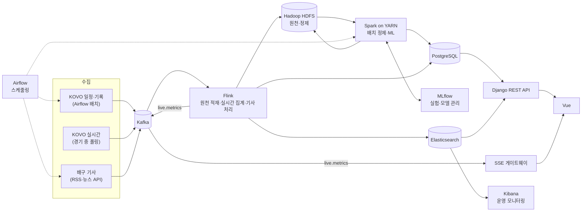

# 배구 전력 분석 플랫폼 요구사항 명세서 (초안)

| 항목 | 내용 |
|---|---|
| 문서 버전 | v0.7 (초안) |
| 작성일 | 2026-11-02 |
| 상태 | 검토 중. 미결정 사항은 [9. 미결정 사항](#9-미결정-사항)에 정리 |

| 버전 | 변경 내용 |
|---|---|
| v0.1 | 최초 작성 |
| v0.2 | 1차 범위를 국내(KOVO)로 확정. 해외 리그 데이터 출처 검토 결과를 [10. 향후 확장](#10-향후-확장-해외-리그-데이터)에 추가 |
| v0.3 | KOVO 사이트 코드 분석 결과 반영: 데이터 출처표(4.1.1), 랠리 단위 기록 수집(COL-10), 사이드아웃·브레이크 분석(ANL-11), 데이터 규모 추정, 문자중계 코드표(부록 A) |
| v0.4 | 과거 시즌·선수 기록 출처 확인 결과 반영: 시즌 코드 범위, 주요 기록 API, 선수 통산·수상 기록, 수집 제외 사이트(archive, dbbank) |
| v0.5 | SSAFY 정리노트(노션) 강의 내용을 바탕으로 기술 스택 보강: 관련 강의 매핑(2.2), 람다 아키텍처(2.4), Kafka 설계(2.5), MLflow 모델 관리(2.6), 제외 기술(2.7), LLM 선택 기능(ANL-12, WEB-15) |
| v0.6 | Airflow·Hadoop·Spark·Flink·Elasticsearch·Kibana 필수 적용 확정: 기술별 적용 범위와 완료 기준(2.8), 실시간 처리 필수화(COL-06, PIPE-06, WEB-04), 경기 재생 기능(PIPE-11), Hadoop YARN 추가, 단계별 계획 조정 |
| v0.7 | 설계서 v0.1 결정 반영: Kafka 토픽 추가(`live.metrics`, `ops.collection-log`), Flink `raw-archiver`의 HDFS 원천 적재(PIPE-03), SSE 게이트웨이 확정, Airflow LocalExecutor, 데이터 마트·실시간 테이블과 경기 확정 상태 추가, 메모리 계획 |

---

## 1. 개요

### 1.1 목적
한국 프로배구(V-리그) 데이터를 수집하고, 머신러닝 기반 전력 분석 결과와 경기 일정·정보·기사를 한곳에서 제공하는 웹 서비스를 만든다.

### 1.2 범위
| 구분 | 포함 | 제외 |
|---|---|---|
| 데이터 | V-리그 남녀부 정규시즌·포스트시즌, KOVO컵 경기 일정/결과/기록, 국내 배구 기사 | 유소년 대회, 해외 리그(2차 확장 시 도입, [10장](#10-향후-확장-해외-리그-데이터) 참고) |
| 분석 | 팀 전력 지수, 경기 결과 예측, 선수 유형 분석, 실시간 경기 지표 | 영상 분석(추후 확장) |
| 서비스 | 웹사이트(PC/모바일 반응형) | 네이티브 앱, 티켓 예매, 유료 기능 |

### 1.3 용어
| 용어 | 설명 |
|---|---|
| 원천 데이터(Raw) | 수집한 그대로의 JSON/HTML. 가공하지 않고 보관 |
| 정제 데이터(Curated) | 중복 제거, 형식 통일, 결측 처리를 마친 데이터 |
| 서빙 데이터 | 웹에서 바로 조회하도록 RDB에 적재한 데이터 |
| 전력 지수 | 팀의 현재 경기력을 나타내는 점수 (예: Elo 레이팅) |
| 배치 / 스트리밍 | 정해진 주기에 모아서 처리 / 들어오는 즉시 처리 |

---

## 2. 시스템 구성

### 2.1 아키텍처 개요

그림 외 보조 구성 요소: Hadoop YARN(Spark 작업 자원 관리), Filebeat(로그 수집). 구성 요소별 상세 설계는 설계서 1장([design.md](design.md))을 따른다.

### 2.2 기술 스택과 역할

"관련 강의"는 팀의 SSAFY 정리노트(노션)에서 해당 기술을 다룬 강의다. "없음"인 기술은 정리노트에 아직 없어 별도 학습이 필요하다 ([9장](#9-미결정-사항) 11번). 정리노트 수록 여부와 관계없이 **Airflow, Hadoop, Spark, Flink, Elasticsearch, Kibana는 필수로 적용**하며, 기술별 적용 범위와 완료 기준은 [2.8절](#28-핵심-데이터-기술-필수-적용-범위)에 정리한다.

| 영역 | 기술 | 역할 | 관련 강의 |
|---|---|---|---|
| 개발 환경 | Ubuntu 24.04(WSL), Docker, Docker Compose | 전체 구성 요소를 컨테이너로 실행. Kafka·Spark 등은 리눅스 환경에서 운영 | 데이터 파이프라인과 리눅스(WSL), Docker 개념 및 활용 |
| 워크플로 | Airflow (LocalExecutor) | 수집 작업, Spark 배치, 모델 재학습·예측을 주기적으로 실행하고 실패 시 재시도·알림. Celery·Redis 없이 LocalExecutor로 실행해 자원 절약 | 없음 |
| KOVO 수집 | Python requests, asyncio·aiohttp | KOVO JSON API를 주기적으로 조회(Polling). 경기 중에는 여러 경기를 비동기로 동시에 수집 | 데이터사이언스 - 데이터 수집(OPEN API, 실시간 Polling), 파이썬 - 제너레이터와 비동기, 관통PJT-01 |
| 기사 수집 | 네이버 뉴스 검색 API, feedparser(RSS), 정규식 | 기사 메타데이터 수집, 제목에서 팀·선수명을 찾아 태그 | 데이터사이언스 - 데이터 수집(OPEN API), 파이썬 - Regex와 NumPy |
| 메시지 큐 | Kafka(KRaft 모드), confluent-kafka | 수집기와 처리 계층 분리. 설계는 2.5절 | Kafka 기초 개념 및 세팅, Kafka의 프로듀서와 컨슈머, Kafka 최적화 |
| 스트림 처리 | Flink | Kafka 전체 토픽의 HDFS 원천 적재(`raw-archiver`), 경기 중 세트별 지표·연속 득점 흐름·실시간 승리 확률 계산(`live-metrics`), 기사 스트림의 중복 제거·태깅(`article-enricher`) | 없음 |
| 실시간 전달 | Django ASGI SSE 게이트웨이 | Kafka `live.metrics`를 구독해 진행 경기 지표를 브라우저에 Server-Sent Events로 전달 | 없음 |
| 배치 처리 | Spark(PySpark) | 원천 데이터 정제, 랠리 단위 기록을 경기·선수 단위 피처로 집계 | 없음 |
| 데이터 레이크·자원 관리 | Hadoop (HDFS, YARN) | HDFS: 원천·정제 데이터를 시즌·날짜별로 장기 보관(Parquet) / YARN: Spark 작업 자원 관리 | 데이터 파이프라인(데이터 레이크) |
| 탐색적 분석 | pandas, NumPy, matplotlib·seaborn, Jupyter | 피처 탐색, 분포·상관 분석, 모델 결과 검증 | AI 파이썬 II(데이터 다루기), AI 파이썬 III(데이터 시각화), 통계 기초 |
| 머신러닝 | scikit-learn, XGBoost, Spark MLlib | 경기 예측(로지스틱 회귀·랜덤 포레스트·XGBoost 비교), 선수 유형 군집(K-means), 표준화·규제로 과적합 방지 | AI & 기계학습 기초·방법론, 머신러닝 알고리즘1·2 |
| ML 실험·모델 관리 | MLflow(Tracking, Model Registry), Hyperopt | 실험 기록, 하이퍼파라미터 튜닝, champion·candidate 모델 관리. 설계는 2.6절 | MLFlow 기본 개념과 세팅, MLFlow를 활용한 실험 환경 구축 |
| 서빙 DB | PostgreSQL (권장) | 웹 조회용 데이터 마트, MLflow 메타데이터 저장 | DB 기초, SQL 기본, SQL 심화(윈도 함수로 순위·최근 N경기 집계) |
| 검색 | Elasticsearch | 기사 전문 검색(한글 형태소 분석기 nori), 선수·팀 통합 검색 | 없음 |
| 모니터링 | Kibana | 수집 성공률, 파이프라인 지연, 오류 로그 대시보드 (관리자용) | 없음 |
| 백엔드 | Django, Django REST Framework | 모델·ORM·Serializer로 REST API 구성, 팀-선수-경기 관계 모델링, 회원 인증 | Django - Web Framework, Model & ORM & Serializer, Relationships, Authentication |
| 프론트엔드 | Vue 3, Vite, Vue Router, Pinia, axios | 컴포넌트 기반 화면, 전역 상태 관리(관심 팀, 로그인 정보), 비동기 API 호출 | Vue, Vue - Syntax, Component State Flow, State Management, Javascript - AJAX |
| 차트 | Chart.js 또는 Apache ECharts | 전력 지수 추이, 레이더 차트, 승리 확률 그래프 | 없음 (시각화 원칙은 AI 파이썬 III) |
| LLM (선택) | LangChain, LLM API | AI 경기 프리뷰 작성(ANL-12), 데이터 질의응답(WEB-15) | AI 파이썬 I(API·JSON·LLM), AI LangChain, AI Agent |
| 협업 | Git, 브랜치 전략 | 기능별 브랜치, 코드 리뷰 | GIT |

### 2.3 DB 선택: PostgreSQL 권장
| 기준 | PostgreSQL | MySQL |
|---|---|---|
| 분석용 SQL (윈도 함수, CTE) | 강함 | 지원하지만 기능이 적음 |
| JSON 저장·조회 (원천 기록 일부 보관) | JSONB 타입과 인덱스 지원 | JSON 타입 지원, 인덱스 제약 있음 |
| Django 지원 | ArrayField, JSONField 등 전용 기능 제공 | 기본 기능 지원 |
| Spark 연동 | JDBC 지원 | JDBC 지원 |

통계 집계와 분석 결과 저장이 많은 서비스라 PostgreSQL이 더 적합하다. 팀이 MySQL에 더 익숙하다면 MySQL로도 요구사항을 모두 충족할 수 있다. MLflow도 운영 환경 메타데이터 저장소로 PostgreSQL·MySQL을 지원하므로 같은 DB 서버를 함께 쓸 수 있다.

### 2.4 파이프라인 구조: 람다 아키텍처

배치 처리와 실시간 처리를 함께 쓰는 람다 아키텍처를 따른다. 원천 데이터를 먼저 저장한 뒤 가공하는 ELT 방식을 써서, 가공 로직이 바뀌어도 원천부터 다시 처리할 수 있게 한다(PIPE-08).

| 계층 | 구성 | 처리 내용 |
|---|---|---|
| 배치 레이어 | Airflow → 수집기 → Kafka → HDFS(원천) → Spark → HDFS(정제·피처) → 모델 학습·예측 | 일정·결과·경기 기록·랠리 기록을 하루 단위로 확정 처리 |
| 스피드 레이어 | 실시간 수집기 → Kafka(`kovo.live`) → Flink | 진행 중인 경기의 점수, 세트별 지표, 실시간 승리 확률. 경기가 없는 기간에는 종료 경기를 재생(PIPE-11)해 같은 경로로 처리 |
| 서빙 레이어 | PostgreSQL(데이터 마트) → Django REST API → Vue / Kafka `live.metrics` → SSE 게이트웨이 → Vue | 화면별로 필요한 데이터만 모은 테이블을 조회하고, 진행 경기 지표는 SSE로 전달. 경기가 끝나 배치 결과가 반영되면(경기 상태 `CONFIRMED`) 실시간 데이터를 확정 기록으로 대체 |

### 2.5 Kafka 설계

| 토픽 | 메시지 키 | 생산자 | 소비자 |
|---|---|---|---|
| `kovo.schedule` | 시즌 코드 | 일정 수집기 | Flink `raw-archiver`(HDFS 적재) |
| `kovo.match` | 시즌-경기 번호 (예: `022-3`) | 경기 상세 기록 수집기 | Flink `raw-archiver` |
| `kovo.rally` | 시즌-경기 번호 | 문자중계 수집기(종료 경기) | Flink `raw-archiver` |
| `kovo.live` | 시즌-경기 번호 | 실시간 수집기, 경기 재생기(HDFS 원천을 다시 발행) | Flink `live-metrics`, Flink `raw-archiver` |
| `news.article` | 기사 URL | 기사 수집기 | Flink `article-enricher`(중복 제거·태깅 후 Elasticsearch 색인), Flink `raw-archiver` |
| `live.metrics` | 시즌-경기 번호 | Flink `live-metrics` | SSE 게이트웨이 |
| `ops.collection-log` | 작업 이름 | 모든 수집기 | Flink `raw-archiver` (수집 이력 보관) |

| 항목 | 설정 | 이유 |
|---|---|---|
| 파티셔닝 | 경기 번호를 키로 사용 | 같은 경기 이벤트가 같은 파티션에 들어가 랠리 순서가 보장된다. 키 기반이므로 파티션 수는 처음 정한 뒤 바꾸지 않는다 |
| 프로듀서 신뢰성 | `acks=all`, `enable.idempotence=true` | 메시지 유실과 중복 저장 방지 |
| 압축 | `compression.type=lz4` | 압축률과 CPU 사용의 균형 |
| 직렬화 | JSON | 개발·디버깅이 쉬움. 데이터가 커지면 Avro 전환 검토 |
| 컨슈머 커밋 | 수동 커밋(N건 처리 후 마지막 offset 커밋) | 안정성과 효율의 균형 |
| 시작 위치 | 적재 컨슈머 `earliest`, Flink `latest` | 적재는 빠짐없이, 실시간 처리는 최신 데이터부터 |
| 보관 | `log.retention` 7일 | 장기 보관은 HDFS가 담당 |
| 클러스터 | 개발: 단일 브로커(KRaft 모드, `replication.factor=1`) / 운영: 브로커 3대, `min.insync.replicas=2` | 개발 자원 절약, 운영 시 장애 대비 |

### 2.6 ML 실험·모델 관리 (MLflow)

| 항목 | 내용 |
|---|---|
| Experiment | `match-winner`(경기 결과 예측), `player-type`(선수 유형 군집) |
| Run 기록 | params: 피처 세트, 하이퍼파라미터, 학습 시즌 범위 / metrics: 정확도, Log Loss, Brier Score / tags: 데이터 기준일 / artifacts: 혼동 행렬, 피처 중요도 그래프 |
| 튜닝 | Hyperopt로 탐색하고 각 시도를 하위 Run(Nested Run)으로 기록 |
| 모델 레지스트리 | 서비스 모델은 `champion`, 검증 중인 모델은 `candidate` 별칭(alias)으로 관리. 재학습 모델은 `candidate`로 등록하고, 최근 경기 예측 성능이 더 좋으면 `champion`으로 교체 |
| 예측 방식 | 별도 모델 서버 없이 Airflow 배치가 `champion` 모델을 불러와 예정 경기를 예측하고 PostgreSQL에 저장. Django는 저장된 예측을 조회만 한다 (경기 전날 1회 예측으로 충분) |
| 저장소 | 메타데이터: PostgreSQL(`mlflow` DB) / 모델 파일: 로컬 볼륨(확장 시 HDFS 또는 오브젝트 스토리지) |

### 2.7 정리노트에 있지만 이번 프로젝트에서 쓰지 않는 기술

| 기술 | 제외 이유 |
|---|---|
| Selenium | KOVO가 JSON API로 데이터를 제공해 브라우저 자동화가 필요 없고, 서버 부하만 커진다 |
| BeautifulSoup | KOVO 데이터는 JSON이고 기사 본문은 수집하지 않는다. HTML 파싱이 필요해지면 그때 사용 |
| 이미지 딥러닝·이미지 파운데이션 모델 | 영상 분석은 1차 범위 밖 (추후 확장) |
| LLM 파인튜닝 | 학습 데이터·GPU 비용 대비 효과가 작다. 프롬프트와 DB 조회로 충분 |
| Avro 직렬화 | 초기에는 JSON으로 충분. 데이터가 커지면 검토 |

### 2.8 핵심 데이터 기술 필수 적용 범위

아래 6개 기술은 MVP에 필수로 포함한다. 각 기술은 아래 완료 기준을 만족해야 적용된 것으로 본다.

| 기술 | 필수 적용 범위 | 관련 요구사항 | 완료 기준 | 적용 단계 |
|---|---|---|---|---|
| Airflow | 모든 배치 작업 스케줄링: 일정·결과 수집(매일), 경기 종료 후 기록·랠리 수집, Spark 정제·집계, 주 1회 모델 재학습, 경기 전날 예측, 기사 수집 | PIPE-01, PIPE-09, COL-02~05, COL-07, COL-10, ANL-09 | 수집 → 적재 → 정제 → 분석 → 서빙 DB 반영이 DAG로 자동 실행되고, 실패 시 재시도·알림이 동작 | 1단계 |
| Hadoop | HDFS: 원천(JSON)·정제(Parquet) 데이터 레이크 / YARN: Spark 작업 자원 관리 | PIPE-03, PIPE-04, PIPE-08, NFR-22 | 모든 수집 데이터가 HDFS 원천 경로에 쌓이고, Spark 작업이 YARN 위에서 실행됨 | 1단계 |
| Spark | 원천 정제, 랠리 → 경기·선수 단위 피처 집계, 서빙용 데이터 마트 생성, Spark MLlib 기준 모델 | PIPE-04, PIPE-05, PIPE-08, ANL-01~05, ANL-11 | 원천에서 피처·데이터 마트까지 Spark 작업으로 생성되고, 시즌 단위 재처리가 가능 | 1단계 |
| Elasticsearch | 기사 전문 검색(nori), 선수·팀 통합 검색과 자동완성, 전 구성 요소 로그 저장 | PIPE-07, WEB-09, WEB-10, NFR-12, NFR-23 | 통합 검색 응답이 95% 1초 이내이고, 모든 구성 요소의 로그가 Elasticsearch에 수집됨 | 1~2단계 |
| Kibana | 운영 대시보드: 수집 성공률, Kafka 컨슈머 랙, Airflow 작업 지연, 오류 로그, 기사 수집 현황 | ADM-04, NFR-23 | 관리자가 Kibana 대시보드 한 곳에서 파이프라인 상태를 확인 | 2단계 |
| Flink | `raw-archiver`: Kafka 전체 토픽의 HDFS 원천 적재 / `live-metrics`: `kovo.live` 실시간 처리(세트별 지표, 연속 득점 흐름, 점수 추이)와 `live.metrics` 발행, 재생 스트림 처리 / `article-enricher`: 기사 중복 제거·팀/선수 태깅 | PIPE-03, COL-06, PIPE-06, PIPE-07, PIPE-11, WEB-04 | 모든 토픽이 HDFS 원천 경로에 적재되고, 실시간 지표가 수집 후 30초 이내 화면에 반영되며(NFR-14), 비시즌에는 재생 모드로 같은 흐름을 시연 가능 | 1단계(원천 적재), 2단계(기사), 3단계(실시간) |

---

## 3. 사용자 정의

| 사용자 | 설명 | 주요 기능 |
|---|---|---|
| 비회원 | 사이트 방문자 | 일정·결과·순위·분석·기사 조회, 검색 |
| 회원 | 가입한 사용자 | 비회원 기능 + 관심 팀/선수 설정, 맞춤 메인 화면 |
| 관리자 | 운영자 | 수집·파이프라인 상태 확인, 데이터 수동 보정, 모델 관리 |

---

## 4. 기능 요구사항

우선순위: **필수**(MVP에 포함) / **선택**(일정이 허락하면 구현)

### 4.1 데이터 수집 (COL)
| ID | 요구사항 | 상세 | 우선순위 |
|---|---|---|---|
| COL-01 | 시즌·팀 기본 정보 수집 | 시즌 목록, 팀, 감독, 선수 명단 | 필수 |
| COL-02 | 경기 일정·결과 수집 | 경기 일시, 장소, 홈/원정, 세트 스코어. 매일 1회 + 경기일에는 경기 종료 후 1회 | 필수 |
| COL-03 | 경기별 기록 수집 | 팀·선수별 공격(오픈·퀵오픈·시간차·이동·후위·속공별 시도/성공/피블로킹/범실), 서브, 블로킹, 리시브, 디그, 세트 기록과 세트별 출전 여부. 경기 메타 정보(세트별 점수·소요 시간, 관중 수, 심판진) 포함 | 필수 |
| COL-04 | 과거 시즌 기록 수집 | 분석·학습용으로 과거 시즌의 일정·결과·순위·경기 기록과 선수별 시즌·통산 기록, 수상·주요 기록을 1회 일괄 수집. 은퇴·군 복무 선수 포함 (범위는 미결정) | 필수 |
| COL-05 | 순위·누적 기록 수집 | 팀 순위, 선수 부문별 순위 | 필수 |
| COL-06 | 실시간 경기 데이터 수집 | 경기 진행 중 문자중계 데이터를 15~30초 주기로 수집 (KOVO 화면은 5초 주기로 갱신) | 필수 |
| COL-07 | 기사 수집 | 뉴스 검색 API·RSS로 제목, 요약, 언론사, 원문 링크, 작성일 수집. 본문 전체는 저장하지 않음 | 필수 |
| COL-08 | 수집 이력 관리 | 수집 시각, 대상, 결과(성공/실패), 건수를 기록 | 필수 |
| COL-09 | 중복·변경 감지 | 같은 데이터는 다시 적재하지 않고, 기록이 정정된 경우 갱신 | 필수 |
| COL-10 | 랠리 단위 플레이 기록 수집 | 종료된 경기의 문자중계 데이터(랠리 번호, 팀, 선수, 플레이 종류, 결과, 득점) 수집. 경기 종료 후 1회. 코드 체계는 [부록 A](#부록-a-문자중계-코드표) | 필수 |

#### 4.1.1 KOVO 데이터 출처 (사이트 코드 분석 결과, 2026-11-02)

KOVO 웹사이트(kovo.co.kr)는 `user-api.kovo.co.kr`의 JSON API로 데이터를 불러온다. 아래는 사이트의 공개 자바스크립트 코드를 분석해 확인한 내용이며, API를 직접 호출해 검증하지는 않았다.

> 2026-11-03 직접 호출로 검증: 로그인 없이 조회된다. `/stat/season-list`, `/stat/game-schedule`, `/stat/game-schedule/{gnum}`(조건: gcode·seasonCode·leagueCode), `/stat/real-time`(조건: season·gcode·gnum·hcode·acode·rset·page·size)의 응답 구조를 확인했다. 경기 번호는 한 시즌 안에서 리그·성별을 통틀어 겹치지 않는다(2025-26: 정규리그 1~252, 준PO 253~254, PO 255~258, 챔프전 261~270). 문자중계는 세트 단위로 조회하며, 한 세트(약 250~300개 이벤트)는 `size=500`이면 요청 1번에 받는다. 이벤트의 `rpage`는 묶음 순번으로, 랠리 하나·선수 교체(`CI`/`CO`)·작전 타임(`CT`)이 각각 한 묶음이다(2025-26 3번 경기 2세트: 랠리 묶음 45개 = 20+25점, 교체 6, 작전 타임 4). 세트 시작은 `ST`(rpage 0), 종료는 `ET`(rpage 200)이다.

| 데이터 | API 경로 | 주요 조회 조건 | 제공 내용 | 관련 요구사항 |
|---|---|---|---|---|
| 시즌·대회 목록 | `/stat/season-list` | 대회 구분(gcode), 시즌 | 시즌 코드, 대회(정규리그·포스트시즌·컵) 코드 | COL-01 |
| 경기 일정·결과 | `/stat/game-schedule` | 시즌, 대회, 성별, 라운드, 팀 | 경기 번호, 일시, 장소, 홈·원정, 세트 스코어, 경기 상태 | COL-02 |
| 경기 상세 기록 | `/stat/game-schedule/{gnum}` | 경기 번호, 시즌, 대회 | 경기 메타(세트별 점수·시간, 관중, 심판), 팀·선수별 상세 기록 | COL-03 |
| 문자중계 (랠리 단위) | `/stat/real-time` | 시즌, 경기 번호, 홈·원정 팀, 세트(rset) | 랠리별 플레이 이벤트(팀, 선수, 등번호, 플레이 코드, 결과 코드, 득점) | COL-06, COL-10 |
| 팀 순위 | `/stat/league/team-rank`, `/stat/cup/team-rank` | 시즌, 대회, 성별, 라운드 | 순위, 승패, 승점, 세트·점수 득실률 | COL-05 |
| 선수 부문별 순위 | `/stat/league/player-rank`, `/stat/cup/player-rank` | 시즌, 대회, 부문 | 득점·공격·서브·블로킹·리시브·디그·세트 및 공격 종류별 순위 | COL-05 |
| 팀 기록 | `/stat/team-records` | 시즌(복수 가능), 대회, 성별, 라운드, 팀 | 팀별 누적 기록 | COL-05 |
| 선수 목록·정보·이력 | `/players`, `/players/{id}`, `/players/{id}/history`, `/teams/{tcode}/players` | 성별, 상태(현역·군 복무·은퇴 및 자유신분), 선수 코드, 팀 코드 | 프로필, 소속 이력, 팀별 선수단 | COL-01, COL-04 |
| 선수 시즌·통산 기록 | `/players/{id}/season-records`, `/players/{id}/season-record-detail`, `/players/{id}/records` | 선수 코드 | 시즌별 기록(정규리그·포스트시즌 구분, 소속 팀), 통산 기록(역대·준플레이오프·플레이오프·챔피언결정전) | COL-04 |
| 선수 수상·달성 기록 | `/players/{id}/honor`, `/players/{id}/rankings` | 선수 코드 | 수상 내역, 트리플크라운, 기준 기록 달성, 부문별 순위 | COL-04 |
| 주요 기록 | `/stat/triple-crown-list`, `/stat/mvp-list`, `/stat/achive-list`, `/stat/player-records` | 시즌, 성별, 부문 | 트리플크라운, 라운드·시즌 MVP, 기준 기록 달성(예: 통산 득점 N점 달성 경기) | COL-04 |
| 관전 포인트 | `/stat/view-point` | 경기 번호, 홈·원정 팀 | 상대 전적, 최근 경기, 달성 예정 기록 | 수집하지 않음 (자체 계산, 검증용으로만 참고) |
| KOVO 뉴스·보도자료 | `/contents/news/...` | - | 기사 | 수집하지 않음 (NFR-02) |

코드 체계:
- 대회 구분(gcode): `001` V-리그, `002` KOVO컵
- 리그(leagueCode): `201` 정규리그. 컵대회는 `212`~`214`
- 시즌 코드(seasonCode): V-리그는 3자리 일련번호로 보인다. 사이트 코드에서 2025-26 시즌이 `022`이므로, `001`이 출범 시즌(2005)이고 현재 2026-27 시즌은 `023`으로 추정한다. 사이트의 관중 현황 화면에 2005~06 시즌부터 기록이 있어, 출범 이후 전 시즌을 다루는 것으로 보인다.
- 경기별 공식 기록지 PDF(`dbbank.kovo.co.kr/upload/gamereport/A_{시즌}{리그}{경기번호}.pdf`)도 있으나, 같은 내용을 JSON으로 받을 수 있으므로 수집하지 않는다.

수집하지 않는 KOVO 사이트:
| 사이트 | 내용 | 제외 이유 |
|---|---|---|
| archive.kovo.co.kr | 과거 기록 보관 사이트 | robots.txt에서 모든 경로 수집 금지 (`Disallow: /`) |
| dbbank.kovo.co.kr | 기록 DB (언론·관계자용) | 로그인 필요 (NFR-04) |

확인이 남은 사항: 로그인 없이 API를 호출할 수 있는지, 과거 시즌의 경기별 상세 기록과 문자중계가 몇 시즌까지 남아 있는지 ([9장](#9-미결정-사항) 2번). 시즌별 순위·선수 기록은 전 시즌 제공될 가능성이 높지만, 경기 단위·랠리 단위 기록은 초기 시즌에 없을 수 있다.

### 4.2 데이터 파이프라인 (PIPE)
| ID | 요구사항 | 상세 | 우선순위 |
|---|---|---|---|
| PIPE-01 | 작업 스케줄링 | Airflow DAG로 수집 → 적재 → 정제 → 분석 → 서빙 DB 반영 순서를 관리 | 필수 |
| PIPE-02 | 메시지 발행 | 수집기는 결과를 Kafka 토픽에 발행. 토픽·메시지 키·전송 설정은 [2.5절](#25-kafka-설계) | 필수 |
| PIPE-03 | 원천 데이터 보관 | Flink `raw-archiver`가 Kafka 전체 토픽을 HDFS에 토픽·날짜별로 저장 | 필수 |
| PIPE-04 | 배치 정제 | Spark로 형식 통일, 결측·이상치 처리 후 Parquet으로 HDFS에 저장 | 필수 |
| PIPE-05 | 서빙 DB 적재 | 정제 데이터와 분석 결과를 PostgreSQL에 반영 | 필수 |
| PIPE-06 | 실시간 처리 | Flink가 `kovo.live`를 받아 세트별 지표, 연속 득점 흐름, 점수 추이를 계산하고 서빙 DB에 저장 | 필수 |
| PIPE-07 | 기사 색인 | Flink가 기사 스트림의 중복을 제거하고 팀·선수를 태깅한 뒤 Elasticsearch에 색인 (nori 형태소 분석) | 필수 |
| PIPE-08 | 재처리 | 특정 날짜·시즌 데이터를 원천부터 다시 처리할 수 있어야 함 | 필수 |
| PIPE-09 | 실패 처리 | 작업 실패 시 자동 재시도(최대 3회) 후 관리자에게 알림 | 필수 |
| PIPE-10 | 데이터 품질 검사 | 적재 전 필수 값 누락, 세트 점수 합계 불일치 등을 검사 | 선택 |
| PIPE-11 | 경기 재생 | 종료 경기의 랠리 기록을 실제 경기 속도(또는 배속)로 `kovo.live`에 다시 발행해 실시간 흐름을 재현. 비시즌 개발·테스트·시연에 사용 | 필수 |

### 4.3 데이터 분석·머신러닝 (ANL)
| ID | 요구사항 | 상세 | 우선순위 |
|---|---|---|---|
| ANL-01 | 팀 전력 지수 | 경기 결과로 Elo 등 레이팅을 계산하고 시즌 중 추이 제공 | 필수 |
| ANL-02 | 팀 강약점 분석 | 공격 성공률, 리시브 효율, 블로킹, 서브 등을 리그 평균과 비교 | 필수 |
| ANL-03 | 경기 결과 예측 | 경기 전 승리 확률과 예상 세트 스코어 예측 (Spark MLlib 분류 모델) | 필수 |
| ANL-04 | 상대 전적 분석 | 두 팀의 시즌별·통산 맞대결 기록과 경향 | 필수 |
| ANL-05 | 선수 효율 지표 | 포지션별 핵심 지표 (공격 효율, 리시브 효율, 세트당 블로킹 등) | 필수 |
| ANL-06 | 선수 유형 분석 | 기록 기반 군집화(K-means 등)로 선수 유형 분류, 유사 선수 추천 | 선택 |
| ANL-07 | 실시간 승리 확률 | 경기 중 점수 상황으로 승리 확률 갱신. 서브권별 랠리 득점 확률을 바탕으로 동적 계획법(DP)으로 세트·경기 승리 확률 계산 | 선택 |
| ANL-08 | 선수 폼 추세 | 최근 N경기 기록으로 상승·하락 추세 감지 | 선택 |
| ANL-09 | 모델 관리 | MLflow로 실험·모델 버전·평가 지표(정확도, Log Loss 등) 기록 ([2.6절](#26-ml-실험모델-관리-mlflow)). 시즌 중 주 1회 재학습 | 필수 |
| ANL-10 | 예측 검증 | 경기 종료 후 예측과 실제 결과를 비교해 적중률 공개. champion·candidate 모델의 최근 경기 적중률 비교 | 선택 |
| ANL-11 | 사이드아웃·브레이크 분석 | 랠리 단위 기록으로 서브권별 득점률(사이드아웃률, 브레이크율), 리시브 품질별 공격 성공률, 점수 상황별(듀스·20점 이후) 효율 계산 | 선택 |
| ANL-12 | AI 경기 프리뷰 | LLM이 우리 분석 결과(승리 확률, 상대 전적, 핵심 지표)를 바탕으로 경기 전 프리뷰 글 작성. 수치는 DB 값만 쓰도록 제한하고 화면에 "AI 작성" 표시 | 선택 |

### 4.4 웹 서비스: 사용자 기능 (WEB)
| ID | 화면/기능 | 상세 | 우선순위 |
|---|---|---|---|
| WEB-01 | 메인 | 오늘 경기, 남녀부 순위 요약, 경기 프리뷰, 최신 기사 | 필수 |
| WEB-02 | 경기 일정·결과 | 월별 캘린더/목록, 남녀부·팀 필터 | 필수 |
| WEB-03 | 경기 상세 | 세트 스코어, 팀·선수 기록, 경기 전 예측과 실제 결과 비교 | 필수 |
| WEB-04 | 실시간 경기 | 진행 중 경기 점수와 실시간 지표 자동 갱신 (SSE 또는 WebSocket) | 필수 |
| WEB-05 | 순위 | 팀 순위표, 부문별 선수 순위 | 필수 |
| WEB-06 | 팀 상세 | 선수단, 전력 지수 추이 그래프, 강약점 레이더 차트, 최근 경기 | 필수 |
| WEB-07 | 선수 상세 | 시즌·경기별 기록, 효율 지표, 리그 내 백분위, 유사 선수 | 필수 |
| WEB-08 | 경기 프리뷰 (전력 분석) | 예정 경기의 승리 확률, 상대 전적, 주요 지표 비교 | 필수 |
| WEB-09 | 기사 목록 | 최신순 목록, 팀·선수별 필터. 클릭 시 원문 사이트로 이동 | 필수 |
| WEB-10 | 통합 검색 | 선수·팀·기사 검색 (Elasticsearch), 자동완성 | 필수 |
| WEB-11 | 회원가입·로그인 | 이메일 가입 또는 소셜 로그인 | 선택 |
| WEB-12 | 관심 팀·선수 | 관심 팀 설정 시 메인에 해당 팀 정보 우선 표시 | 선택 |
| WEB-13 | 반응형 화면 | PC와 모바일 화면 모두 지원 | 필수 |
| WEB-14 | 출처 표시 | 데이터 출처(KOVO)와 기사 출처(언론사)를 화면에 표시 | 필수 |
| WEB-15 | AI 데이터 질의응답 | "OO팀 최근 5경기 리시브 효율은?" 같은 질문에 LangChain 에이전트가 DB 조회 도구를 써서 답변. 답변에 근거 데이터 표시 | 선택 |

### 4.5 관리자 기능 (ADM)
| ID | 요구사항 | 상세 | 우선순위 |
|---|---|---|---|
| ADM-01 | 수집 현황 조회 | 작업별 최근 실행 결과, 실패 내역 | 필수 |
| ADM-02 | 수동 실행 | 특정 경기·날짜의 수집과 재처리 수동 실행 | 필수 |
| ADM-03 | 데이터 보정 | 잘못된 기록, 선수 이적·동명이인 정보 수정 | 선택 |
| ADM-04 | 모니터링 대시보드 | Kibana에서 수집 성공률, Kafka 컨슈머 랙, Airflow 작업 지연, 오류 로그 확인 | 필수 |
| ADM-05 | 모델 관리 | 모델 버전별 성능 비교, 서비스 모델 교체 | 선택 |

---

## 5. 비기능 요구사항

### 5.1 수집 정책 (법적·윤리적 제약)
| ID | 요구사항 |
|---|---|
| NFR-01 | KOVO에 보내는 요청은 1초에 1회 이하로 제한하고, 이미 수집한 과거 데이터는 다시 요청하지 않는다 |
| NFR-02 | 경기 기록·일정 등 사실 데이터만 수집한다. 구단 로고, 선수 사진·영상, KOVO 기사 본문은 수집·게시하지 않는다 |
| NFR-03 | 이메일 등 개인정보는 수집하지 않는다 (정보통신망법 제50조의2) |
| NFR-04 | 로그인이 필요한 영역이나 접근 차단을 우회하지 않는다 |
| NFR-05 | 비영리 학습 프로젝트로 운영한다. 광고·유료화 시에는 KOVO 사전 승낙을 받는다 (KOVO 이용약관 제23조) |
| NFR-06 | 기사는 제목·요약·링크만 제공하고 본문은 원문 사이트로 연결한다 |

### 5.2 성능
| ID | 요구사항 |
|---|---|
| NFR-11 | 일반 페이지 API 응답 시간: 95%의 요청이 500ms 이내 |
| NFR-12 | 검색 응답 시간: 95%의 요청이 1초 이내 |
| NFR-13 | 경기 종료 후 1시간 이내에 결과·기록·분석이 사이트에 반영 |
| NFR-14 | 실시간 경기 지표는 수집 후 30초 이내에 화면에 반영 |

### 5.3 안정성·운영
| ID | 요구사항 |
|---|---|
| NFR-21 | 수집이 실패해도 웹 서비스는 마지막으로 성공한 데이터로 계속 동작 |
| NFR-22 | 원천 데이터는 삭제하지 않고 보관해 언제든 재처리 가능 |
| NFR-23 | 전 구성 요소의 로그를 Elasticsearch로 모아(Filebeat 등 로그 수집기 사용) Kibana에서 조회 |
| NFR-24 | Docker Compose 한 번으로 전체 개발 환경 실행 |

### 5.4 보안
| ID | 요구사항 |
|---|---|
| NFR-31 | 비밀번호는 Django 기본 해시 방식으로 저장 |
| NFR-32 | 관리자 기능은 관리자 권한 계정만 접근 |
| NFR-33 | API 키, DB 비밀번호 등은 환경 변수로 관리하고 저장소에 올리지 않음 |
| NFR-34 | Kafka, Elasticsearch, Kibana, Airflow 관리 화면은 외부에 공개하지 않음 |

---

## 6. 데이터 요구사항

### 6.1 주요 엔터티

전체 테이블 정의, 관계, 제약조건은 설계서 2장 ERD([design.md](design.md))를 따른다.

| 엔터티 | 주요 속성 |
|---|---|
| Season | 시즌 코드, 이름, 시작일, 종료일 |
| Competition | 시즌, 대회 구분(gcode), 리그 코드, 유형(정규/포스트/컵) |
| Team | 팀 코드, 이름, 성별 리그, 연고지, 홈 경기장 |
| Player | 선수 ID, 이름, 포지션, 키, 생년, 등번호 |
| PlayerTeamHistory | 선수, 팀, 시즌, 입단·이적 일자 |
| Match | 경기 번호, 대회, 일시, 장소, 홈팀, 원정팀, 세트 스코어, 상태(예정/진행/종료/확정). 확정(`CONFIRMED`)은 경기 후 정제까지 끝난 상태 |
| SetScore | 경기, 세트 번호, 홈 점수, 원정 점수, 소요 시간 |
| TeamMatchStat | 경기, 팀, 공격·서브·블로킹·리시브·디그·세트 기록 |
| PlayerMatchStat | 경기, 선수, 세트별 출전 여부, 득점, 공격 종류별 시도/성공/피블로킹/범실, 서브, 블로킹(유효·어시스트 포함), 리시브, 디그, 세트, 벌칙 |
| PlayerAttackStat | 선수 경기 기록, 공격 종류, 시도, 성공, 피블로킹, 범실 |
| RallyEvent | 경기, 세트, 랠리 번호, 순번, 팀, 선수, 등번호, 플레이 코드, 결과 코드, 득점, 직후 점수 |
| LiveMatchState | 경기, 현재 세트, 점수, 세트 스코어, 서브권, 연속 득점, 마지막 이벤트 순번 (Flink가 갱신) |
| LiveSetMetric | 경기, 세트, 팀, 공격 성공률, 서브 득점, 블로킹 득점, 범실 (Flink가 갱신) |
| TeamSeasonSummary | 팀, 대회, 순위, 승패, 승점, 세트·점수 득실률, 주요 지표, 사이드아웃률·브레이크율 (데이터 마트) |
| PlayerSeasonSummary | 선수, 대회, 팀, 경기·세트 수, 득점, 효율 지표, 포지션 내 백분위, 유형 군집 (데이터 마트) |
| TeamRating | 팀, 날짜, 전력 지수 |
| MatchPrediction | 경기, 모델 버전, 홈 승리 확률, 예상 세트 스코어, 예측 일시 |
| ModelVersion | 모델 이름, 버전, 학습 기간, 평가 지표, 서비스 여부 |
| Article | 제목, 요약, 언론사, 원문 URL, 작성일, 관련 팀·선수 태그 |
| CollectionLog | 작업 이름, 대상, 시작·종료 시각, 결과, 건수, 오류 내용 |

### 6.2 데이터 저장 위치
| 계층 | 저장소 | 형식 | 보관 |
|---|---|---|---|
| 원천 | HDFS `/raw/topic={토픽}/dt={yyyy-mm-dd}/` | JSON (메시지 1건 = 1줄) | 영구 |
| 정제 | HDFS `/curated/{entity}/season={code}/` | Parquet | 영구 |
| 서빙 | PostgreSQL | 테이블 | 현재 시즌 + 과거 시즌 |
| 검색 | Elasticsearch | 인덱스 | 기사 2년, 로그 30일 |

---

## 7. 제약사항 및 가정

- 1차 개발의 데이터 출처는 KOVO 공개 웹사이트와 공개 뉴스 API/RSS로 한정한다. 해외 리그 데이터는 1차 범위에서 제외한다.
- 수집기와 데이터 모델은 리그를 구분하는 값(리그 코드, 출처)을 두어, 해외 리그를 추가할 때 구조를 바꾸지 않도록 설계한다.
- V-리그 정규시즌은 남녀부 각 126경기로, 포스트시즌·컵대회를 더하면 시즌당 약 280경기다. 경기 단위 기록은 양이 작지만, 랠리 단위 기록(COL-10)은 경기당 약 1,000~1,500건(약 180랠리 × 랠리당 플레이 5~8건, 추정)으로 시즌당 약 30만~40만 건, 10시즌이면 수백만 건 규모가 된다. Hadoop·Spark·Kafka·Flink는 이 랠리 데이터 처리와 향후 확장(해외 리그, 기사 증가)에 사용한다.
- 과거 시즌 일괄 수집(COL-04, COL-10)은 경기당 요청 2~6회로, 10시즌 기준 약 1만~2만 회 요청이다. 초당 1회 이하로 제한하면 수 시간에서 하루 안에 끝난다.
- 모든 구성 요소를 한 서버에서 실행하려면 최소 32GB 메모리가 필요하다. 서비스별 메모리 상한 합계는 약 26GB로 계획한다(설계서 1.5절). 개발 중에는 경량 설정(단일 노드)으로 운영한다.
- 실시간 처리(COL-06, PIPE-06, WEB-04)는 필수로 구현한다. KOVO 문자중계는 5초 주기로 갱신되어 데이터가 충분하다. 경기가 없는 기간에는 종료 경기를 재생(PIPE-11)해 개발·시연한다.

---

## 8. 단계별 개발 계획 (안)

| 단계 | 목표 | 포함 요구사항 |
|---|---|---|
| 1단계: 데이터 기반 | 수집 → Kafka → HDFS → Spark 정제 → PostgreSQL 흐름 완성 | COL-01~05, 07~10, PIPE-01~05, 07~09 |
| 2단계: 서비스 MVP | 일정·결과·순위·팀·선수·기사·검색 화면 | WEB-01~03, 05~07, 09, 10, 13, 14, ADM-01, 02, 04 |
| 3단계: 전력 분석·실시간 | 전력 지수, 강약점, 경기 예측, 프리뷰 화면, Flink 실시간 처리와 경기 재생 | ANL-01~05, 09, WEB-08, COL-06, PIPE-06, PIPE-11, WEB-04 |
| 4단계: 확장 | 선수 유형 분석, 사이드아웃 분석, 회원 기능, AI 기능 | PIPE-10, ANL-06~08, 10~12, WEB-11, 12, 15, ADM-03, 05 |

단계별 핵심 기술: 1단계 Airflow·Kafka·Hadoop·Spark·PostgreSQL, Flink(원천 적재), Elasticsearch(로그) / 2단계 Elasticsearch(검색)·Kibana·Flink(기사 처리) / 3단계 Flink(실시간)·MLflow ([2.8절](#28-핵심-데이터-기술-필수-적용-범위))

---

## 9. 미결정 사항

| 번호 | 항목 | 결정 필요 내용 | 권장안 |
|---|---|---|---|
| 1 | DB | PostgreSQL / MySQL | PostgreSQL |
| 2 | KOVO API 접근 | API 구조와 데이터 단위(랠리 단위)는 확인 완료(4.1.1). 남은 것: 비로그인 호출 가능 여부, 과거 시즌의 경기별 상세 기록·문자중계 보유 범위 | 브라우저 개발자 도구에서 시즌 목록과 과거 경기 문자중계 응답 확인 |
| 3 | 과거 데이터 범위 | 몇 시즌까지 수집할지 | 문자중계가 있는 시즌 전체 (2번 확인 후 확정) |
| 4 | 기사 출처 | 네이버 뉴스 검색 API / 언론사 RSS / 둘 다 | 네이버 뉴스 검색 API + 주요 스포츠지 RSS |
| 5 | 회원 기능 | 소셜 로그인 여부, 범위 | MVP에서는 제외 |
| 6 | 실시간 통신 방식 | **확정(v0.7): SSE.** Django ASGI SSE 게이트웨이가 Kafka `live.metrics`를 구독해 전달 (설계서 1.3절) | - |
| 7 | 배포 환경 | 서버 사양, 대수 | 개발 1대 + 시연 1대, 각 32GB 이상 |
| 8 | 예측 모델 평가 기준 | 목표 정확도 등 | 단순 기준(홈팀 승·순위 높은 팀 승)보다 높은 정확도 |
| 9 | 일정·인원 | 개발 기간, 역할 분담 | - |
| 10 | LLM 사용 여부 | AI 기능(ANL-12, WEB-15) 포함 여부, LLM 제공사와 비용 | 4단계 착수 시 결정. 무료 한도 또는 교육용 크레딧 안에서 사용 |
| 11 | 신규 기술 학습 일정 | 적용은 확정(2.8절). Airflow, Flink, Spark, Hadoop, Elasticsearch, Kibana가 정리노트에 없어 학습 담당자와 일정 결정 필요 | 적용 단계 순서로 학습: Airflow·Hadoop·Spark(1단계 전) → Elasticsearch·Kibana(2단계 전) → Flink(2~3단계 전) |

---

## 10. 향후 확장: 해외 리그 데이터

1차 개발 범위에는 포함하지 않는다. 2차 확장 시 아래 검토 결과(2026-11-02 기준)를 바탕으로 도입하며, 도입 전에 robots.txt와 약관을 다시 확인한다.

### 10.1 출처별 검토 결과
| 판정 | 출처 | 근거 |
|---|---|---|
| 사용 가능 | API-Sports Volleyball (공식 데이터 API) | 무료 플랜 하루 100회 요청. 지원 리그와 표시 조건은 가입 후 확인 |
| 사용 가능 | Data Project 연맹 사이트 (`xxx-web.dataproject.com`) | robots.txt 전부 허용, 별도 약관 없음. 튀르키예·프랑스·독일·스페인·이탈리아 연맹 등 약 38개 연맹이 같은 구조. 연맹별 최신 시즌 갱신 여부 확인 필요 |
| 조건부 | SV.League (일본), Lega Volley Femminile (이탈리아 여자부) | 수집은 허용하지만 `ai-train=no` 표시. SV.League 약관은 전재·가공·배포 금지. ML 학습에 쓰려면 허락 필요 |
| 조건부 | MLV (미국) | robots.txt 허용, 약관 확인 필요 |
| 허락 필요 | LOVB (미국) | 약관에서 크롤러·데이터 마이닝 명시 금지 |
| 허락 필요 | PLS (폴란드) | 약관 제10.2조에서 데이터베이스 내용의 다운로드·재사용 금지 |
| 사용 안 함 | Lega Pallavolo Serie A (이탈리아 남자부) | robots.txt에서 통계 페이지(`/statistiche/` 등) 수집 금지 |
| 사용 안 함 | FIVB/VNL (volleyballworld.com), CEV | 약관에서 제공 화면 외 접근 또는 복제·활용 금지 |
| 사용 안 함 | NCAA (stats.ncaa.org), Volleybox, Sofascore 등 집계 사이트 | 자동 접근 차단 또는 약관상 스크래핑 금지 |

### 10.2 확장 시 요구사항 (예정)
| ID | 요구사항 | 우선순위 |
|---|---|---|
| EXT-01 | API-Sports로 해외 주요 리그 일정·결과·순위 수집 | 필수 |
| EXT-02 | Data Project 연맹 사이트에서 경기별 상세 기록 수집 (KOVO와 같은 수집 정책 적용) | 필수 |
| EXT-03 | 리그별 데이터를 공통 데이터 모델로 변환 (리그 코드, 출처 표시) | 필수 |
| EXT-04 | 해외 리그 일정·결과·순위 화면 | 필수 |
| EXT-05 | 리그 간 비교 분석 (예: 외국인 선수의 이전 리그 기록) | 선택 |
| EXT-06 | 허락이 필요한 리그(LOVB, PLS, SV.League)에 이용 허락 요청 | 선택 |

---

## 부록 A. 문자중계 코드표

KOVO 사이트 코드에서 확인한 랠리 이벤트 코드다. 이벤트마다 플레이 코드(`raction`), 결과 코드(`raresult`), 득점(`rgrade`)이 붙는다. `rgrade`는 1 = 이 팀이 이 랠리를 땀, -1 = 이 팀이 실점(범실·피블로킹 등), 0 = 득점과 무관이다. 점수가 난 랠리에는 +1 이벤트와 -1 이벤트가 정확히 하나씩 있으며, +1 이벤트의 팀을 승자로 세면 2025-26 시즌 1,042개 세트의 공식 점수와 모두 일치한다(2026-11-03 검증). 처음 사이트 코드만 보고 적은 "2 = 2점, -1 = 득점 없음"은 실제 데이터와 맞지 않아 고쳤다.

### A.1 플레이 코드 (raction)
| 분류 | 코드 |
|---|---|
| 수비·연결 | `DF` 디그, `RR` 리시브, `SS` 세트 |
| 서브 | `VV` 서브, `VS` 스파이크서브 |
| 공격 | `AA` 오픈, `AC` 퀵오픈, `AT` 시간차, `AE` 이동, `AQ` 속공, `AW`·`AZ` 백어택(후위공격, 두 코드의 차이는 수집 후 확인) |
| 블로킹 | `BB` 블로킹, `BA` 블로킹 어시스트, `BT` 유효블로킹 |
| 팀 | `TO` 팀 실패, `OP` 팀 득점 |
| 경기 운영 | `CO` 교체, `CI` 투입, `CT` 타임아웃, `CW` 경고, `CY` 벌칙, `CR` 세트 퇴장, `CC` 경기 퇴장 |
| 경기 시작·종료 | `ST` 경기 시작, `ET` 경기 종료 |

### A.2 결과 코드 (raresult)
| 분류 | 코드 |
|---|---|
| 성공·실패 | `suc` 성공, `exc` 정확(리시브)·성공(세트), `fal` 실패, `tot` 시도, `blk` 시도로 표시(공격·서브에서 사용, 상대 블로킹에 막힌 경우로 추정) |
| 범실 | `er0`·`era` 기타 범실, `er1`·`er3`·`erb` 아웃, `er2` 로테이션 범실(서브), `er4`·`ere` 포히트, `er5`·`erf` 라인오버, `er6`·`erg` 네트터치, `er7` 드리블, `er8`·`eri` 아웃오브포지션(포지션폴트), `er9`·`erj` 스크린, `erc` 로테이션, `erd` 네트걸림, `erh` 더블컨택트, `erk` 캐치볼, `erl` 오버네트 |
