# 화면 설계서 (현재 구현 기준)

- 작성일: 2026-11-16 / 기준: 실제 구현(`frontend/src/views`, Django 관리자)
- 캡처: 2026-11-16, 데스크톱 폭 1440px(모바일은 390px), 2026-27 시즌 실제 데이터. 그림의 노란 동그라미 번호(①②…)가 각 화면 표의 "번호"와 같다.
- 관련 문서: [요구사항 명세서](requirements.md), [설계서](design.md)(REST API는 1.11절), [ERD](erd.md), [디자인 규칙](../design-system/volley-insight/MASTER.md), [폰트 라이선스](../frontend/FONT_LICENSES.md). 제출용 Word: `배구_전력분석_화면설계서_v1.0.docx`

## 목차

1. [화면 목록](#1-화면-목록)
2. [화면 흐름](#2-화면-흐름)
3. [공통 사항](#3-공통-사항)
4. [사용자 화면](#4-사용자-화면)
5. [관리자 화면](#5-관리자-화면)
6. [아직 없는 화면](#6-아직-없는-화면)

---

## 1. 화면 목록

| ID | 화면 | 주소 | 접근 | 요구사항 | 부르는 API |
|---|---|---|---|---|---|
| S01 | 홈 | `/` | 누구나 | WEB-01, 12 | `/api/live`, `/api/matches`, `/api/standings`, `/api/articles`, (로그인 시) `/api/me/feed` |
| S02 | 일정·결과 | `/schedule` (`?view=calendar`) | 누구나 | WEB-02 | `/api/seasons`, `/api/teams`, `/api/matches` |
| S03 | 경기 상세(종료·예정) | `/matches/{시즌-경기번호}` | 누구나 | WEB-03, 08, ANL-03, 04 | `/api/matches/{key}`, `/api/matches/{key}/rallies?set=N` |
| S04 | 실시간 경기 | `/matches/{key}/live` | 누구나 | WEB-04, ANL-07 | `/api/live/{key}/stream` (SSE) |
| S05 | 순위 | `/standings` | 누구나 | WEB-05 | `/api/standings`, `/api/standings/players` |
| S06 | 팀 | `/teams/{팀 코드}` (`?season=`) | 누구나 | WEB-06, ANL-01, 02, 11 | `/api/teams/{code}` |
| S07 | 선수 | `/players/{선수 코드}` (`?season=`, `?card=career`) | 누구나 | WEB-07, ANL-05, 06, 08, COL-04 | `/api/players/{code}` |
| S08 | 포지션별 능력치 | `/ratings` (`?scope=career`) | 누구나 | ANL-05 확장 | `/api/ratings` |
| S09 | 예측 검증 | `/predictions` | 누구나 | ANL-10 | `/api/predictions` |
| S10 | 기사 | `/news` (`?team=`) | 누구나 | WEB-09 | `/api/articles`, `/api/teams` |
| S11 | 검색 | `/search?q=` | 누구나 | WEB-10 | `/api/search` |
| S12 | 로그인·회원가입 | `/login`, `/signup` | 로그인 전만 | WEB-11 | `/api/auth/login`, `/api/auth/signup` |
| S13 | 내 정보 | `/me` | 로그인한 사람 | WEB-11, 12 | `/api/me`, `/api/teams`, `/api/me/favorites`, `/api/auth/logout` |
| S14 | 없는 주소 | 그 밖의 모든 주소 | 누구나 | - | 없음 |
| A01~A06 | 관리자 화면 | `/admin/...` | 관리자 계정(`is_staff`) | ADM-01~05, PIPE-09, 10 | Django 관리자(서버 화면), Airflow REST, Elasticsearch |

## 2. 화면 흐름

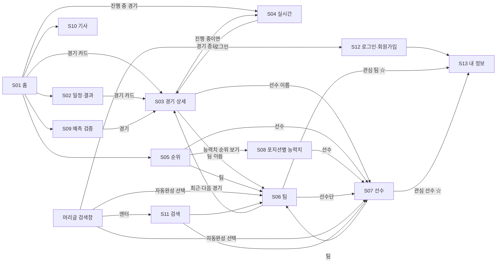

기사 제목은 모든 화면에서 언론사 원문으로 새 창을 연다(본문은 저장하지 않음, NFR-06).

## 3. 공통 사항

### 3.1 공통 레이아웃

| 영역 | 구성 | 동작 |
|---|---|---|
| 머리글(남색 띠) | 로고 "배구 전력 분석", 주 메뉴 5개(홈, 일정·결과, 순위, 기사, 예측 검증), 검색창, 로그인 버튼(로그인 후에는 닉네임 = 내 정보) | 지금 메뉴 아래에 형광 밑줄이 미끄러져 옮겨 간다. 검색창은 입력을 멈추고 0.2초 뒤 팀·선수 자동완성(`/api/search/suggest`, 방향키로 고름), 엔터를 누르면 S11 |
| 본문 | 화면별 내용, 최대 폭 1200px | 화면을 옮기면 짧게 겹쳐 사라지고 나타난다 |
| 바닥글 | "데이터 출처: KOVO 한국배구연맹. 비상업 학습용 프로젝트이며, 경기 기록 사실 정보만 사용합니다. 기사는 각 언론사의 제목·요약·링크만 보여줍니다." | WEB-14, NFR-02, 05, 06 |

### 3.2 디자인 규칙 (Hallmark Sport 테마, 자세한 값은 `frontend/src/tokens.css`)

| 항목 | 규칙 |
|---|---|
| 색 | 바탕은 옅은 회청색 종이, 글자는 짙은 남색(잉크). 강조색은 형광 라임(volt) 하나뿐이며 **바탕 채움 + 잉크 글자**로만 쓴다(선택된 탭, 이긴 쪽 세트 수, 번호 표시). 홈팀 = 잉크, 원정팀 = 회청색 |
| 팀 컬러 | 팀 이름 글자를 구단 대표색으로 칠한다. 밝은 바탕에서도 대비 4.5:1 이상이 되도록 밝기를 낮췄다. 로고·엠블럼 이미지는 쓰지 않는다(NFR-02) |
| 글꼴 | 표제 Saira Condensed + Black Han Sans, 본문 Pretendard, 숫자·시각 JetBrains Mono. 모두 OFL(무료, 상업 사용 가능) |
| 표 | 숫자는 고정폭 글꼴로 오른쪽 정렬. 열 제목을 누르면 정렬(▲▼ 표시) |
| 접근성 | 글자 대비 4.5:1 이상, 키보드로 모든 조작 가능, 포커스 표시, 색만으로 뜻을 전하지 않음(승·패, 적중·빗나감은 글자를 함께 씀) |

### 3.3 반응형

| 화면 폭 | 바뀌는 점 |
|---|---|
| 1040px 이상 | 홈: 왼쪽 대진표 + 오른쪽 순위표(348px)의 2단. 그보다 좁으면 순위표가 아래로 |
| 900px 이하 | 머리글이 2줄: 첫 줄 로고 + 메뉴(넘치면 메뉴 안에서 옆으로 밂), 둘째 줄 검색창 + 로그인 |
| 760px 이하 | 2단 구역(팀의 강약점·리그 비교, 예측 검증 차트 등)이 1단으로 |
| 640px(40rem) 이하 | 좌우 여백 24 → 16px |
| 560px 이하 | 로고 글자를 숨기고 아이콘만. 경기 카드가 한 줄에 하나. 넓은 표는 가로로 밀어서 본다 |
| 터치 화면 | 탭·버튼·선택 상자의 높이를 44px 이상으로 |

| 모바일 홈 (390px) | 모바일 경기 상세 (390px) |
|---|---|
| 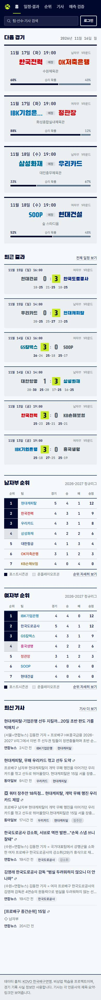 | 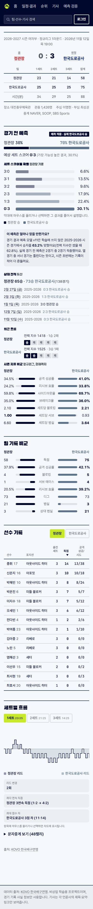 |

### 3.4 상태 표시와 주소 규칙

- **불러오는 중 / 비었음 / 오류:** 모든 데이터 구역이 같은 부품(`AsyncState`)을 쓴다. 불러오는 동안 회색 뼈대를 보여 주고, 비었으면 이유를 글로 적고, 오류면 "다시 시도" 버튼을 둔다. 필터를 바꿀 때는 이전 내용을 흐리게 남겨 화면이 비지 않게 한다.
- **주소에 상태를 담음:** 시즌(`?season=`), 보기 방식(`?view=calendar`), 팀 필터(`?team=`), 검색어(`?q=`), 통산 보기(`?scope=career`, `?card=career`)를 주소에 담아, 링크를 공유하거나 뒤로 가기를 해도 같은 화면이 열린다.
- **움직임:** 숫자 세어 올라가기, 막대 늘어나기, 정렬 시 행 미끄러지기 등. 운영체제에서 "동작 줄이기"를 켜면 모두 끈다.

## 4. 사용자 화면

### S01 홈 `/`

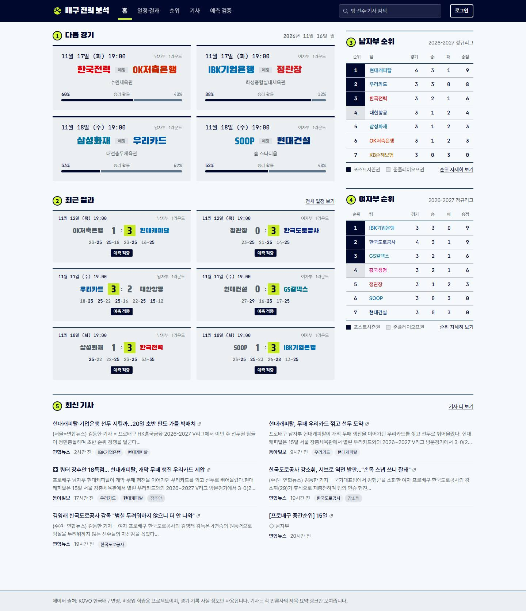

| 번호 | 구역 | 내용 | 동작 |
|---|---|---|---|
| (위) | 내 관심 | 로그인한 사람에게만: 관심 팀의 다음 경기·최근 결과, 관심 선수 소식 (WEB-12) | 관심 팀 경기는 아래 목록에서도 앞에 온다 |
| (위) | 진행 중 경기 | 지금 진행 중인 경기(실시간 점수, 세트, 승리 확률). 경기가 있을 때만 보인다 | 누르면 S04 |
| ① | 다음 경기 | 오늘 경기, 없으면 다가오는 경기 4개: 일시, 남녀부·라운드, 팀(팀 컬러), 장소, 모델의 승리 확률 막대 | 누르면 S03(프리뷰) |
| ② | 최근 결과 | 최근 끝난 경기 6개: 세트 수(이긴 쪽 형광), 세트별 점수, 경기 전 예측의 적중·빗나감 | 누르면 S03, "전체 일정 보기"는 S02 |
| ③④ | 남자부·여자부 순위 | 순위, 팀, 경기, 승, 패, 승점. 포스트시즌권(1~3위)은 순위 칸을 남색으로, 준플레이오프권은 회색으로 | 팀 이름은 S06, "순위 자세히 보기"는 S05 |
| ⑤ | 최신 기사 | 기사 6개: 제목, 요약, 언론사, 날짜, 팀·선수 태그 | 제목은 원문 새 창, "기사 더 보기"는 S10 |

### S02 일정·결과 `/schedule`

| 목록 보기 | 달력 보기 (`?view=calendar`) |
|---|---|
| 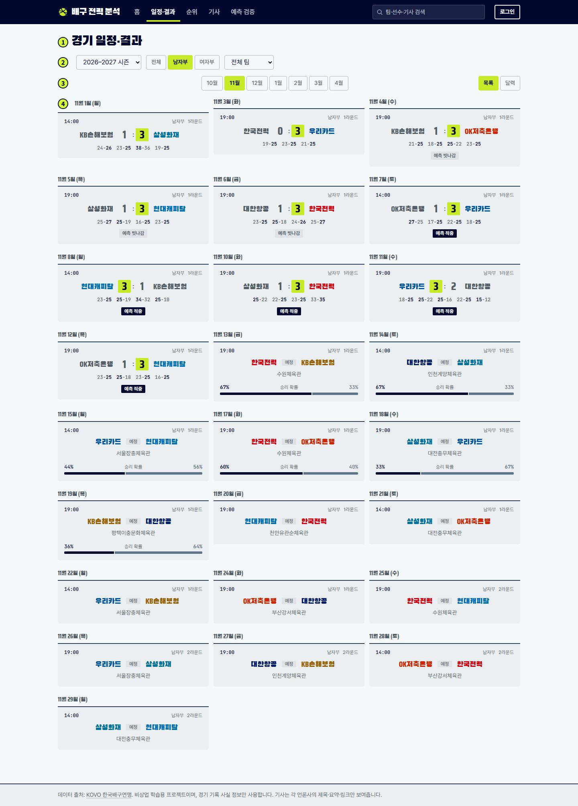 | 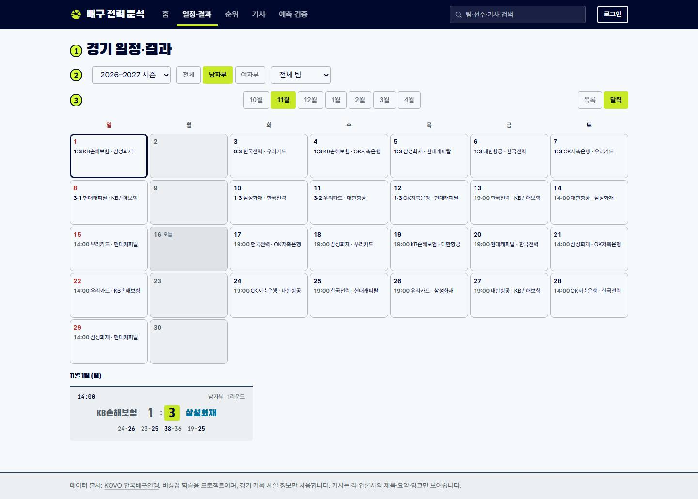 |

| 번호 | 구역 | 내용 | 동작 |
|---|---|---|---|
| ① | 제목 | 경기 일정·결과 | |
| ② | 필터 | 시즌 선택, 남녀부(전체·남자부·여자부), 팀 선택 | 바꾸면 그 조건으로 다시 불러온다. 팀 목록은 고른 시즌·성별의 팀만 |
| ③ | 월 선택·보기 방식 | 시즌의 달(10월~4월) 탭, 목록·달력 전환, (오늘이 있는 달이면) "오늘 경기로" 버튼 | 달을 바꾸면 선택 표시가 미끄러진다. 보기 방식은 주소에 담는다 |
| ④ | 날짜별 경기 | 날짜 제목 아래 경기 카드 격자(한 줄 3개). 끝난 경기: 세트 수·세트 점수·예측 적중 여부 / 예정 경기: 장소·승리 확률 | 카드를 누르면 S03. 달력 보기에서는 날짜 칸에 경기를 3개까지(끝난 경기는 세트 수, 예정은 시각) 적고 나머지는 "+N", 날짜를 고르면 아래에 그날 경기 카드가 나온다. 방향키로 날짜를 옮긴다 |

### S03 경기 상세 `/matches/{key}`

끝난 경기와 예정 경기가 같은 화면이다. 예정 경기는 ① 아래에 ② 경기 프리뷰만 나온다.

| 끝난 경기 (023-22) | 예정 경기 (023-30) |
|---|---|
| 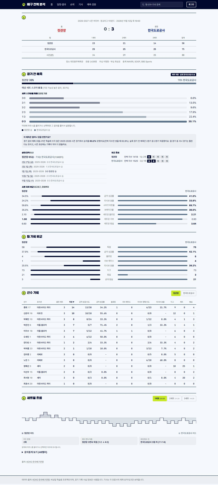 | 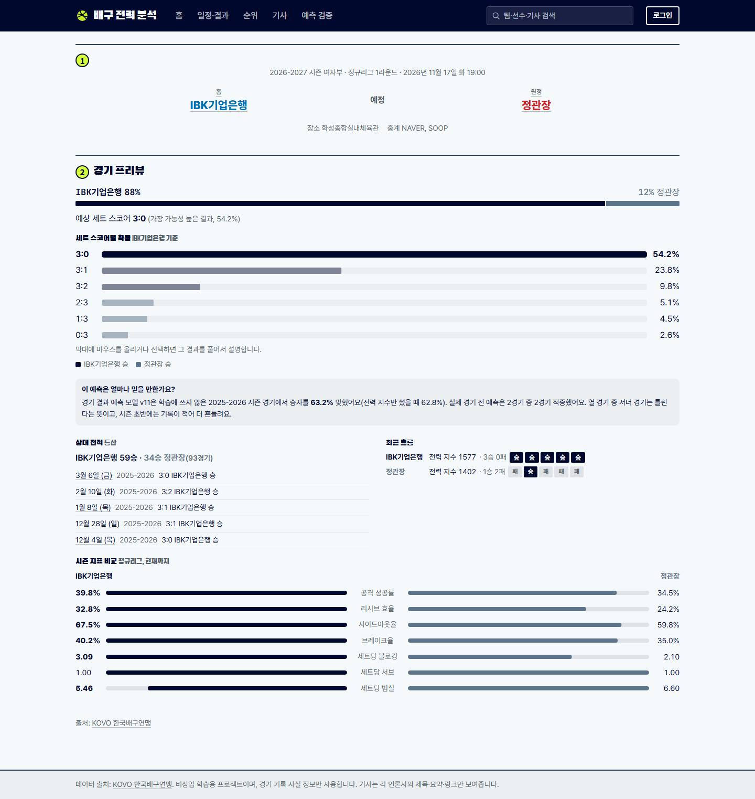 |

| 번호 | 구역 | 내용 | 동작 |
|---|---|---|---|
| ① | 스코어보드 | 시즌·남녀부·대회·라운드·일시, 홈·원정 팀, 세트 수, 세트별 점수와 세트 시간 표, 장소·관중·심판·중계사. 품질 문제가 있는 경기는 아래에 안내 문구(PIPE-10) | 팀 이름은 S06. 진행 중이면 "실시간으로 보기"(S04) |
| ② | 경기 프리뷰 / 경기 전 예측 | 승리 확률 막대, 예상 세트 스코어, 세트 스코어(3:0~0:3)별 확률 막대, "이 예측은 얼마나 믿을 만한가요?"(모델 버전, 시험 시즌 적중률, Elo 기준), 상대 전적(통산과 최근 5경기), 최근 흐름(전력 지수, 최근 5경기 승패), 시즌 지표 비교(ANL-03, 04, WEB-08). 끝난 경기는 "예측 적중·실제 ○○ 승" 표시 | 세트 스코어 막대에 마우스를 올리거나 선택하면 그 결과를 풀어 설명한다 |
| ③ | 팀 기록 비교 | 득점, 공격 성공률, 블로킹, 서브 에이스, 리시브 효율, 디그, 범실, 상대 범실을 가운데 기준의 좌우 막대로 | |
| ④ | 선수 기록 | 팀 탭(홈·원정), 선수별 출전 세트·득점·공격 성공/시도 등 박스스코어 | 열 정렬, 선수 이름은 S07 |
| ⑤ | 세트별 흐름 | 세트 탭, 점수 차 계단 차트(위 = 홈 리드), 리드 변경·최다 연속 득점·최대 점수 차, "문자중계 보기(N랠리)" 펼치기 | 세트를 고르면 그 세트 문자중계를 불러온다(`/rallies?set=N`). 항목을 고르면 차트에 표시 |

### S04 실시간 경기 `/matches/{key}/live`

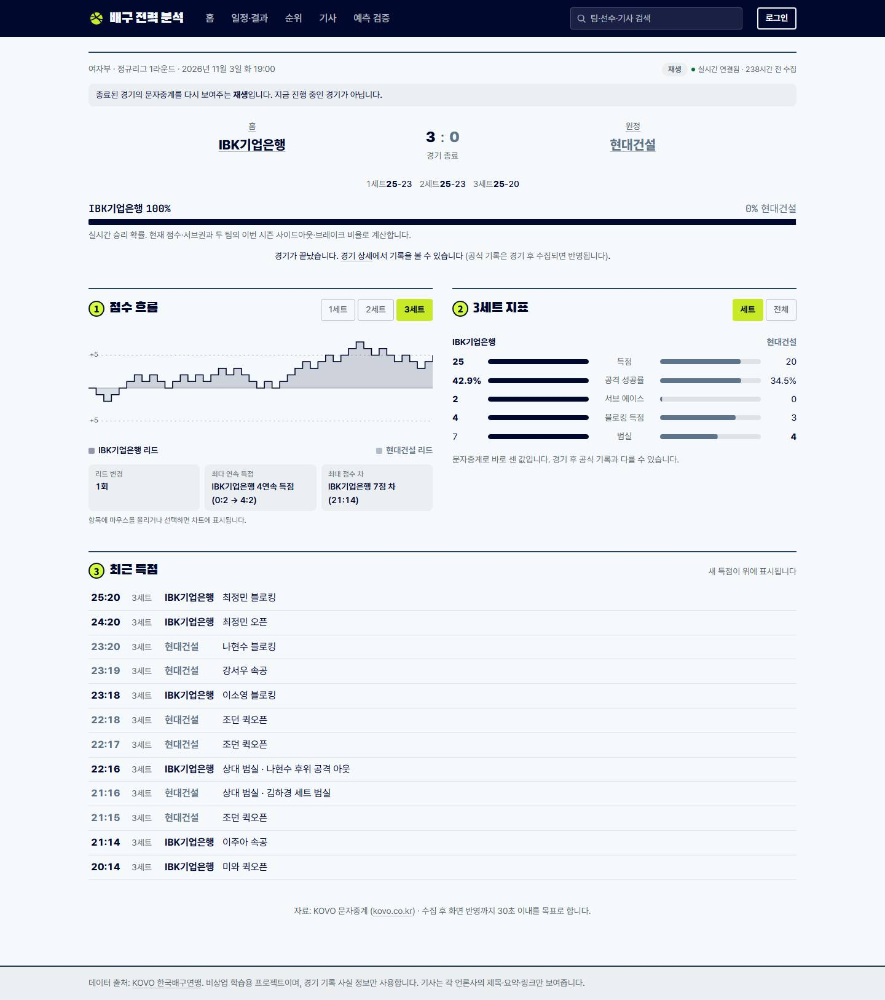

캡처는 끝난 경기의 **재생**(PIPE-11)이다. 재생이면 상단에 "재생" 표시와 "지금 진행 중인 경기가 아닙니다" 안내를 띄워 실제 경기와 헷갈리지 않게 한다.

| 번호 | 구역 | 내용 | 동작 |
|---|---|---|---|
| (위) | 스코어보드 | 대회·일시, 실시간/재생 표시, 연결 상태와 마지막 수집 시각, 홈·원정 팀, 세트 수, 지금 세트 점수, 서브권(공 아이콘), 연속 득점, 끝난 세트 점수, 실시간 승리 확률 막대(ANL-07) | 서버가 보내는 새 상태(SSE)로 바로 바뀐다: 점수 숫자가 굴러가고, 득점한 쪽에 "+1"이 반짝이고, 확률 막대가 움직인 만큼 표시. 화면 낭독기에는 "1세트 A 12 대 10 B"처럼 맥락과 함께 알린다 |
| ① | 점수 흐름 | 세트 탭, 점수 차 계단 차트, 리드 변경·최다 연속 득점·최대 점수 차 | 새 득점이 오면 선이 이어진다 |
| ② | 세트 지표 | 세트·전체 전환, 팀별 득점·공격 성공률·서브 에이스·블로킹 득점·범실 | "문자중계로 바로 센 값이라 공식 기록과 다를 수 있음" 안내 |
| ③ | 최근 득점 | 득점 하나당 한 줄: 점수, 세트, 득점한 팀, 선수와 방법(블로킹·오픈·상대 범실 등) | 새 득점이 위에 미끄러져 들어온다 |
| (아래) | 출처·목표 | "자료: KOVO 문자중계 · 수집 후 화면 반영까지 30초 이내를 목표"(NFR-14) | 경기가 끝나면 "경기 상세에서 기록을 볼 수 있습니다" 링크 |

### S05 순위 `/standings`

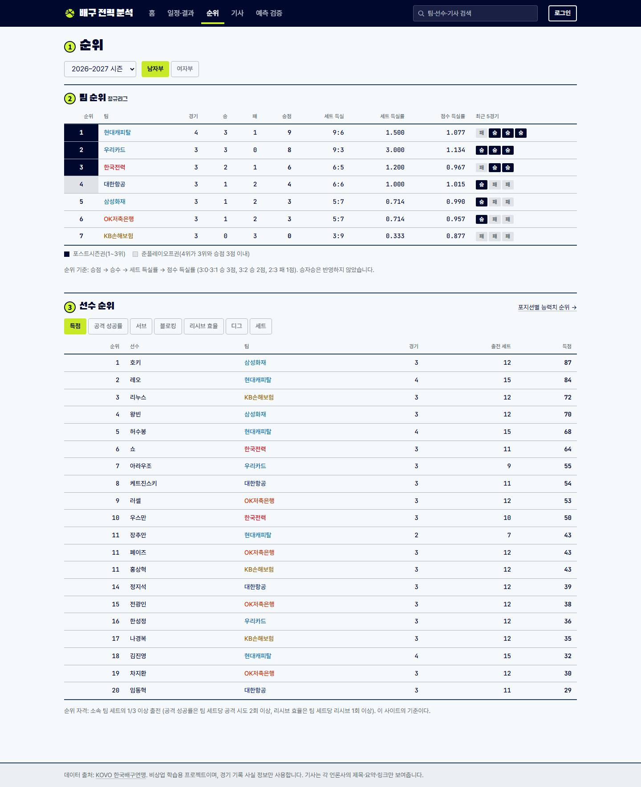

| 번호 | 구역 | 내용 | 동작 |
|---|---|---|---|
| ① | 제목·필터 | 시즌 선택, 남자부·여자부 | |
| ② | 팀 순위 | 순위, 팀, 경기, 승, 패, 승점, 세트 득실, 세트 득실률, 점수 득실률, 최근 5경기. 포스트시즌권·준플레이오프권 표시, 순위 기준 설명 | 팀 이름은 S06 |
| ③ | 선수 순위 | 부문 탭 7개(득점, 공격 성공률, 서브, 블로킹, 리시브 효율, 디그, 세트), 상위 선수 표(순위, 선수, 팀, 경기, 출전 세트, 부문 값), 순위 자격 기준 | 부문을 바꾸면 남는 선수는 새 자리로 미끄러진다. "포지션별 능력치 순위"는 S08 |

순위는 KOVO 공식 순위 API가 아니라 우리 경기 기록으로 계산한다. 승점 감점 같은 공식 처분은 반영되지 않는다(화면 안내 문구에 "승자승은 반영하지 않았습니다"라고 적혀 있다).

### S06 팀 `/teams/{code}`

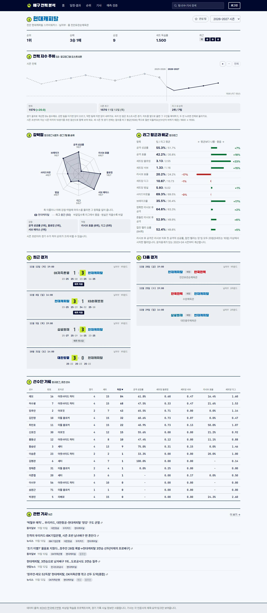

| 번호 | 구역 | 내용 | 동작 |
|---|---|---|---|
| ① | 팀 머리글 | 팀 이름(팀 컬러), 정식 이름·남녀부·홈 경기장, 관심 팀 버튼(☆), 시즌 선택, 요약(순위, 승패, 승점, 세트 득실률, 최근 5경기) | ☆는 로그인한 사람만(아니면 로그인으로). 시즌은 `?season=` |
| ② | 전력 지수 추이 | Elo 꺾은선(시즌 초반에는 지난 시즌 마지막 10경기를 흐린 점선으로), 1500 기준선, 현재·시즌 최고·리그 내 순위 (ANL-01) | 끌어서 구간 확대, +/−/전체 버튼, 점에 마우스를 올리면 그 경기 |
| ③ | 강약점 | 8개 지표의 리그 내 순위 레이더(공격 성공률, 리시브 효율, 블로킹, 서브 에이스, 디그, 범실, 사이드아웃, 브레이크), 강점·약점 요약 (ANL-02, 11) | 축 이름이나 강점·약점에 마우스를 올리면 그 항목을 짚는다 |
| ④ | 리그 평균과 비교 | 지표별 팀 값 / 리그 평균, 평균 대비 % 막대(좋음 초록·나쁨 빨강, 글자 함께), 리시브 품질별 공격·접전 랠리 승률 | |
| (조건부) | 선수 폼 변화 | 최근 경기에서 폼이 크게 오르거나 내린 선수(ANL-08). 해당 선수가 있을 때만 | |
| ⑤ | 최근 경기 | 최근 4경기 카드(세트 점수, 예측 적중 여부) | 누르면 S03 |
| ⑥ | 다음 경기 | 예정 3경기 카드 | 누르면 S03 |
| ⑦ | 선수단 기록 | 출전 선수 표: 번호, 포지션, 경기, 세트, 득점, 공격 성공률, 세트당 블로킹·서브, 리시브 효율, 세트당 디그 | 열 정렬, 선수 이름은 S07 |
| ⑧ | 관련 기사 | 이 팀 태그가 붙은 기사 5개와 건수 | "더 보기"는 S10(`?team=`) |

### S07 선수 `/players/{code}`

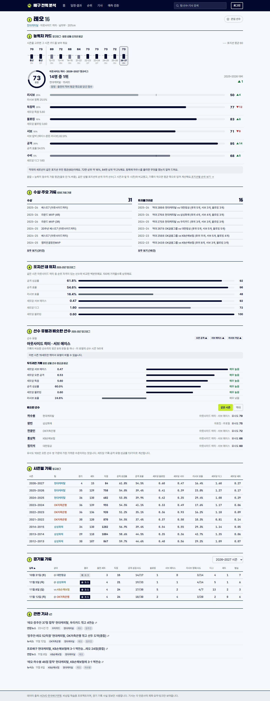

| 번호 | 구역 | 내용 | 동작 |
|---|---|---|---|
| ① | 선수 머리글 | 이름, 등번호, 팀·포지션·남녀부·키, 관심 선수 버튼(☆) | 팀 이름은 S06 |
| ② | 능력치 카드 | 위쪽 띠: 통산(포지션별)과 시즌별 종합 점수 막대. 카드: 종합 링(1~99), 포지션 내 순위, 능력치별 막대(평균 60 표시선, 비중, 근거 기록, 이전 시즌 대비 ▲▼), 잠정 표시 | 띠에서 시즌·통산을 고르면 카드가 바뀐다(탭, 방향키). `?card=career`면 통산 카드로 열린다. 항목에 마우스를 올리면 계산 설명 |
| ③ | 수상·주요 기록 | 수상 / 트리플크라운 / 기록 달성 열, 각 최근 6개와 총 건수 (COL-04) | "모두 보기(N건)"로 펼친다 |
| ④ | 포지션 내 위치 | 같은 시즌·포지션 순위 자격 선수 중 백분위 막대(공격 성공률·효율, 리시브 효율, 세트당 서브 에이스·디그·블로킹) (ANL-05) | |
| (조건부) | 최근 폼 | 최근 경기 득점 추세 꺾은선과 상승·하락 판정(ANL-08). 이번 시즌 경기가 충분할 때만 | 점에 마우스를 올리면 그 경기, 누르면 S03 |
| ⑤ | 선수 유형과 비슷한 선수 | K-means 유형 이름과 특징, 두드러진 기록(같은 성별 평균 대비), 비슷한 선수 5명과 유사도 (ANL-06) | 같은 시즌·역대 전환, 선수 이름은 S07 |
| ⑥ | 시즌별 기록 | 정규리그 시즌마다 팀·경기·세트·득점·지표 | 팀 이름은 S06 |
| ⑦ | 경기별 기록 | 시즌 선택, 경기마다 상대(@ 원정, vs 홈)·결과·출전 세트·득점·공격 성공/시도 등 | 시즌을 바꾸면 화면 전체가 그 시즌으로(`?season=`). 날짜를 누르면 S03 |
| ⑧ | 관련 기사 | 이 선수 태그가 붙은 기사 | 원문 새 창 |

### S08 포지션별 능력치 `/ratings`

| 시즌별 | 역대 통산 (`?scope=career`) |
|---|---|
| 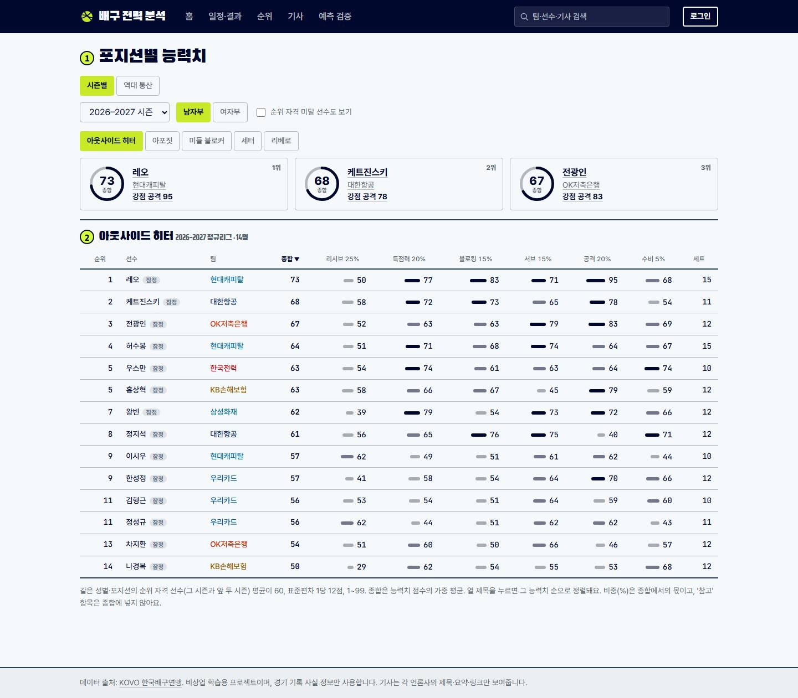 | 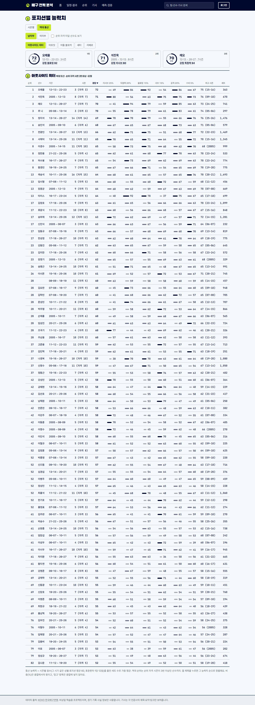 |

| 번호 | 구역 | 내용 | 동작 |
|---|---|---|---|
| ① | 제목·필터·상위 3명 | 시즌별·역대 통산 전환, 시즌 선택(시즌별만), 남녀부, "순위 자격 미달 선수도 보기", 포지션 탭 5개(아웃사이드 히터, 아포짓, 미들 블로커, 세터, 리베로), 상위 3명 카드(종합 링, 팀, 가장 높은 능력치) | 이른 시즌이라 자격 선수가 적으면 지난 시즌 안내. 다른 조건을 불러오는 동안 이전 표를 흐리게 남긴다 |
| ② | 능력치 표 | 순위, 선수(잠정 표시), 팀, 종합, 능력치별 점수와 작은 막대(머리글에 비중 %), 출전 세트. 통산은 자격 시즌 수·기간·최고 시즌 | 어느 열이든 눌러 정렬(행이 새 자리로 미끄러짐). 선수 이름은 S07(통산은 `?card=career`) |

### S09 예측 검증 `/predictions`

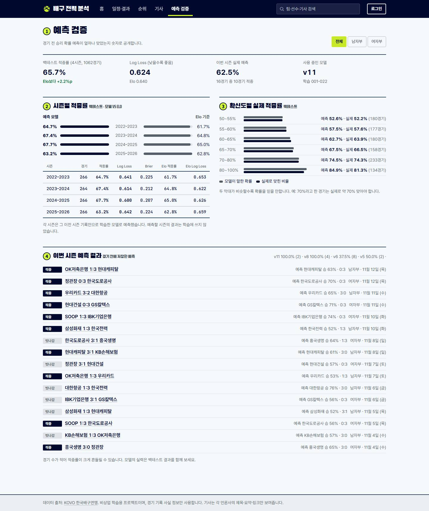

| 번호 | 구역 | 내용 | 동작 |
|---|---|---|---|
| ① | 제목·요약 | 전체·남자부·여자부, 요약 숫자 4개: 백테스트 적중률(Elo 대비), Log Loss(Elo 대비), 이번 시즌 실제 예측 적중률, 사용 중인 모델 버전과 학습 기간 (ANL-10) | 숫자가 세어 올라간다. 남녀부를 바꾸면 새 값으로 미끄러진다 |
| ② | 시즌별 적중률 | 시즌마다 모델 대 Elo 막대, 표(경기 수, 적중률, Log Loss, Brier, Elo 적중률, Elo Log Loss) | "각 시즌은 그 이전 시즌 기록만으로 학습한 모델로 예측" 안내 |
| ③ | 확신도별 실제 적중률 | 확률 구간(50~55% … 80~100%)마다 "모델이 말한 확률"과 "실제로 맞힌 비율" 짝 막대와 경기 수 | 두 막대가 비슷할수록 믿을 만하다는 설명 |
| ④ | 이번 시즌 예측 결과 | 경기 전에 저장한 예측의 적중·빗나감 목록(결과, 예측 팀과 확률, 예상 세트 스코어, 날짜), 모델 버전별 적중률 | 경기 이름은 S03 |

### S10 기사 `/news`

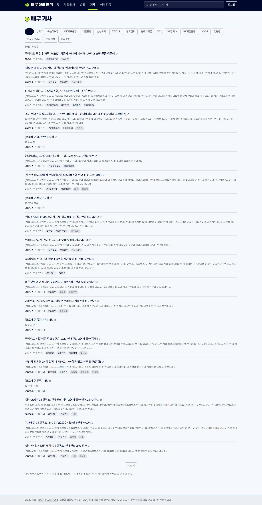

| 번호 | 구역 | 내용 | 동작 |
|---|---|---|---|
| ① | 기사 목록 | 팀 필터, 최신순 기사(제목, 요약, 언론사, 시각, 팀·선수 태그) 20개씩 | 팀 필터는 `?team=`. "더 보기"로 20개씩 이어 붙인다. 제목은 원문 새 창(WEB-09, NFR-06) |

### S11 검색 `/search?q=`

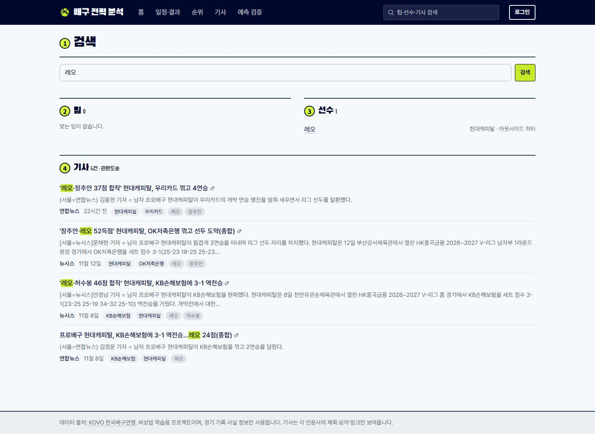

| 번호 | 구역 | 내용 | 동작 |
|---|---|---|---|
| ① | 검색 | 검색어는 머리글 검색창으로 입력하고 주소 `?q=`에 담긴다. 검색어가 없으면 "팀·선수 이름이나 기사 낱말로 찾을 수 있어요" 안내와 예시 검색어 링크 | 뒤로 가기·공유 가능 |
| ②③ | 팀·선수 | 이름이 맞는 팀·선수와 건수(Elasticsearch `entities`) | 누르면 S06·S07 |
| ④ | 기사 | 관련도순 기사와 건수, 검색어 강조 표시(Elasticsearch `articles`, nori 형태소 분석) | 10개씩 "더 보기". 결과가 없으면 안내 문구 |

### S12 로그인·회원가입 `/login`, `/signup`

| 로그인 | 회원가입 |
|---|---|
| 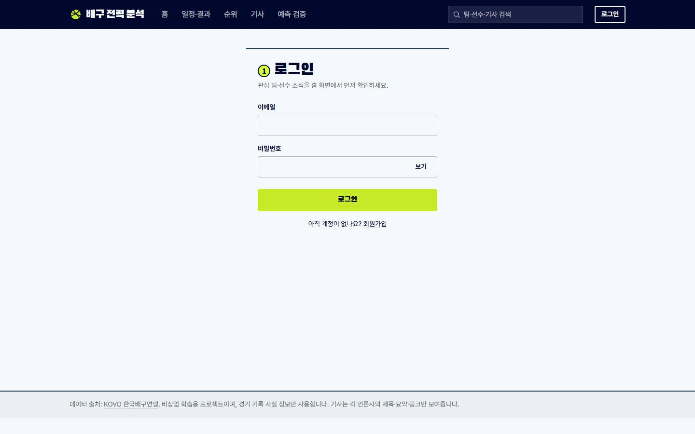 | 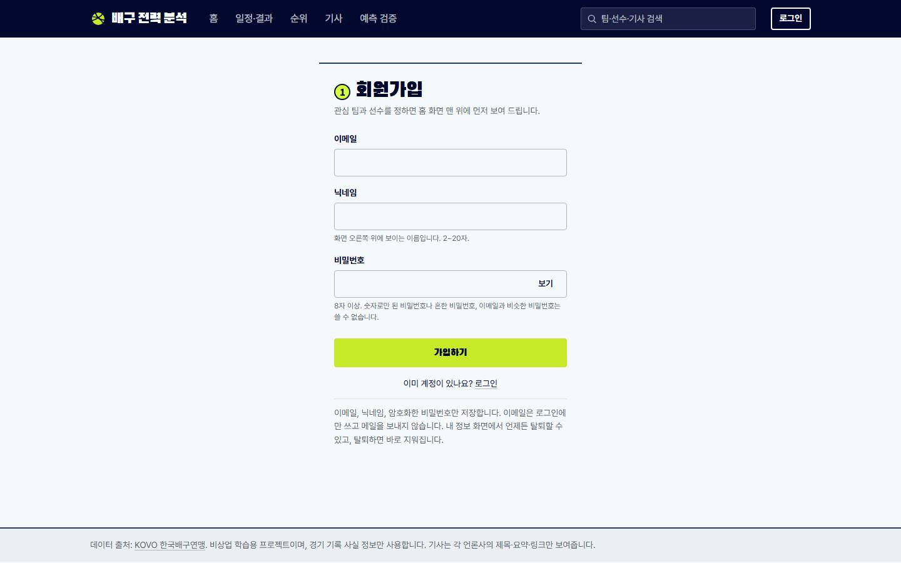 |

| 구역 | 내용 | 동작 |
|---|---|---|
| 양식 | 로그인: 이메일, 비밀번호 / 회원가입: 이메일, 닉네임(2~20자), 비밀번호(Django 기본 비밀번호 규칙 검사). 받는 개인정보는 이메일과 닉네임뿐(NFR-03) | 모든 칸에 보이는 이름표, 비밀번호 보기·숨기기, 비밀번호 관리자와 붙여넣기 허용. 칸 아래에 오류 문구, 제출 실패 시 맨 위에 오류 요약(포커스를 옮겨 화면 낭독기가 읽게). 요청은 1분에 10번까지 |
| 이동 | 로그인 ↔ 회원가입 링크 | 성공하면 `?next=` 주소(이 사이트 안의 경로만), 없으면 홈 |

### S13 내 정보 `/me` (캡처 없음: 로그인 필요)

| 구역 | 내용 | 동작 |
|---|---|---|
| 내 정보 | 이메일, 닉네임, 로그아웃 버튼 | 로그아웃하면 서버의 토큰도 지운다 |
| 관심 팀 | 이번 시즌 팀 목록(남녀부별) 체크 | 최대 10팀. 고르면 홈 맨 위 "내 관심"에 나온다 |
| 관심 선수 | 관심 선수 목록과 빼기 버튼 | 선수 추가는 S07의 ☆. 최대 10명 |
| 회원 탈퇴 | 비밀번호를 다시 입력해 탈퇴 | 관심 목록도 함께 지워진다 |

로그인하지 않고 들어오면 로그인 화면으로 보낸 뒤, 로그인하면 이 화면으로 돌아온다. 토큰이 만료되면 저장된 토큰을 버리고 한 번 다시 시도한다.

### S14 없는 주소

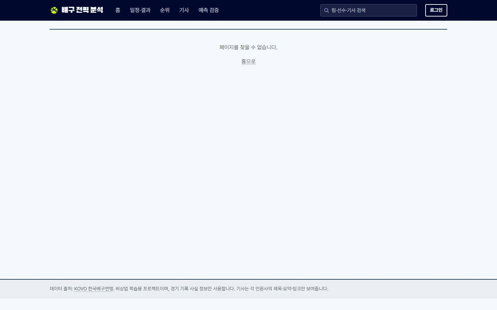

"페이지를 찾을 수 없습니다" 안내와 홈으로 가는 링크. 없는 경기·팀·선수 주소는 각 화면 안에서 "찾을 수 없음"으로 표시한다.

## 5. 관리자 화면

Django 관리자(`/admin/`)를 한국어로 꾸며 쓴다. 관리자 권한(`is_staff`) 계정만 들어갈 수 있고(NFR-32), 개발 PC의 `127.0.0.1`에서만 열린다(NFR-34). 관리자 로그인이 필요해 캡처는 넣지 않았다.

| ID | 화면 | 주소 | 구성 | 동작 | 요구사항 |
|---|---|---|---|---|---|
| A01 | 관리자 첫 화면 | `/admin/` | Django 기본 메뉴 + 맨 위 "미확인 작업 실패 N건" 안내 | 안내를 누르면 A04 | ADM-01 |
| A02 | 품질 검사 결과 | `/admin/ops/qualityissue/` | 목록: 경기·세트, 검사 규칙, 심각도, 상태, 대상, 내용, 마지막 발견. 필터: 상태, 심각도, 규칙, 시즌 | 여러 행을 골라 "확인함"(KOVO에도 없는 데이터 등) 또는 "다시 열기". 메모 기록 | PIPE-10 |
| A03 | 데이터 보정 | `/admin/ops/correction/` | 목록: 대상, 키, 항목, 원래 값, 고친 값, 켜짐, 만든 사람, 시각. 추가 양식: 대상(선수·팀·경기·세트 점수·선수·팀 경기 기록), 키, 항목, 고친 값, 근거 | 저장 전에 키가 실제 기록을 가리키는지, 값 형식이 맞는지 검사. 저장하면 바로 반영, "끄기"로 원래 값 복원 | ADM-03 |
| A04 | 수집 현황 | `/admin/ops/jobalert/` | ① Airflow 작업(DAG별 최근 실행·상태) ② 수집기 실행 결과(최근 7일, Elasticsearch `ops-collection-*`)와 실패하거나 끝나지 않은 수집 ③ 작업 실패 내역(시각, 작업, 오류 요약, 알림 전송 결과, 상태, Airflow 로그 링크) | 실패 행을 골라 "확인함" | ADM-01, PIPE-09 |
| A05 | 수동 실행 | `/admin/ops/manualrun/` | 양식 4개: 예약 작업 지금 실행 / 경기·날짜·시즌 재처리(경기 `023-9, 023-10`, 날짜, 시즌, KOVO에서 다시 받기) / 과거 시즌 수집(시즌, 확정된 경기는 건너뛰기) / 경기 재생(경기, 배속 1~600). 아래 실행 기록 | "실행"을 누르면 Airflow에 실행을 요청하고, 누가·무엇을·언제 요청했는지와 Airflow 실행 링크를 남긴다 | ADM-02, PIPE-08, 11 |
| A06 | 모델 관리 | `/admin/analytics/modelchange/` | ① `match-winner` 등록 버전 표(버전, 시험 적중률·Log Loss, Elo 기준, 학습 기간, 지금 서비스 모델 표시) ② 서비스 모델을 바꾼 기록 | 버전을 고르고 사유를 적어 "선택한 버전을 서비스 모델로" → MLflow 별칭 변경 + 예측 다시 실행(`ml_daily_predict`) | ADM-05 |
| - | 데이터 조회 | `/admin/league/...`, `/admin/matches/...`, `/admin/articles/...`, `/admin/accounts/...` | 시즌, 대회, 팀, 선수, 경기(세트 점수 포함), 팀·선수 경기 기록, 문자중계, 기사, 회원(관심 목록 포함) 목록과 필터 | 파이프라인이 쓰는 데이터는 **읽기 전용**. 고칠 때는 A03 보정을 쓴다(다시 수집해도 남도록) | - |

운영 대시보드는 Kibana(`127.0.0.1:5601`, 대시보드 "배구 파이프라인 운영")에 따로 있다(ADM-04): 수집 성공률, 수집 건수 추이, 수집 실패, Kafka 컨슈머 랙, Airflow DAG 실행·태스크 대기 시간, 오류 로그, 기사 저장 현황, 미해결 품질 오류.

## 6. 아직 없는 화면

| 요구사항 | 화면 | 상태 |
|---|---|---|
| ANL-12 AI 경기 프리뷰 (선택) | S03 경기 프리뷰 안에 "AI 작성" 표시를 단 프리뷰 글 | LLM 결정 대기. 검토는 [llm-options.md](llm-options.md) |
| WEB-15 AI 데이터 질의응답 (선택) | 새 화면(질문 입력, 답변과 근거 데이터 표) | 위와 같음 |
